# Kawaguchiko: activity groups (clean list)

**Key:** ☀️ fine-weather group · ☔ wet-weather group (works in rain) · 📷 photography · 🏛 history/museum · 🥾 walk · 🏞 views · 📜 link to a historic print, painting or writer
Every group here is **top** priority. Backups are at the bottom. Place names link to Google Maps.
Photos (tap one for its source) are from Wikimedia Commons; see [photo credits](photos/CREDITS.md).

**Fuji visibility** is best early in the morning, and clouds often build by midday. Check the forecast or a Fuji live camera each evening, and **put the Fuji groups (#1–#3) on the clearest mornings.**

**Transport:**
- Red, Green and Blue sightseeing buses run from the station, and the Fujikko bus goes to Oshino and Yamanaka.
- The **Fujikyu Rail & Bus Pass (2 days, ¥4,700)** covers the Fujikyu trains and all of those buses.

---

## ☀️ Fine-weather groups

### 1. Chureito Pagoda and Fujiyoshida 📷🏞🏛

<a href="https://commons.wikimedia.org/wiki/File:12-Chureito-pagoda-and-Mount-Fuji-Japan_(29677439878).jpg">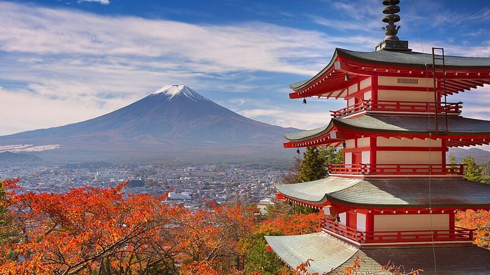</a> <a href="https://commons.wikimedia.org/wiki/File:-i---i-_(53076133649).jpg">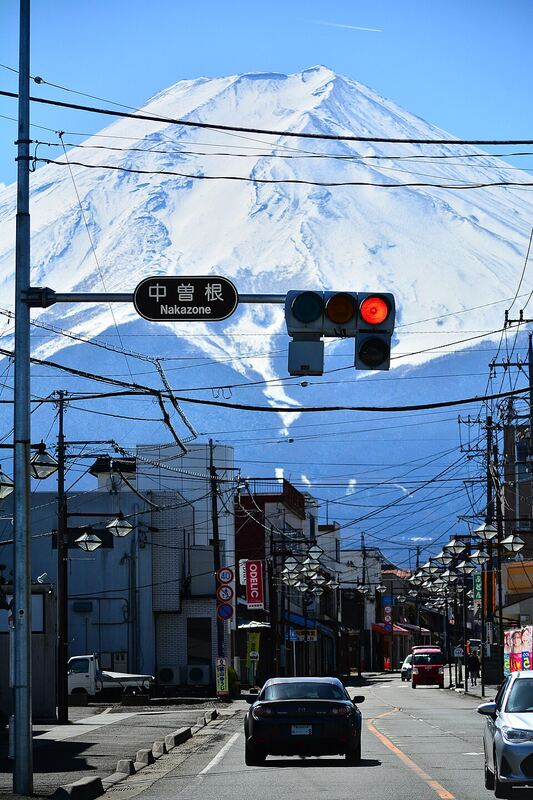</a> <a href="https://commons.wikimedia.org/wiki/File:Kitaguchi_Hongu_Fuji_Sengen_jinja_Torii.jpg">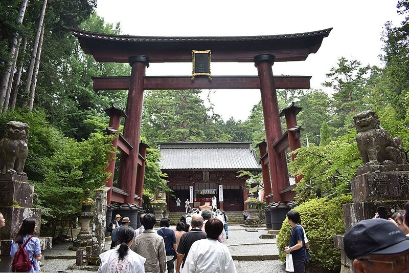</a>

*Chureito Pagoda with Fuji in autumn · Fuji at the end of Honcho Street · The torii at Kitaguchi Hongu Fuji Sengen Shrine*

- **[Chureito Pagoda](https://maps.google.com/?cid=15733293726462568345)** (above **[Arakura Fuji Sengen Shrine](https://maps.google.com/?cid=15880066859449372797)**): *the* postcard shot of a five-storey pagoda with Fuji behind. About 400 steps up. **Go at sunrise.**
- **[Honcho Street](https://www.google.com/maps/search/?api=1&query=Honcho+Street+Fujiyoshida+Fuji+view)**: a Showa-era shopping street with Fuji looming at the end.
- **[Kitaguchi Hongu Fuji Sengen Shrine](https://www.google.com/maps/search/?api=1&query=Kitaguchi+Hongu+Fuji+Sengen+Shrine)**: an ancient shrine with an avenue of huge cedars, stone lanterns and a 1,000-year-old tree. It's the traditional start of the Fuji pilgrimage trail. Fine in mist or rain.
- Optional: **[Fujisan World Heritage Center](https://www.google.com/maps/search/?api=1&query=Fujisan+World+Heritage+Center+Fujiyoshida)**, a free museum on Fuji's culture and pilgrimage.
- **Getting there:** Fujikyu train to Shimoyoshida, then on to Fujisan or Fujiyoshida stations.

### 2. Hokusai's viewpoint: Misaka Pass (Tenka-chaya) 📜🏞📷🥾

*Hokusai, Reflection in Lake Misaka, Kai Province*

- **[Tenka-chaya, Misaka Pass](https://www.google.com/maps/search/?api=1&query=Tenka+Chaya+Misaka+Pass)**: 📜 Hokusai's *Reflection in Lake Misaka, Kai Province* (Thirty-six Views of Mt Fuji) shows Lake Kawaguchi with Fuji beyond, seen from this pass. In the print, Fuji's reflection has snow but the real mountain doesn't. The writer **Dazai Osamu** stayed at the teahouse in 1938, and it has a small room about him.
- **Getting there:** a hiking bus from Kawaguchiko Station takes about 28 min. **It runs only once a day, at 9:50 (check).** Plan how to get back before going: there are walking routes down, or a taxi.
- Stronger walkers continue to Mt Kurodake and down to the north shore. That's 4–5 h, **probably more than we want**.

### 3. North shore: Oishi Park, Kubota Museum and the Momiji Corridor 📷🏞🏛

<a href="https://commons.wikimedia.org/wiki/File:Mount_Fuji_from_Oishi_Park.jpg">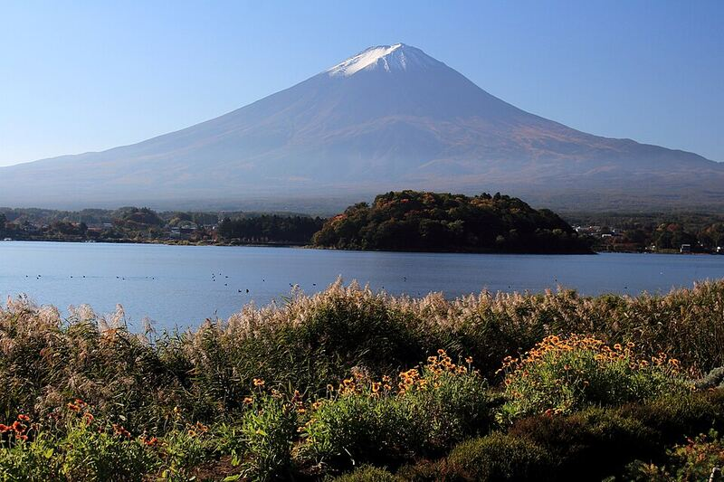</a> <a href="https://commons.wikimedia.org/wiki/File:%E6%B2%B3%E5%8F%A3%E6%B9%96%E7%95%94%E3%82%82%E3%81%BF%E3%81%98%E5%9B%9E%E5%BB%8A_-_panoramio_(1).jpg">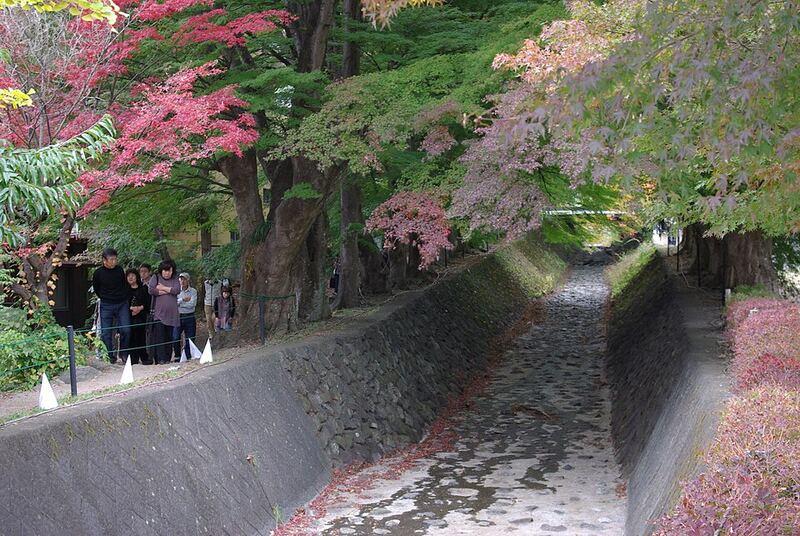</a> <a href="https://commons.wikimedia.org/wiki/File:Itchiku_Kubota_Art_Museum_2018c.jpg">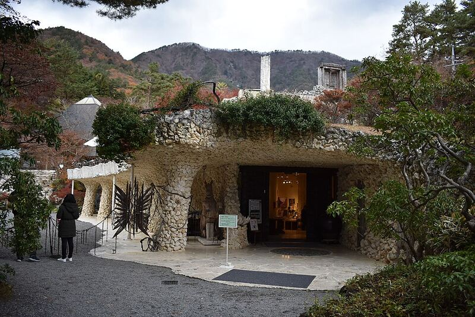</a>

*Fuji across the lake from Oishi Park · The Momiji Corridor · The Itchiku Kubota Art Museum*

- **[Oishi Park](https://www.google.com/maps/search/?api=1&query=Oishi+Park+Kawaguchiko)**: Fuji across the lake with flower beds in front. The red **kochia** bushes are usually at their best in mid to late October.
- **[Itchiku Kubota Art Museum](https://www.google.com/maps/search/?api=1&query=Itchiku+Kubota+Art+Museum)**: stunning dyed-kimono landscapes in beautiful gardens. Indoors, so it works in rain too.
- **[Momiji Corridor](https://www.google.com/maps/search/?api=1&query=Momiji+Corridor+Kawaguchiko)**: maples over a stream. Expect early colour; the peak is mid-November.
- Optional: **[Kawaguchiko Music Forest Museum](https://www.google.com/maps/search/?api=1&query=Kawaguchiko+Music+Forest+Museum)**, antique music boxes in a European-style village.
- **Getting there:** Red bus.

### 4. Around the lake by the station: ropeway, Yagizaki Park and a bike ride 🏞🥾📷

<a href="https://commons.wikimedia.org/wiki/File:KachikachiyamaRopeway.JPG">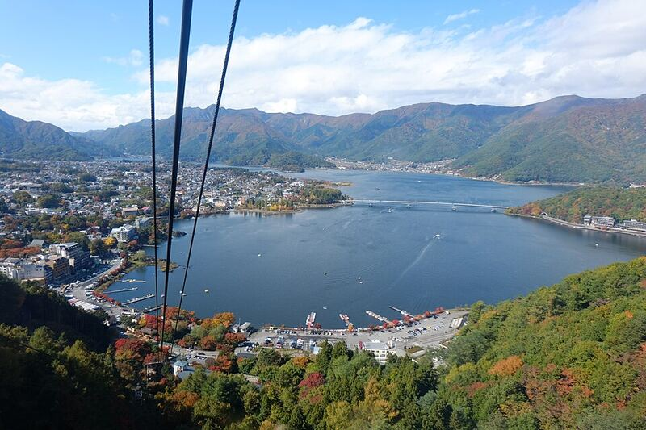</a> <a href="https://commons.wikimedia.org/wiki/File:Kachi_Kachi_Ropeway_(16217350765).jpg">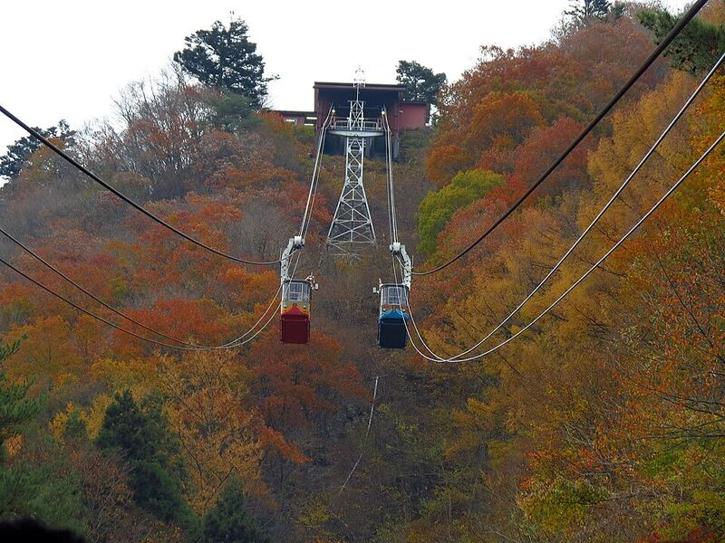</a>

*Lake Kawaguchi from the ropeway · The ropeway in autumn*

- **[Mt Fuji Panoramic Ropeway](https://www.google.com/maps/search/?api=1&query=Mt+Fuji+Panoramic+Ropeway+Kawaguchiko)**: 3 minutes up Mt Tenjo for views of the lake and Fuji. **Walk down (about 40 min).**
- **[Yagizaki Park](https://www.google.com/maps/search/?api=1&query=Yagizaki+Park)** lakeside walk and the **[Kawaguchiko Muse Museum](https://www.google.com/maps/search/?api=1&query=Kawaguchiko+Muse+Museum)** (dolls), with **lavender ice cream**.
- **Rental bike** along the flat east and north shore.
- **When:** good for the arrival afternoon (26 Oct) or the checkout morning (30 Oct).

### 5. West lakes: Panorama-dai hike and the ¥1,000-note view 🥾🏞📷

<a href="https://commons.wikimedia.org/wiki/File:Mount_Fuji_from_panoramadai.jpg">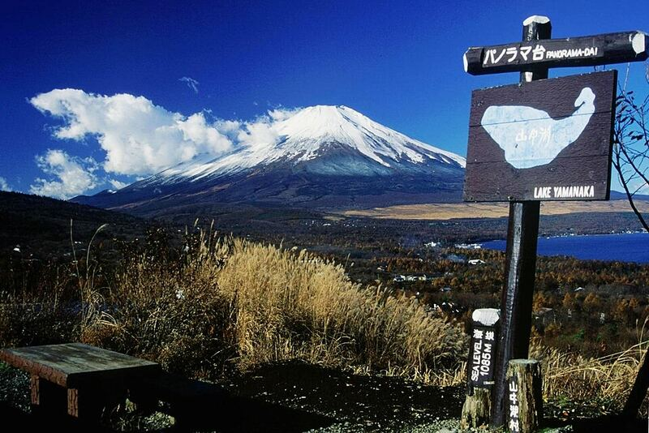</a> 

*Fuji from Panorama-dai · Fuji reflected in Lake Motosu*

- **[Panorama-dai](https://www.google.com/maps/search/?api=1&query=Panoramadai+Shojiko)** (Lake Shoji): a forest climb of about 1–1.5 h to a ridge facing Fuji full-on over the Aokigahara forest. About 2.5–3 h return.
- **[Lake Motosu ¥1,000-note viewpoint](https://www.google.com/maps/search/?api=1&query=Lake+Motosu+1000+yen+bill+view+point)**: the view of Fuji printed on the ¥1,000 note.
- **Getting there:** Blue bus, which only runs every 1–2 hours, so **plan around the timetable**.

### 6. Ishiwariyama, Oshino Hakkai and Lake Yamanaka 🥾🏛📷

<a href="https://commons.wikimedia.org/wiki/File:Oshino-Hakkai-Nakaike.jpg">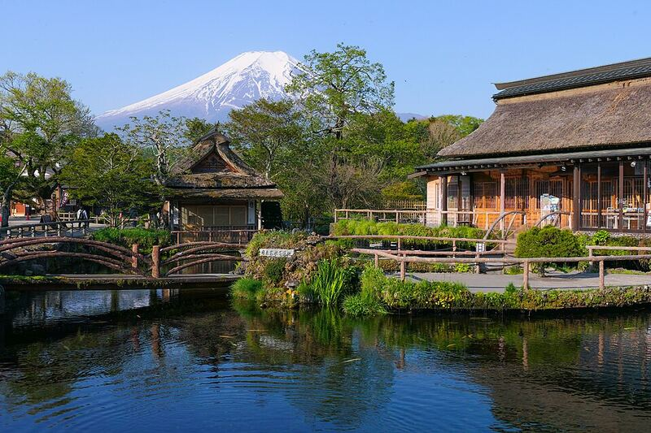</a> <a href="https://commons.wikimedia.org/wiki/File:Ishiwari_shrine_and_fissured_rock_with_shimenawa_-_Feb_26,_2020.jpg">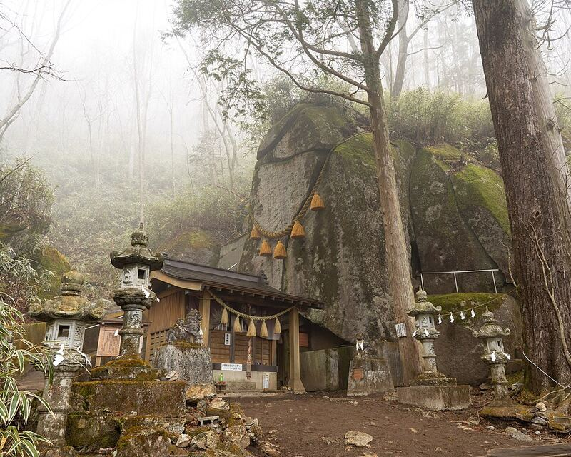</a> <a href="https://commons.wikimedia.org/wiki/File:Mount_Fuji_from_Lake_Yamanaka_1995-7-30.jpg">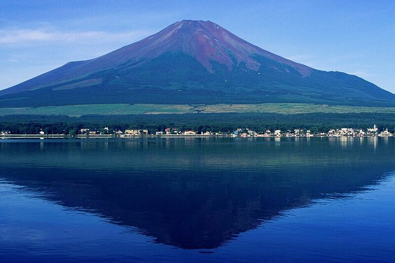</a>

*Oshino Hakkai · Ishiwari Shrine's split rock · Fuji over Lake Yamanaka*

- **[Ishiwariyama](https://maps.google.com/?cid=12167420549129818280)**: a shrine at the foot of about 400 steps to a giant split rock, then a mountain walk to a Fuji viewpoint. **(check walk length)**.
- **[Oshino Hakkai](https://www.google.com/maps/search/?api=1&query=Oshino+Hakkai)**: eight spring-fed ponds in a village with thatched houses and Fuji behind. Go early. **[Deguchi-ike Pond](https://www.google.com/maps/search/?api=1&query=Deguchi+Pond+Oshino)** is nearby and quieter.
- **[Lake Yamanaka](https://maps.google.com/?cid=17189721498507637575)**: the largest of the lakes. Ceramic shop **[碧工房](https://maps.google.com/?cid=133438621367350114)**.
- **Getting there:** Fujikko bus.

### 7. Kawaguchi Asama Shrine and the "torii in the sky" 🏛📷🏞

<a href="https://commons.wikimedia.org/wiki/File:Kawaguchi-asama-jinja_haiden_and_sugi_(1).JPG">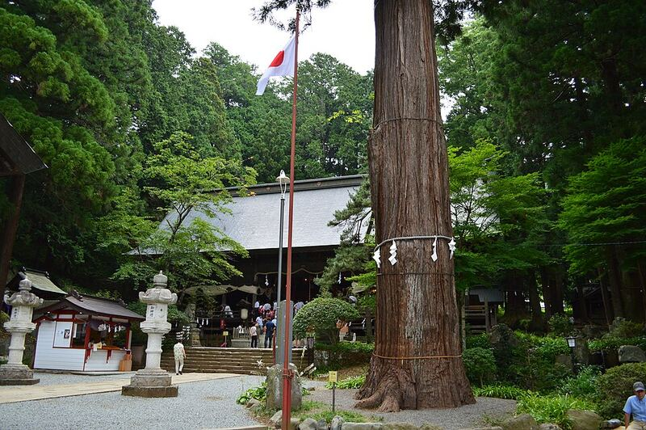</a>

*Kawaguchi Asama Shrine and its giant cedars*

- **[Kawaguchi Asama Shrine](https://www.google.com/maps/search/?api=1&query=Kawaguchi+Asama+Shrine)**: a quiet old shrine with giant cedars, some of them over 1,000 years old.
- **[Haruka-mia (torii in the sky)](https://www.google.com/maps/search/?api=1&query=Kawaguchi+Asama+Shrine+Haruka-mia+Tenku+no+Torii)**: a torii on the hillside above, framing Fuji and the lake. A popular photo spot.
- **[Haha-no-Shirataki Falls](https://www.google.com/maps/search/?api=1&query=Haha+no+Shirataki+Falls)**: a short forest walk from the shrine area.

### 8. Saruhashi "Monkey Bridge", on the way back to Tokyo 📜🏛📷

<a href="https://commons.wikimedia.org/wiki/File:Saruhashi-Otsuki-Yamanashi.JPG">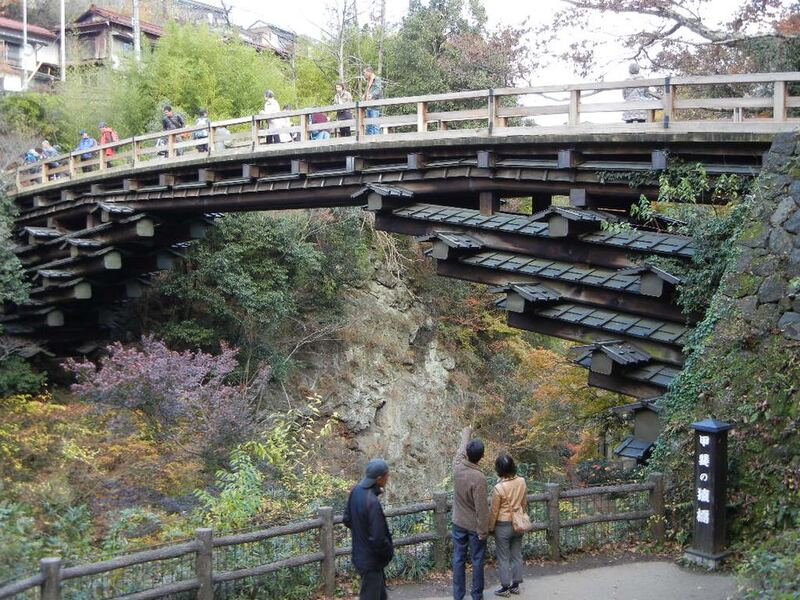</a> <a href="https://commons.wikimedia.org/wiki/File:Saruhashi_-02.jpg">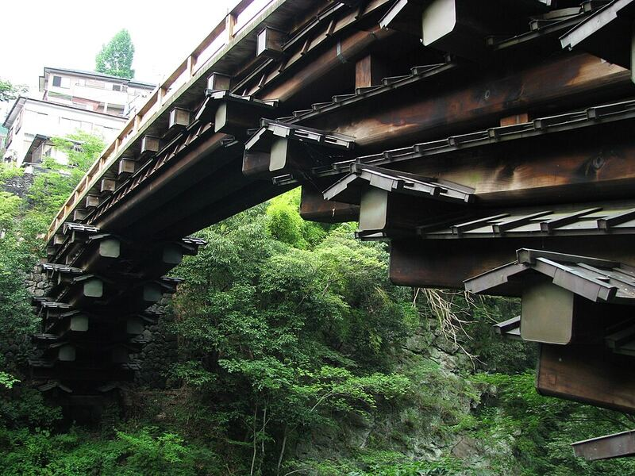</a> <a href="https://commons.wikimedia.org/wiki/File:Kai_Province,_Monkey_Bridge_(5765353809).jpg">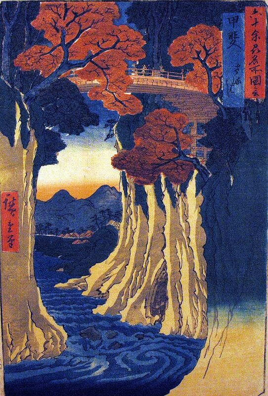</a>

*Saruhashi in autumn · The cantilevered beams under Saruhashi · Hiroshige, Monkey Bridge in Kai Province*

- **[Saruhashi](https://www.google.com/maps/search/?api=1&query=Saruhashi+Bridge+Otsuki)**: 📜 Hiroshige's *Monkey Bridge in Kai Province* (1840s) shows this cantilevered bridge over a deep gorge. It's one of Japan's "three strange bridges", rebuilt in the same style, and there's a short gorge walk.
- **Getting there:** on 30 Oct, take the **train** back via **Otsuki** (Fujikyu, then JR Chuo Line) instead of the Fuji Excursion or bus. Saruhashi is a short bus ride from Otsuki **(check the bus and luggage lockers at Otsuki)**.

---

## ☔ Wet-weather groups

### 9. Iyashi no Sato Nenba and the lava caves 🏛📷🥾

<a href="https://commons.wikimedia.org/wiki/File:Iyashinosato_village_04.jpg">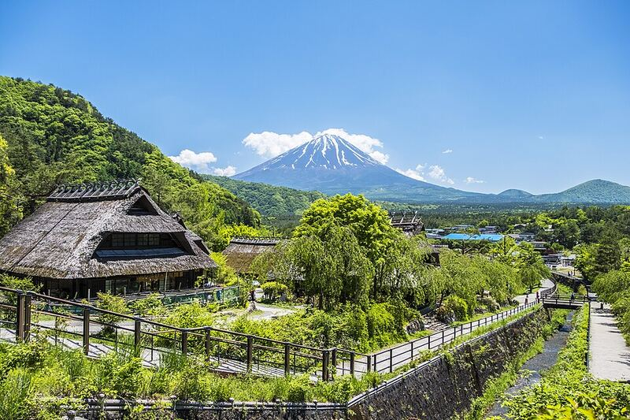</a> <a href="https://commons.wikimedia.org/wiki/File:Icicle_in_Narusawa_Ice_Cave.jpg">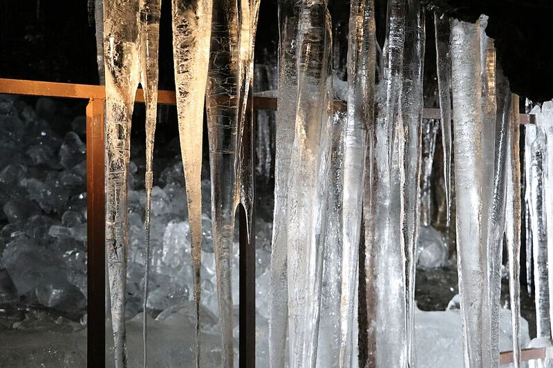</a> <a href="https://commons.wikimedia.org/wiki/File:Fugaku_fuketsu_-_Walking_in_the_cave.jpg">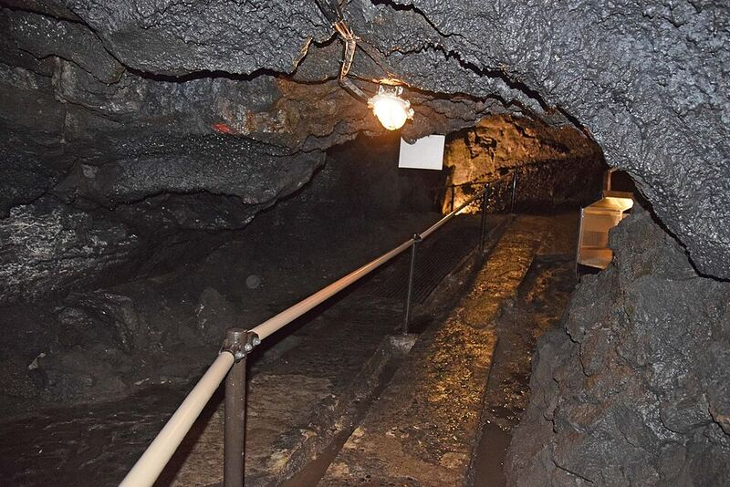</a>

*Iyashi no Sato Nenba's thatched houses with Fuji · Ice in Narusawa Ice Cave · Inside Fugaku Wind Cave, a lava tube*

- **[Iyashi no Sato Nenba](https://www.google.com/maps/search/?api=1&query=Saiko+Iyashi+no+Sato+Nenba)**: a rebuilt village of thatched farmhouses (craft shops, galleries, small museums) on the slope above Lake Saiko. Fuji views on a clear day.
- **[Fugaku Wind Cave](https://www.google.com/maps/search/?api=1&query=Fugaku+Wind+Cave)** and **[Narusawa Ice Cave](https://www.google.com/maps/search/?api=1&query=Narusawa+Ice+Cave)**: short visits into lava caves, linked by an easy walk through the Aokigahara forest (20–30 min). The forest is atmospheric in mist.
- **Getting there:** Green bus.

### 10. Kofu: Jomon archaeology, Takeda Shingen and pottery (day trip) 🏛📜

<a href="https://commons.wikimedia.org/wiki/File:Late_Jomon_clay_head_Shidanai_Iwateken_1500BCE_1000BCE.jpg">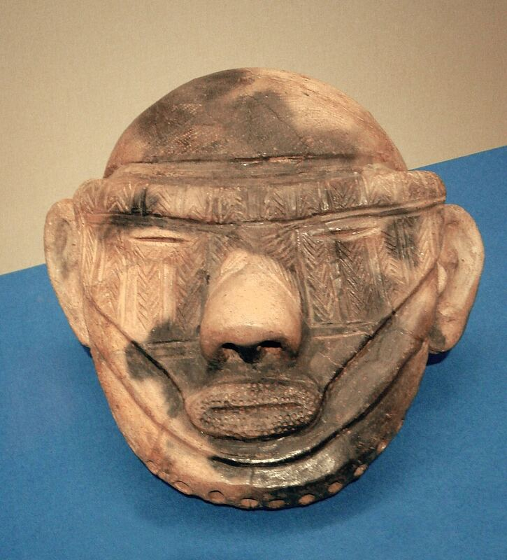</a> <a href="https://commons.wikimedia.org/wiki/File:KofuTakedaJinja3.jpg">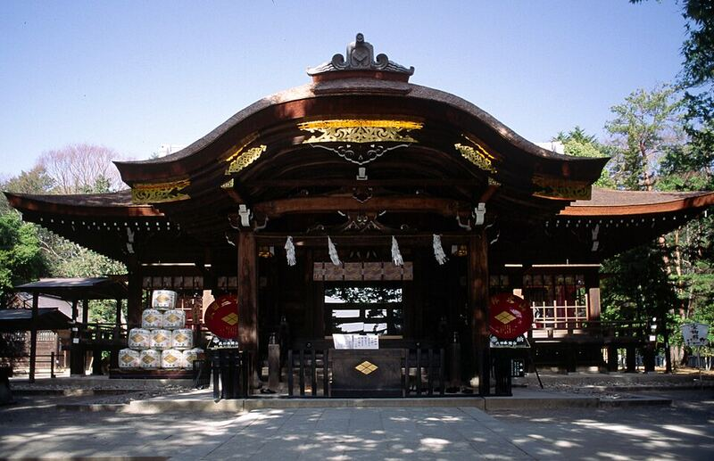</a>

*A Jomon clay face, about 3,000 years old (from northern Japan; similar pieces are in the museum) · Takeda Shrine, on the site of Takeda Shingen's home*

- **[Yamanashi Prefecture Archaeological Museum](https://maps.google.com/?cid=7360556434425664234)**: Jomon pottery and figurines, some of Japan's oldest art.
- **[Takeda Shrine](https://www.google.com/maps/search/?api=1&query=Takeda+Shrine+Kofu)**: built on the site of the home of **Takeda Shingen**, the famous 16th-century warlord of this province, with a small treasure museum. **[Kofu Castle (Maizuru Park)](https://www.google.com/maps/search/?api=1&query=Maizuru+Castle+Park+Kofu)** is near the station.
- **[うつわのおぎの](https://maps.google.com/?cid=3457360590051351955)**: a Kofu pottery shop.
- **Getting there:** bus from Kawaguchiko to Kofu, about 1 h **(check)**.

---

## Backup list

### ☀️ Fine weather
- **[Shakushiyama](https://www.google.com/maps/search/?api=1&query=Mount+Shakushi+Fujiyoshida)**: a 2 h hike to a Fuji view **(check the route and difficulty)**.
- **Lakeshore sunrise** at **[Ubuyagasaki](https://www.google.com/maps/search/?api=1&query=Ubuyagasaki+Kawaguchiko)**, for reflections of Fuji on calm mornings.
- **[Lake Saiko](https://www.google.com/maps/search/?api=1&query=Lake+Saiko)** lakeside walk, a quiet lake that can be added to #9.
- **[Fuji Subaru Line 5th Station](https://www.google.com/maps/search/?api=1&query=Fuji+Subaru+Line+5th+Station)**: a bus up to 2,300 m. It may be cold, snowy or closed by late October **(check)**.

### ☔ Wet weather
- **[Fujisan World Heritage Center](https://www.google.com/maps/search/?api=1&query=Fujisan+World+Heritage+Center+Fujiyoshida)** as a whole visit (also optional in #1).
- **[Kawaguchiko Music Forest Museum](https://www.google.com/maps/search/?api=1&query=Kawaguchiko+Music+Forest+Museum)** as a whole visit (also optional in #3).
- Sake bars, coffee shops, pottery shops and wandering around town.
- Antique and pottery shops in Hokuto, **[アンティーク冬花](https://maps.google.com/?cid=9834687477280379622)** and **[工房月の手](https://maps.google.com/?cid=11675281411271573930)**. They're beyond Kofu, so only worth it combined with #10 **(check travel time)**.
