# Tokyo: activity groups (clean list)

**Key:** ☀️ fine-weather group · ☔ wet-weather group (works in rain) · 📷 photography · 🏛 history/museum · 🥾 walk · 🏞 views · 📜 link to a historic print or painting
Every group here is **top** priority. Backups are at the bottom. Place names link to Google Maps.
Background reading: [Ukiyo-e landscape prints, their viewpoints and where to see them](ukiyo-e.md).
Audio walks, like Rick Steves' Europe walks, are listed under each group where we found one. They're GPS-triggered phone tours: download over Wi-Fi first and they play offline, so bring earphones. Near base, the [VoiceMap Tokyo](https://voicemap.me/tour/tokyo) catalogue also has *A Different Side of Shibuya: A Dogenzaka Walking Tour* and a *History and Architecture* walk from Jingumae (Meiji Jingu, Harajuku and the Yoyogi Gymnasium) **(check)**.
Photos (tap one for its source) are from Wikimedia Commons; see [photo credits](photos/CREDITS.md).
NZ$ prices are approximate, at ¥1,000 ≈ NZ$11 (rate on 9 Oct 2026).

**Day-of-week traps:**
- Most museums and gardens close on **Mondays** (Tokyo Mondays: 19 Oct, 2 Nov). Use Mondays for hikes and day trips.
- Avoid Kamakura and Hakone on weekends (24–25 Oct, 31 Oct–1 Nov, 7–8 Nov) if possible.
- **3 Nov (Tue) is Culture Day**, a public holiday: busy everywhere, and some museums are free.
- **Only open some days:** Yayoi Kusama Museum (Thu–Sun and holidays, timed tickets) and the Showa Era Lifestyle Museum (Fri–Sun). Noh has only a few performances a month. See the backups.

---

## ☀️ Fine-weather groups

### 1. Kamakura and the Shonan coast (day trip) 📷🏛🥾🏞📜

  

*Kamakura's Great Buddha, outdoors since the 1490s · Hase-dera's rows of small jizo statues · Hokusai, Shichiri Beach in Sagami Province*

- **[Great Buddha (Kotoku-in)](https://www.google.com/maps/search/?api=1&query=Kotoku-in+Great+Buddha+Kamakura)**: a 13th-century bronze Buddha, sitting outdoors since the hall around it was washed away in the late 1400s.
- **[Hase-dera](https://www.google.com/maps/search/?api=1&query=Hase-dera+Kamakura)**: a hillside temple with sea views, 5 minutes' walk from the Buddha.
- **[Daibutsu hiking course](https://www.google.com/maps/search/?api=1&query=Daibutsu+Hiking+Course+Kamakura)**: a wooded ridge trail from the Buddha to Kita-Kamakura, about 1.5 h, easy to moderate. It finishes near Engaku-ji and Kencho-ji, two of Kamakura's great Zen temples (pick one).
- **[Tsurugaoka Hachimangu](https://www.google.com/maps/search/?api=1&query=Tsurugaoka+Hachimangu)**: the shrine of the shoguns who ruled from Kamakura in the 1100s–1300s.
- 📜 **History link:** Hokusai's *Shichiri Beach in Sagami Province* (Thirty-six Views of Mt Fuji) shows Fuji across the bay. Stand on **[Shichirigahama beach](https://www.google.com/maps/search/?api=1&query=Shichirigahama+Beach)** (Enoden line) to see the same view, best on a clear afternoon. Hokusai's *Enoshima* print is a stop further along.
- **Getting there:** Odakyu *Enoshima-Kamakura Freepass* from Shinjuku. The Odakyu Line runs right by the base **(check price)**. Starting at [Kamakura Station](https://maps.google.com/?cid=10126820322969569051).
- **Audio walk:** **[Kamakura: Temples & Timeless Charm](https://wegotrip.com/kamakura-d1195/explore-kamakuras-heritage-a-self-guided-audio-tour-p10671/)** (WeGoTrip app): about 6 km, 2–3 h, GPS map, works offline once downloaded. About €10 **(check)**.
- **Time:** full day, on a weekday.

### 2. Mt Takao (day trip) 🥾🏞📷

 

*Fuji from Mt Takao's summit · A tengu guardian at Yakuo-in*

- **[Mount Takao](https://maps.google.com/?cid=14341444200467673055)**: Tokyo's favourite hiking mountain. Walk up Trail 1 (paved) or Trail 6 (a stream path), about 1.5–2 h, or take the cable car (about ¥500 (~NZ$6)) part of the way and walk the rest.
- **[Yakuo-in](https://www.google.com/maps/search/?api=1&query=Yakuoin+Yukiji+Takao)**: a mountain temple guarded by statues of *tengu* (long-nosed mountain spirits), which is unusual.
- Fuji from the summit on a clear morning. Autumn colour starts in early November, with the peak mid to late November.
- **Getting there:** Keio Line from Shinjuku, about 50 min.
- **Time:** most of a day. Good for a Monday.

### 3. Edo heart: Nihonbashi and Edo Castle (print walk) 📜🏛🥾📷

  

*The stone base of Edo Castle's keep, in the East Gardens · Nihonbashi bridge, under the expressway · Hiroshige, Suruga-cho: the Echigoya (now Mitsukoshi) street with Fuji*

- **[Imperial Palace East Gardens](https://www.google.com/maps/search/?api=1&query=Imperial+Palace+East+Gardens)**: the inner grounds of Edo Castle, with the huge stone base of the old keep, moats and gates. Free. **Closed Mon and Fri (check).**
- **[Nihonbashi bridge](https://www.google.com/maps/search/?api=1&query=Nihonbashi+Bridge)**: the starting point of the Edo highways. Hokusai drew Fuji beyond it, and Hiroshige's Tokaido series begins here. Today an expressway runs over it (it's being moved underground).
- **[Suruga-cho (Mitsukoshi corner)](https://www.google.com/maps/search/?api=1&query=Mitsukoshi+Nihonbashi+Main+Store)**: Hiroshige's *Suruga-cho* shows the Echigoya store, which became Mitsukoshi, with Fuji at the end of the street. The store still stands, though buildings now hide Fuji. Compare the print on your phone.
- **[Kanda Surugadai](https://www.google.com/maps/search/?api=1&query=Surugadai+Kanda+Tokyo)**: the rise Hokusai drew Fuji from in *Surugadai in Edo*.
- **Getting there:** Chiyoda Line from Yoyogi-koen, direct to Otemachi.
- **Audio guides (GPS-triggered, like Rick Steves' walks):** download both over Wi-Fi before going. They play offline.
  - **[Everlasting Edo: A Guide to Nihonbashi's History](https://voicemap.me/tour/tokyo/everlasting-edo-a-guide-to-nihonbashi-s-history)** (VoiceMap app): about 2 km, 1 h and 29 stops. It starts at the Nihonbashi pier and takes in the bridge, the zero-milestone marker, the Bank of Japan and Mitsukoshi. A Tokyo local wrote it and a professional narrator reads it. About US$12–15 **(check)**. One reviewer had trouble with the unlock code, so buy it a day early.
  - **[Imperial Palaces Guide](https://www.kunaicho.go.jp/en/visit/guide/app.html)**: the Imperial Household Agency's free official app, in English. It covers the East Gardens (the Edo Castle keep base, gates and guardhouses) and tells you when you reach each spot.
- **Time:** half to full day. Pairs well with **#10**, which has the Edo-Tokyo Museum's full-size Nihonbashi replica and the prints themselves. See those first, then walk the real places.

### 4. Asakusa and the Sumida River 📷🏛📜

  

*Senso-ji's Kaminarimon gate · Senso-ji's pagoda after dark · The teahouse on the pond at Hama-rikyu*

- **[Senso-ji](https://www.google.com/maps/search/?api=1&query=Senso-ji)**: Tokyo's oldest temple, with the Kaminarimon gate and its giant lantern. Go early morning or after dark for photos without the crowds.
- 📜 Hiroshige's *Kinryuzan Temple at Asakusa* shows the gate in snow, looking towards the pagoda. The same angle works today.
- **[Sumida River water bus](https://www.google.com/maps/search/?api=1&query=Asakusa+Pier+Tokyo+Cruise)** from Asakusa downriver to **[Hama-rikyu Gardens](https://www.google.com/maps/search/?api=1&query=Hama-rikyu+Gardens)**, the shogun's seaside garden with a teahouse on the pond.
- Optional: **[Tokyo Skytree](https://www.google.com/maps/search/?api=1&query=Tokyo+Skytree)** deck across the river (paid).
- **Getting there:** Ginza Line from Shibuya, direct to Asakusa.
- **Audio walk:** **[Secrets of Sensoji: A Tour of Asakusa's History, Art and Culture](https://voicemap.me/tour/tokyo/secrets-of-sensoji-temple-a-tour-of-asakusa-s-history-art-and-culture)** (VoiceMap app, by the same local company as the Nihonbashi walk in #3): 90 min, about 2 km, 34 stops. About US$15 **(check)**.
- **Time:** full day. Ryogoku (**#10**) is 10 minutes away if the weather turns.

### 5. Views over Tokyo: free observation decks (plus Shinjuku Gyoen) 🏞📷

  

*Fuji at sunset from the Metropolitan Government Building · Shinjuku Gyoen in autumn · Shibuya Sky's rooftop deck*

Do these one or two at a time as they fit other days.
- **[Tokyo Metropolitan Government Building](https://www.google.com/maps/search/?api=1&query=Tokyo+Metropolitan+Government+Building)** (Shinjuku): 45F, free. Fuji on clear mornings. South Deck 9:30–22:00.
- **[Shinjuku Gyoen](https://maps.google.com/?cid=12815362615039550287)** next door: a former imperial garden with autumn colour. **Chrysanthemum exhibition 1–15 Nov.** Closed Mondays.
- **[Bunkyo Civic Centre](https://maps.google.com/?cid=12778390561688336080)**: 25F, free, with a Fuji view. Near Kasuga and Korakuen.
- **[Carrot Tower](https://www.google.com/maps/search/?api=1&query=Carrot+Tower+Sangenjaya)** (Sangenjaya): 26F, free **(check)**.
- **[Shibuya Hikarie Sky Lobby](https://www.google.com/maps/search/?api=1&query=Shibuya+Hikarie)**: 11F, free, looking over Shibuya **(check)**.
- Paid option near base: **[Shibuya Sky](https://www.google.com/maps/search/?api=1&query=Shibuya+Sky)** at sunset (book ahead). See the crossing options below.

#### Shibuya Crossing from above (15 min walk from base)

  

*Shibuya Crossing from above · The crossing after dark · The view from the Starbucks window*

The scramble outside Shibuya station's Hachiko exit, the crossing in all the stock footage: every direction gets a green light at once and the whole junction fills with people. It's busiest on Friday and Saturday evenings, and the lit-up signs are best from dusk (about 17:00 late Oct / 16:45 early Nov). Walk across it first, then watch it from above.

| Viewpoint | View | Cost | Hours | Notes |
|---|---|---|---|---|
| **[MAG8 rooftop](https://www.google.com/maps/search/?api=1&query=MAG8+Crossing+View+Magnet+by+Shibuya109)** (Magnet by Shibuya109, rooftop) | Looking straight down onto the crossing, the classic shot | ¥1,800 (~NZ$20) incl. one drink (up to ¥300 (~NZ$3) off online). **Cards and e-money only, no cash** | 10:00–22:00, last entry 21:30 | **Best for photos.** Open air, but you shoot through clear panels. Optional "drone photo" camera ¥1,500 (~NZ$17) for 150 s. Reopened after renovation 3 Mar 2026. |
| **[Starbucks, Shibuya Tsutaya 2F](https://www.google.com/maps/search/?api=1&query=Starbucks+Coffee+Shibuya+Tsutaya)** | Close and head-on, through glass, from 2 floors up | Price of a drink (about ¥500–800 (~NZ$6–9)) | 7:00–22:30 | **Yes, it's fine to go up for the view.** The 2024 redesign deliberately set the seats back from the window so people can walk up, look and take photos. Buy a drink as a courtesy. Window seats are scarce: go early morning or late evening. |
| **[L'Occitane Café](https://www.google.com/maps/search/?api=1&query=L%27Occitane+Cafe+Shibuya)** (Shibuya Ekimae Building 2–3F) | Close, on the corner of the crossing, slightly elevated | Price of a drink | 10:00–23:00 (last order 22:00) | Calmer than Starbucks. **(check it's still open)** |
| **[Mark City walkway](https://www.google.com/maps/search/?api=1&query=Myth+of+Tomorrow+Shibuya+Mark+City)** (station to Mark City, past Okamoto Taro's *Myth of Tomorrow* mural) | Side-on, through glass | Free | Station hours | A modest view, but free and worth a look on the way through. The mural is worth seeing too. |
| **[Shibuya Sky](https://www.google.com/maps/search/?api=1&query=Shibuya+Sky)** (Scramble Square rooftop, 230 m) | The crossing is tiny far below, but you get the whole city, and Fuji on clear days | Web: about ¥2,700 (~NZ$30) before 15:00, ¥3,400 (~NZ$38) from 15:00; ¥300 (~NZ$3) more at the counter **(check)** | 10:00–22:30, last entry 21:20 | Timed tickets. **Sunset slots sell out**, so book as soon as they open (about 2–4 weeks ahead). The rooftop closes in bad weather. No tripods or selfie sticks. |

**Suggested evening:** sunset at Shibuya Sky, then down to street level to walk the crossing, then MAG8 after dark for the lit-up view from above. Or for a cheaper version, Starbucks at breakfast and the Mark City walkway.

### 6. Setagaya green walk: Todoroki Ravine to Jiyugaoka 🥾📷🏛

  

*Todoroki Ravine · Todoroki Fudo shrine by the waterfall · Kuhonbutsu Joshin-ji*

- **[Todoroki Ravine](https://maps.google.com/?cid=8190717095247196857)**: a 1 km wooded stream valley inside the city, with a small waterfall shrine and Kofun-era **burial caves** (tunnel tombs).
- **[Gotoh Museum](https://maps.google.com/?cid=5564290463521425014)**: Japanese and Chinese paintings, ceramics and scrolls, with a hillside garden in autumn colour. **Closed Mondays.**
- **[Kuhonbutsu Joshin-ji](https://maps.google.com/?cid=13888666751185333972)**: a peaceful temple complex with nine Buddha statues in three halls.
- **[Mont St.Clair](https://maps.google.com/?cid=3872742080123885955)** in Jiyugaoka for pastries to finish.
- **Getting there:** Tokyu Den-en-toshi Line from Shibuya, changing to the Oimachi Line.
- **Time:** half to full day, with 2–3 h of easy walking.

### 7. Gōtoku-ji and Shimokitazawa (via the Setagaya tram) 📷🏛🥾

<a href="https://commons.wikimedia.org/wiki/File:Shelves_of_maneki-neko_in_Gotokuji.jpg">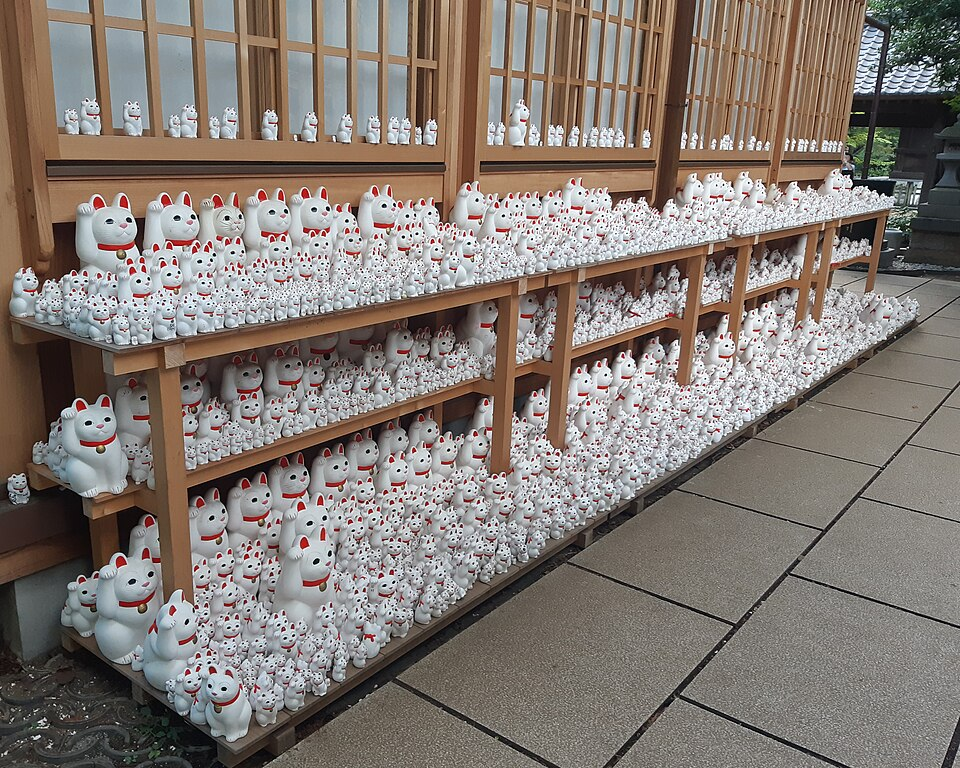</a> <a href="https://commons.wikimedia.org/wiki/File:Walk_in_Shimokitazawa_3.jpg">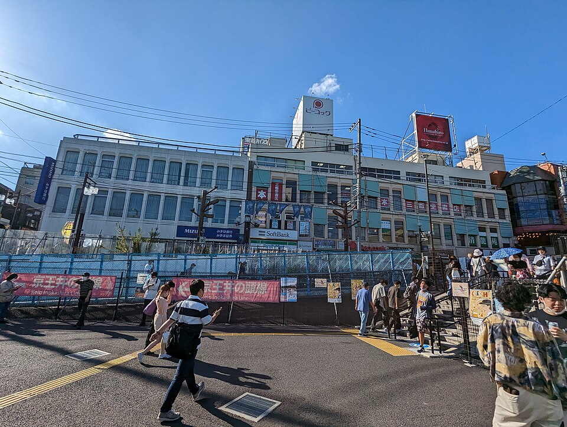</a> <a href="https://commons.wikimedia.org/wiki/File:Tokyo_Setagaya_Line_Tram_in_2024.jpg">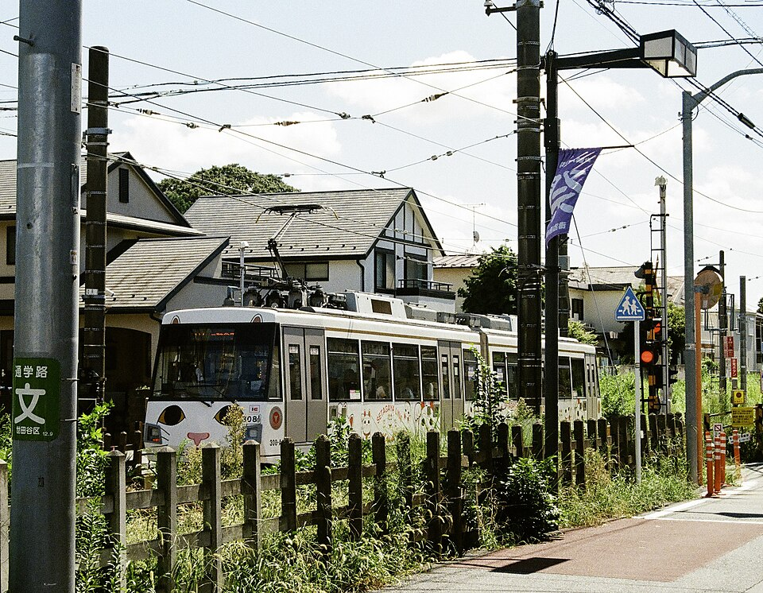</a>

*Shelves of maneki-neko at Gōtoku-ji · Shimokitazawa's streets · A maneki-neko themed Setagaya Line tram*

- **[Gōtoku-ji](https://maps.google.com/?cid=482142090738683052)**: the "lucky cat temple", where hundreds of small white *maneki-neko* are left as thank-you offerings. It's quiet, free and very photogenic, especially the shelves of cats near the pagoda.
- **The Setagaya Line tram**: one of Tokyo's two surviving street-tram lines. Some trains have a lucky-cat theme. Get off at Miyanosaka, 3 min walk from the temple. Fare ¥160, or a day pass for ¥340 (~NZ$4) **(check)**.
- **[Shimokitazawa](https://maps.google.com/?cid=3688041400833590402)**: the old-fashioned "cool part of town", a tangle of lanes with vintage clothes, record shops, tiny cafés and live-music bars.
- **Getting there:** Shibuya to Sangenjaya on the Den-en-toshi Line, then the Setagaya Line to Miyanosaka. Or the Odakyu Line from Yoyogi-Hachiman near base, where local trains stop at Shimokitazawa and (a few stops further on) Gotokuji station **(check)**.
- **Cost and hours:** the temple is free, roughly 6:00–17:00 **(check)**. Shimokitazawa's shops mostly open 11:00–12:00 and stay open into the evening.
- **Best day:** a **weekday afternoon**. Shimokitazawa is packed on Saturdays and Sundays, and the shops are shut in the early morning.
- **Time:** half a day, with 2–3 h of easy walking.

### 8. Meiji Jingu and Yoyogi Park (next to base) 📷🏛🥾

<a href="https://commons.wikimedia.org/wiki/File:Meiji-jingu_Torii_1.jpg">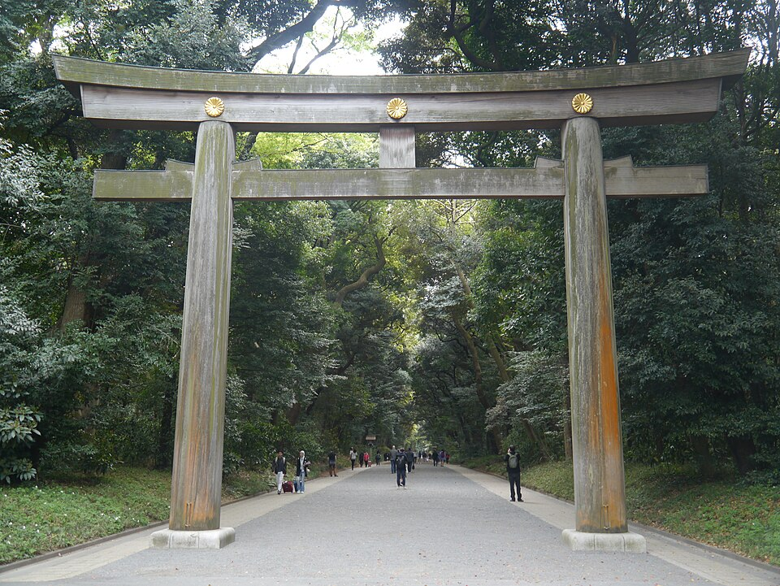</a> <a href="https://commons.wikimedia.org/wiki/File:Meiji-jingu_wedding_procession_-_P1000847.jpg">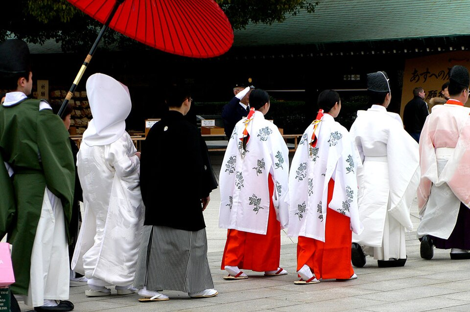</a>

*The great torii of Meiji Jingu · A Shinto wedding procession at Meiji Jingu*

- **[Meiji Jingu](https://www.google.com/maps/search/?api=1&query=Meiji+Jingu)**: the shrine to the Meiji Emperor and Empress, reached by a 10–15 minute gravel path under a forest of 100,000 donated trees. It sits in the middle of the city and feels nowhere near it.
- **Photography:** traditional **weddings** (the white-robed procession in the photo) are common on weekends, and in November families bring children in kimono for **Shichi-Go-San**, the 7-5-3 blessing. A wide-angle shot of the great torii is the classic frame.
- **Yoyogi Park** is next door: lawns, ginkgo trees and (on Sundays) street performers.
- **Events to check:** the shrine's **Autumn Grand Festival runs about 1–3 Nov**, with traditional performances and **yabusame (horseback archery)** around Culture Day, 3 Nov. The 2026 times aren't confirmed **(check)**. Arrive early to get a spot.
- **Cost and hours:** the shrine is free and opens at sunrise (about 6:00 in early Nov) and closes around 16:00–17:00 depending on the date **(check)**. The Inner Garden is about ¥500 (~NZ$5.50) **(check)**.
- **Best day:** a **weekday morning** for calm. For ceremonies and Shichi-Go-San, **Saturday or Sunday** (7–8 Nov) is better, but busy. Avoid the middle of the day on 3 Nov.
- **Getting there:** about 15 minutes on foot from base, or Chiyoda Line one stop to Meiji-jingumae.
- **Time:** a morning or an evening. Pairs with the Ōta Museum (backup) in Harajuku.

---

## ☔ Wet-weather groups

### 9. Ueno Park museums and the Moon Pine 🏛📜📷

  

*Samurai armour at the Tokyo National Museum · The Moon Pine at Kiyomizu Kannon-do today · Hiroshige's Moon Pine print, from the same spot*

- **[Tokyo National Museum](https://www.google.com/maps/search/?api=1&query=Tokyo+National+Museum)**: Japan's biggest collection of samurai armour, swords, screens and ukiyo-e. It includes the **[Gallery of Horyuji Treasures](https://maps.google.com/?cid=8184332031323003816)**. Closed Mondays.
- **[Kiyomizu Kannon-do](https://www.google.com/maps/search/?api=1&query=Kiyomizu+Kannon-do+Ueno)**: 📜 the **Moon Pine** from two of Hiroshige's *One Hundred Famous Views of Edo*, a pine trained into a circle that frames the pond. It was lost in the 1870s and recreated in 2012, so you can stand where Hiroshige did.
- Also here: **[National Museum of Western Art](https://maps.google.com/?cid=13484864514866363531)**, **[Tokyo Metropolitan Art Museum](https://maps.google.com/?cid=9518604028842126160)**, and Shinobazu Pond.
- **Getting there:** Chiyoda Line from Yoyogi-koen to Nezu or Yushima, direct.

### 10. Ryogoku: Edo-Tokyo Museum and Hokusai Museum 🏛📜

  

*The full-size Nihonbashi replica in the Edo-Tokyo Museum · The museum's kabuki theatre · Sumida Hokusai Museum*

- **[Edo-Tokyo Museum](https://www.google.com/maps/search/?api=1&query=Edo-Tokyo+Museum)**: reopened 31 Mar 2026 after a 4-year renovation. It has a full-size replica of half of Nihonbashi bridge, models of Edo streets, and kabuki. Closed Mondays.
- **[Sumida Hokusai Museum](https://www.google.com/maps/search/?api=1&query=Sumida+Hokusai+Museum)**: in the district where Hokusai was born. A good place to see his prints before chasing the views. Closed Mondays.
- **Getting there:** Oedo Line or JR Sobu Line to Ryogoku. 10 minutes from Asakusa (**#4**).

### 11. Kawagoe, "Little Edo" (day trip) 🏛📷📜

  

*Toki-no-Kane bell tower · Kurazukuri Street's clay-walled warehouses · Kita-in's 540 rakan statues*

Mostly outdoors, but fine in light rain.
- **[Kurazukuri Street](https://www.google.com/maps/search/?api=1&query=Kurazukuri+Street+Kawagoe)**: over 20 Edo-period clay-walled merchant warehouses, plus the wooden **Toki-no-Kane bell tower**.
- **[Kita-in](https://www.google.com/maps/search/?api=1&query=Kitain+Temple+Kawagoe)**: the **only surviving rooms of Edo Castle**, moved here in the 1630s. It also has **540 stone *rakan* statues**, each with a different face, which is unusual.
- **[Kawagoe Castle Honmaru Palace](https://www.google.com/maps/search/?api=1&query=Kawagoe+Castle+Honmaru+Goten)**: the surviving palace of a feudal lord's castle.
- **Getting there:** Seibu Shinjuku Line from Seibu-Shinjuku, or Tobu Tojo Line from Ikebukuro, about 1 h. Day passes are available **(check)**.

### 12. Tojo Museum of History, Matsudo (day trip) 🏛📜📷

<a href="https://commons.wikimedia.org/wiki/File:Tojo-tei_01.jpg">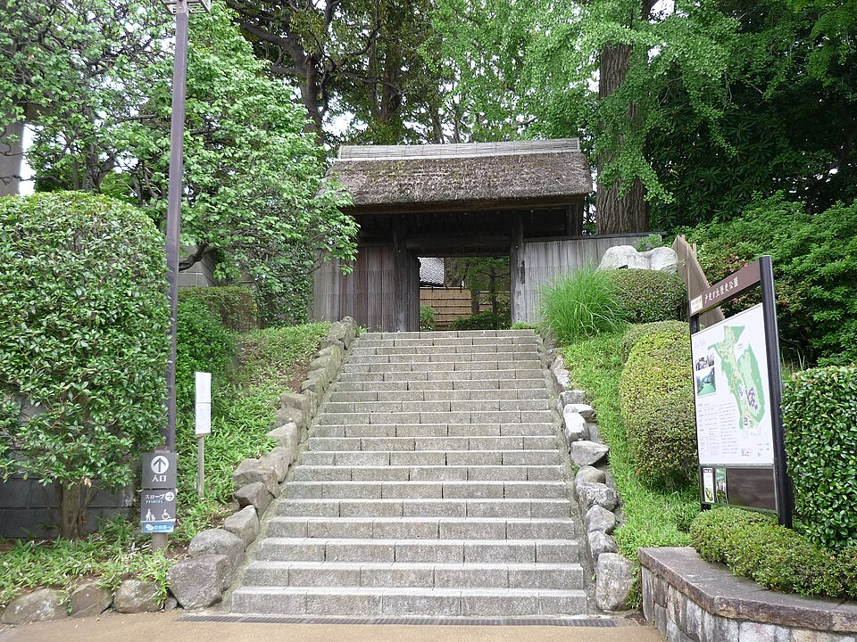</a> <a href="https://commons.wikimedia.org/wiki/File:Tojo_tei_2009.jpg">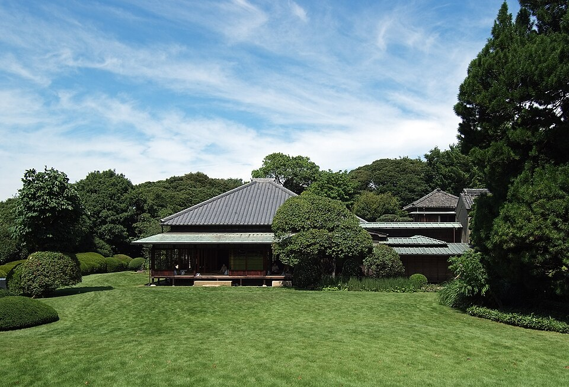</a>

*The thatched gate of Tojo-tei · Tojo-tei, built in 1884*

- **[Tojo Museum of History](https://maps.google.com/?cid=9722492646698936878)** (Tojo-tei): the 1884 villa of **Tokugawa Akitake**, the younger brother of the last shogun. A well-travelled man who had visited France, he made oil paintings and early photographs, and the house shows them with the family's history. The house is kept as a Meiji-era villa.
- **The gardens** around the house are a calm walk, with the hill park beside them.
- **Cost:** about ¥150 (~NZ$2) for the house and museum **(check)**. The park is free.
- **Hours:** 9:30–17:00 (some listings say 16:30) **(check)**. **Closed Mondays** (Tuesday instead if the Monday is a holiday).
- **Best day:** **Tuesday to Friday**. Never on a Monday (19 Oct, 2 Nov). It's small and fine on weekends too.
- **Getting there:** Matsudo Station (JR Joban Line, about 25 min from Ueno), then a 13 min walk from the East exit. Some Chiyoda Line trains from Yoyogi-koen run straight through onto the Joban Line **(check)**.
- **Time:** 2–3 h at the house, so about half a day with the travel.

---

## Extra picks

**Most of these are already placed.** The ones not already in the lists are now in the main list (#7, #8 and #12) or the backups below, and the table shows where each one is. The only one that was new is the **National Noh Theatre** (T1).

| Pick | Where it is now |
|---|---|
| teamLab Borderless (MORI Building digital art museum) | Backup, wet weather |
| Aviation Shrine | Backup, wet weather (with Tokorozawa) |
| Yasukuni Shrine and war museum (the Zero fighter) | Backup, wet weather |
| Jōrin-ji, next to the Yayoi Kusama Museum | Backup, wet weather |
| Samurai Restaurant (show) | Backup, wet weather |
| Yodobashi Fujisawa Camera Museum | Backup, wet weather |
| Shinjuku Gyoen | Main list, **#5** |
| Ōta Memorial Museum of Art | Backup, wet weather |
| PARCO Museum Tokyo | Backup, wet weather |
| Tojo Museum of History | Main list, **#12** (moved up) |
| Komaba Museum, University of Tokyo | Backup, wet weather |
| Shōtō Museum of Art | Backup, wet weather |
| Shimokitazawa | Main list, **#7** (moved up) |
| Showa Era Lifestyle Museum (Fri–Sun only) | Backup, wet weather |
| Gōtoku-ji (lucky cat shrine) | Main list, **#7** (moved up) |
| Art Aquarium Museum | Backup, wet weather |
| Setagaya Art Museum (closed Mondays) | Backup, wet weather |
| Meiji Shrine and park | Main list, **#8** (moved up) |
| National Noh Theatre | New: **#13** below |

### 13. National Noh Theatre (Sendagaya) ☔🏛📷

<a href="https://commons.wikimedia.org/wiki/File:National_Noh_Theatre.JPG">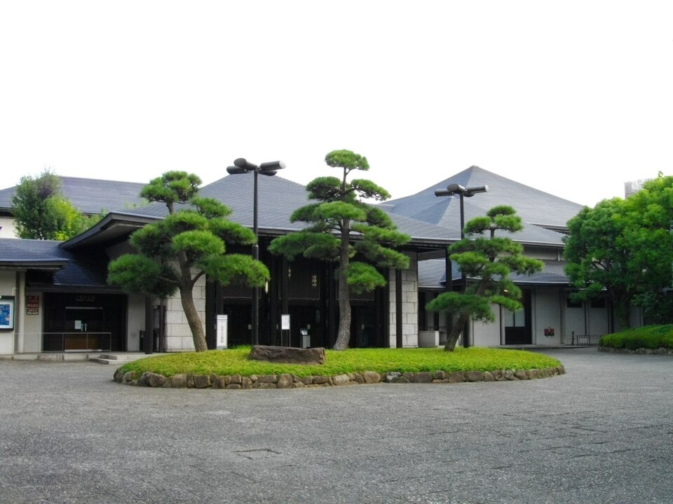</a> <a href="https://commons.wikimedia.org/wiki/File:Noh-stage.jpg">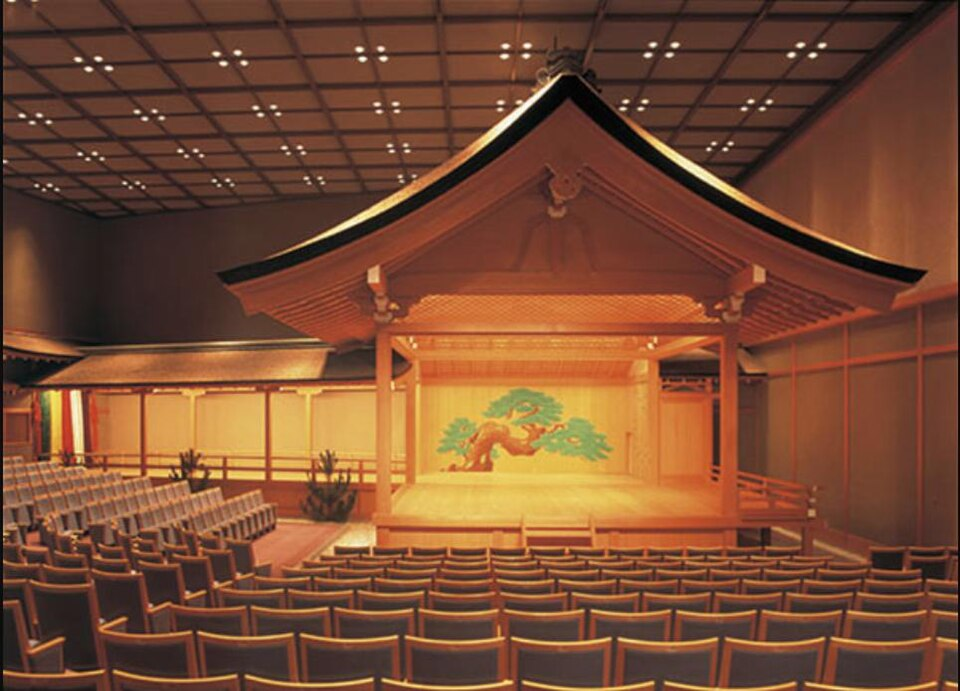</a>

*The National Noh Theatre · A Noh stage, with its painted pine backdrop*

- **[National Noh Theatre](https://www.google.com/maps/search/?api=1&query=National+Noh+Theatre+Sendagaya)**: Japan's national stage for **Noh**, the slow, masked drama of the 1300s, with a pine-backed stage like the one in the photo. A good fit for the old-Japan interest: it's the living tradition behind much of the temple and castle history we'll see.
- **English help:** each of the 627 seats has a small screen that switches between Japanese and English subtitles, so you can follow the story.
- **Cost:** tickets start from about ¥3,000 (~NZ$33), more for the better seats **(check, the data I found was old)**. Book through the National Theatre ticket centre, online or by phone.
- **Hours:** Noh isn't on every day. The theatre has performances on only a handful of days each month, so check the schedule for our dates before planning around it **(check)**.
- **Best day:** whichever day has a performance. There's nothing to see on the other days, so **don't just turn up**.
- **Getting there:** 5 min walk from Sendagaya Station (JR Sobu Line). It's near Shinjuku Gyoen (#5) and the Meiji Jingu Gaien, so it pairs with either.
- **Time:** a Noh programme usually runs about 2–3 h with a Kyogen comedy in the middle.

---

## Backup list

Each backup has photos, what it is, cost, hours and the best or worst days. **Our Tokyo days:** Thu 15 – Mon 19 Oct · Sat 24 – Sun 25 Oct · Sat 31 Oct – Sun 8 Nov. Mondays are 19 Oct and 2 Nov, and Tue 3 Nov is Culture Day. Prices and hours are approximate **(check)**; NZ$ at ¥1,000 ≈ NZ$11.

### ☀️ Fine weather

#### [Mount Oyama](https://maps.google.com/?cid=11195187286412280388) (Isehara, Kanagawa)

<a href="https://commons.wikimedia.org/wiki/File:%C5%8Cyama_Afuri_Shrine.jpg">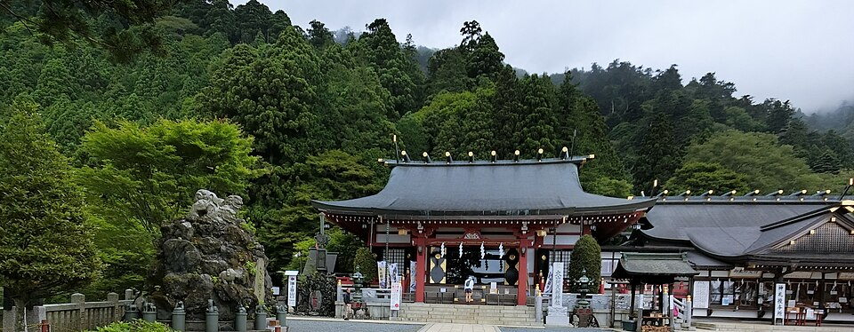</a> <a href="https://commons.wikimedia.org/wiki/File:Oyama_Cable_Car_Afuri-jinja_Station_01.jpg">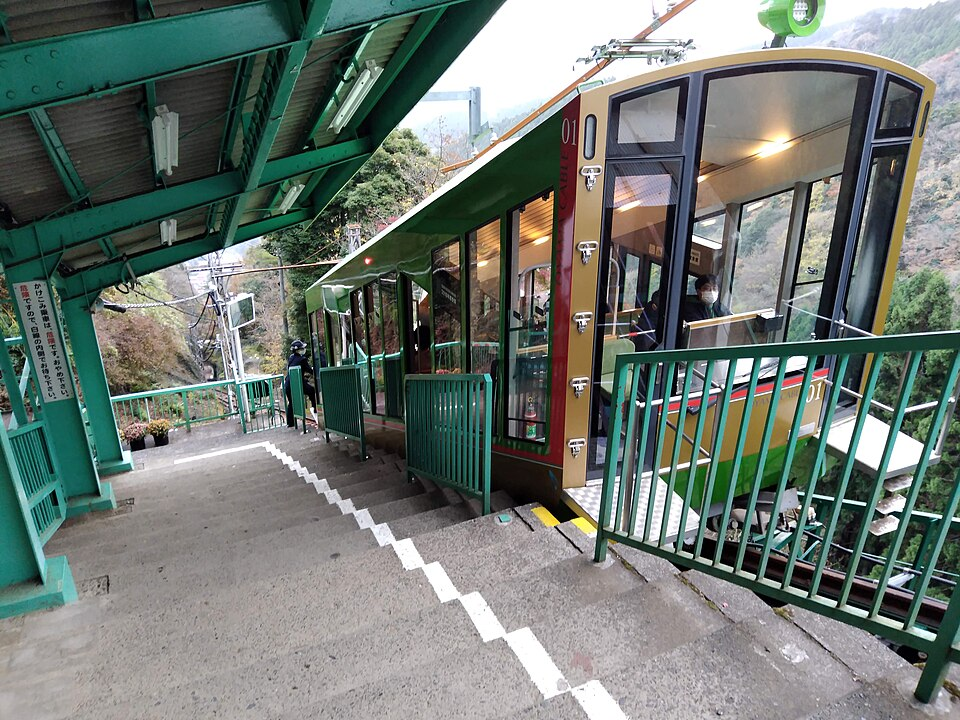</a>

*Ōyama Afuri Shrine · The Oyama cable car at Afuri-jinja station*

An alternative to Takao: a short cable car climbs to the Afuri shrine, then there's a steep hike to the summit with views over the bay and, on clear days, Fuji. Hiroshige drew Edo pilgrims climbing it, so it fits the print theme. Odakyu Line from Shinjuku to Isehara (about 1 h), then a bus to the cable car.
- **Cost:** about ¥2,900 each return (~NZ$32): train about ¥590 each way, bus about ¥310 each way, cable car about ¥1,100 return
- **Hours:** cable car about 9:00–16:30 on weekdays and 9:00–17:00 on weekends and holidays. The mountain has no closing day
- **Best / avoid:** **a weekday**, and a clear one. Weekends and holidays are busy, with long cable-car queues. Good for a Monday (19 Oct or 2 Nov). Autumn colour here usually peaks later in November, so early Nov may be a little early.

#### [Tokyo Tower](https://www.google.com/maps/search/?api=1&query=Tokyo+Tower) and [Zōjō-ji](https://www.google.com/maps/search/?api=1&query=Zojo-ji)

<a href="https://commons.wikimedia.org/wiki/File:Tokyo_Z%C5%8Dj%C5%8D-ji_Main_Hall_and_Tokyo_Tower.jpg">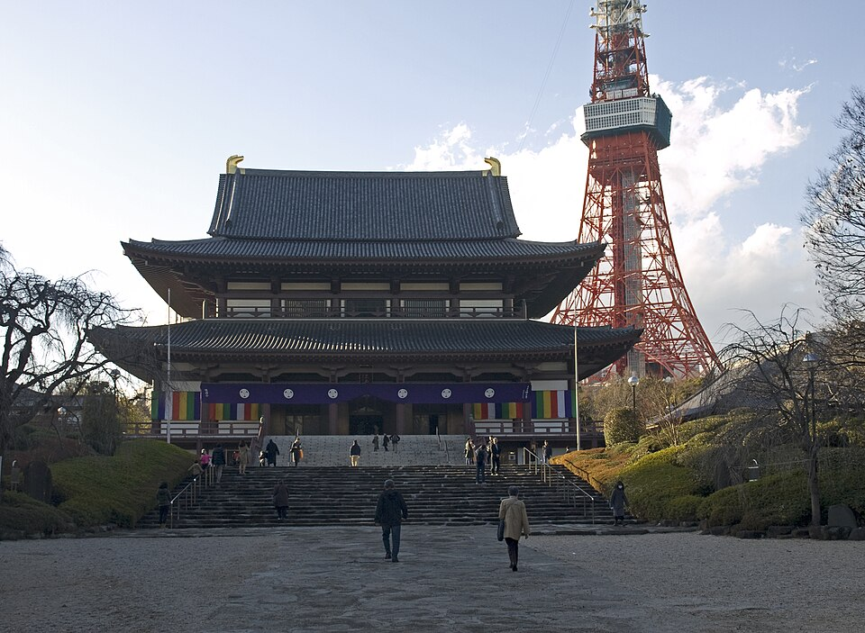</a>

*Zōjō-ji's main hall with Tokyo Tower behind*

Zōjō-ji is the Tokugawa family temple, and its big hall with the red-and-white tower behind it is one of Tokyo's classic photos. Take the picture first, then go up the tower for the city at dusk.
- **Cost:** Zōjō-ji is free. Tower main deck about ¥1,200–1,500 (~NZ$13–17); the Top Deck combined ticket about ¥3,000 (~NZ$33), a little cheaper online
- **Hours:** tower about 9:00–23:00, with last entry about 22:30 for the main deck and earlier for the Top Deck. Zōjō-ji's grounds are open in daylight
- **Best / avoid:** a **weekday late afternoon**, to catch dusk (about 17:00 late Oct, 16:45 early Nov) and the lights coming on. Avoid weekend evenings and the 3 Nov holiday, when it's busy. No closing day.

#### [Rikugien](https://www.google.com/maps/search/?api=1&query=Rikugien+Garden) or [Koishikawa Korakuen](https://www.google.com/maps/search/?api=1&query=Koishikawa+Korakuen)

<a href="https://commons.wikimedia.org/wiki/File:Rikugien_Garden_@_Komagome_(11165852244).jpg">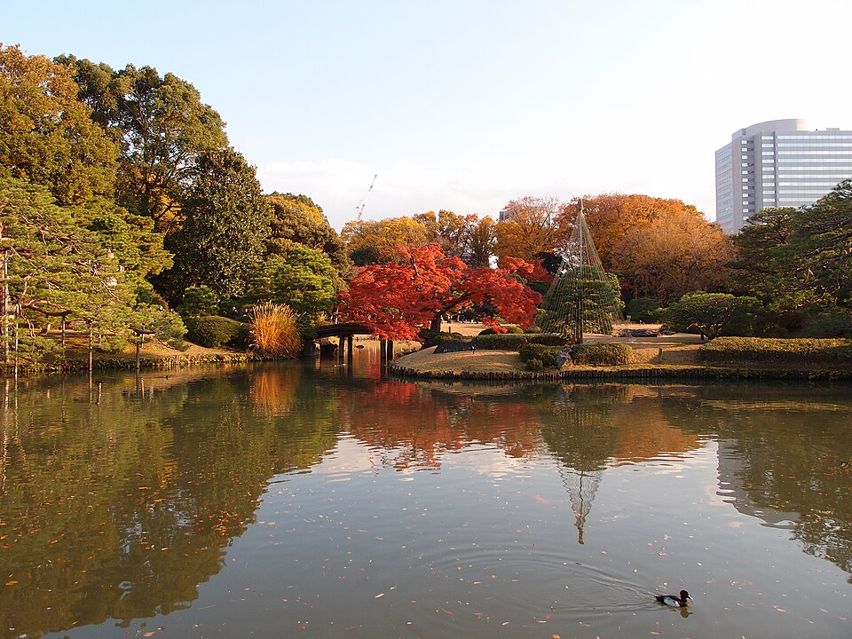</a> <a href="https://commons.wikimedia.org/wiki/File:Koishikawa_Korakuen_Gardens_(11168297536).jpg">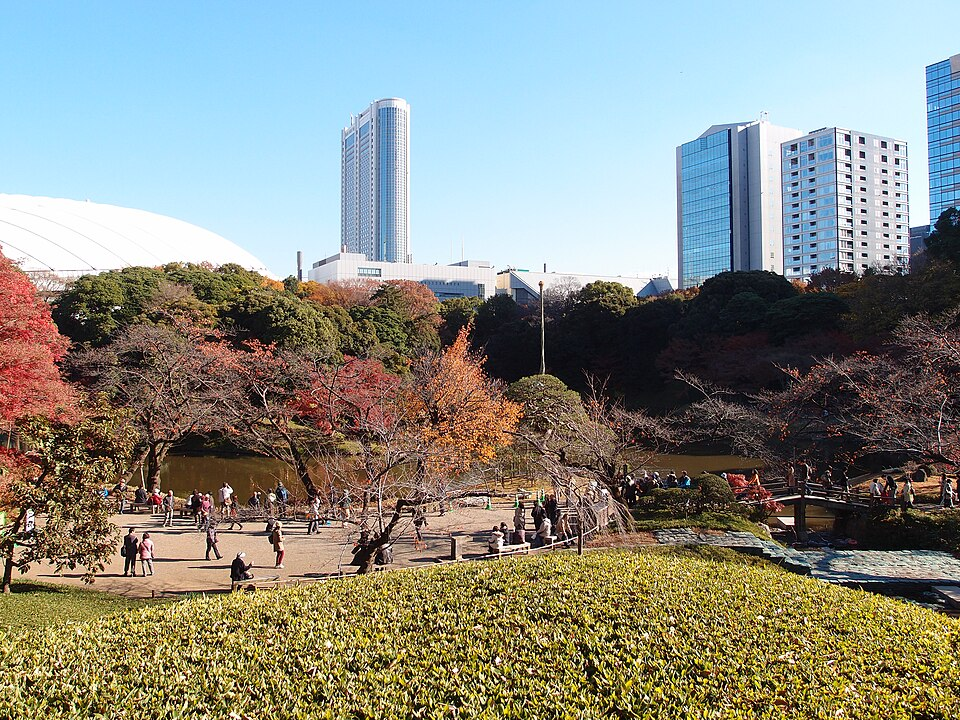</a> <a href="https://commons.wikimedia.org/wiki/File:Rikugien_Garden_(9237965732).jpg">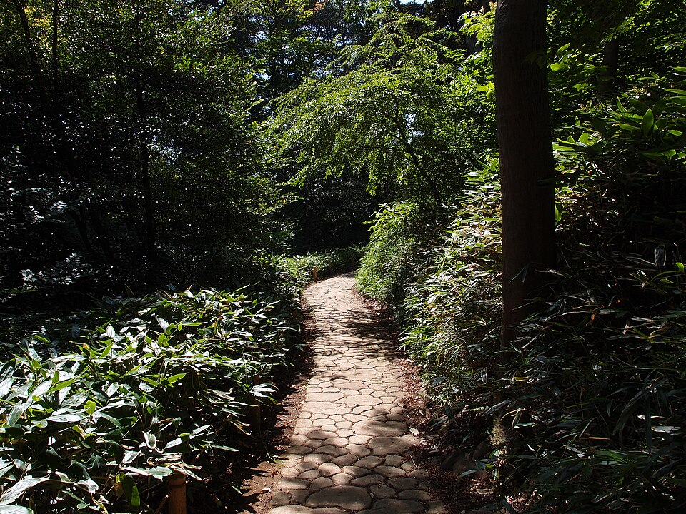</a>

*Rikugien's pond in autumn colour · Koishikawa Korakuen with the city beyond · A path in Rikugien*

Two Edo-period lords' gardens. **Rikugien** is the more beautiful, laid out to echo scenes from famous poems. **Korakuen** has a rice paddy and a round-arched Chinese-style bridge, beside the Tokyo Dome and Bunkyo Civic Centre (#5). Pick one; each takes about 1–1.5 h.
- **Cost:** ¥300 each (~NZ$3)
- **Hours:** 9:00–17:00, last entry 16:30, open every day. Rikugien's night illumination runs 25 Nov – 6 Dec, so we'll miss it
- **Best / avoid:** a **weekday morning**. Weekends are busier. Leaves usually peak late Nov – early Dec, so we'll catch only the start of colour **(check)**. Fine on a Monday.

#### [Edo-Tokyo Open Air Architectural Museum](https://www.google.com/maps/search/?api=1&query=Edo-Tokyo+Open+Air+Architectural+Museum) (Koganei)

<a href="https://commons.wikimedia.org/wiki/File:Edo-Tokyo_Open_Air_Architectural_Museum_PB252276.jpg">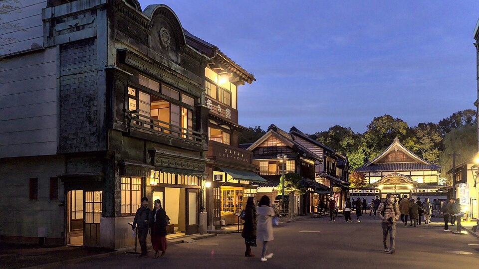</a>

*The East Zone at dusk (a summer evening event)*

Historic buildings from Edo to Showa Tokyo, saved from demolition and rebuilt in a park: merchant houses, shops, a bathhouse and a statesman's residence. You can walk inside most of them, and it's a good place for photos of old wood and light.
- **Cost:** ¥400 (~NZ$4.50)
- **Hours:** 9:30–16:30 from October to March, last entry 16:00. **Closed Mondays** (Tuesday if the Monday is a holiday)
- **Best / avoid:** **Tuesday to Friday**. **Avoid Mondays** (19 Oct, 2 Nov). Go in the morning: it closes early, and dusk is about 16:50.

### ☔ Wet weather

#### [Ōta Memorial Museum of Art](https://maps.google.com/?cid=528350391604663209) (Harajuku, near base)

<a href="https://commons.wikimedia.org/wiki/File:Ota-Memorial-Museum-Harajuku-01.jpg">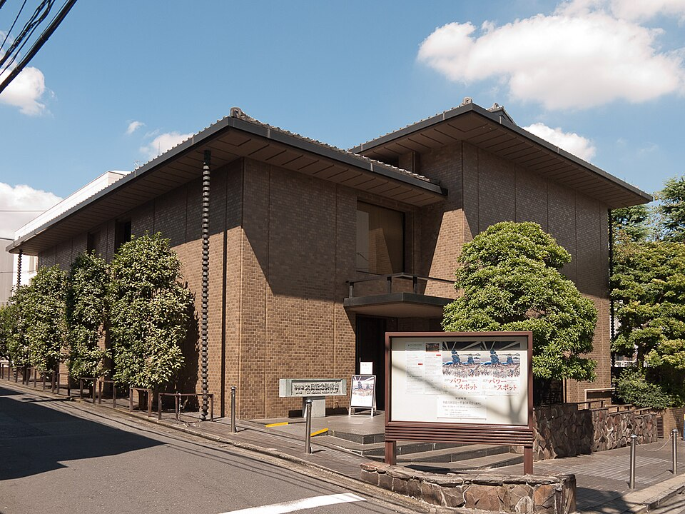</a>

*The Ōta Memorial Museum of Art, Harajuku*

A small, calm museum of ukiyo-e, built around one of the great private collections. Its current show on Hokusai's daughter Ōi and night scenes is the one a photographer will like (see *Where to see the real thing* in the [ukiyo-e guide](ukiyo-e.md)).
- **Cost:** ¥1,200 (~NZ$14). **Cash only**
- **Hours:** 10:30–17:30, last entry 17:00. **Closed Mondays**, and closed 4–6 Nov for the changeover
- **Best / avoid:** any day except Mondays and 4–6 Nov. About 20 min walk from base, or one stop on the Chiyoda Line. A perfect wet hour.

#### [Yasukuni Shrine](https://maps.google.com/?cid=13107538590517743248) and the Yushukan war museum ([Zero fighter](https://maps.google.com/?cid=16503706424972160210))

<a href="https://commons.wikimedia.org/wiki/File:Yushukan_Museum_@_Yasukuni_shrine_(9116510174).jpg">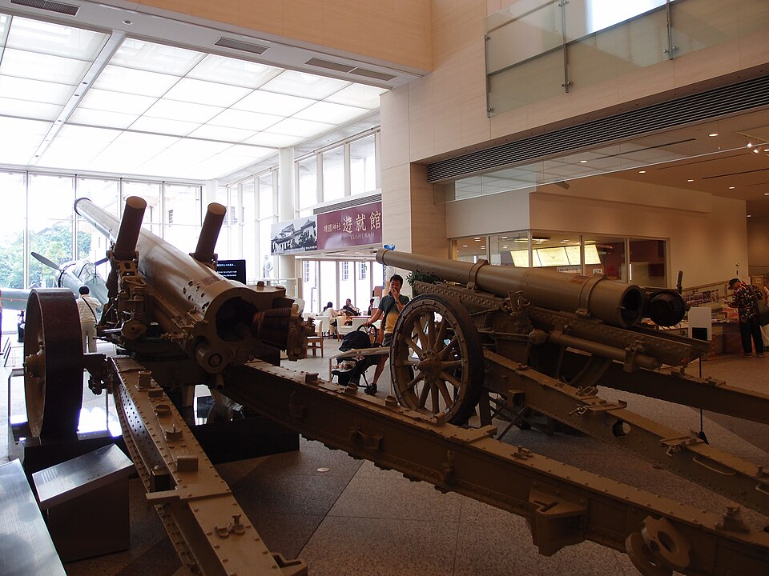</a> <a href="https://commons.wikimedia.org/wiki/File:Mitsubishi_Type_O_(Zero)_Fighter_-_Museum_Entrance_Hall_-_Yasukuni_Shrine_-_Tokyo_-_Japan_-_01_(47907347511).jpg">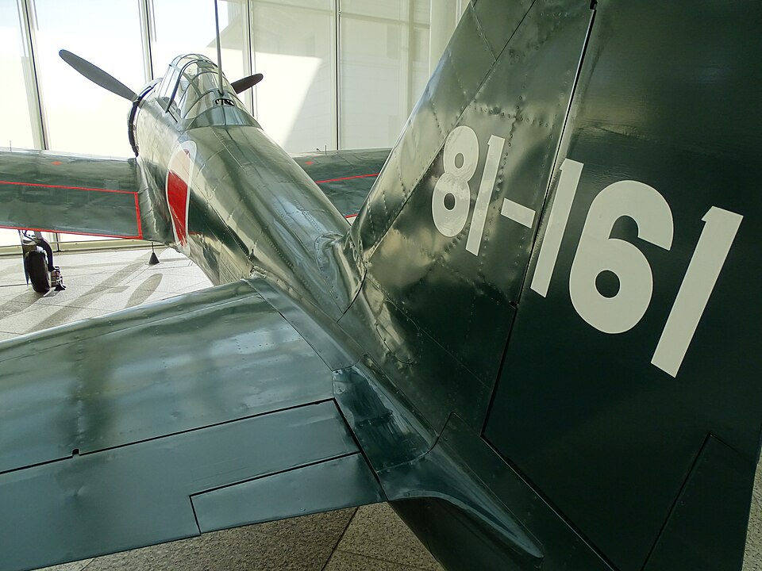</a>

*The Yushukan's entrance hall · A Mitsubishi Zero fighter in the Yushukan*

A large Shinto shrine to Japan's war dead, with a museum of wartime objects that includes a Zero fighter, a locomotive and kamikaze items. It's a **contested** place (it also honours convicted war criminals, and the museum tells the war from the shrine's own point of view), so go with that context in mind.
- **Cost:** the shrine is free; the Yushukan about ¥800–1,000 (~NZ$9–11) **(check)**
- **Hours:** shrine in daylight hours; the museum about 9:00–16:30 (some sources say 17:00) **(check)**
- **Best / avoid:** open every day. A **weekday** is calmer. The shrine's autumn festival is around 17–20 Oct **(check)**, with stalls and crowds.

#### [National Museum of Japanese History](https://maps.google.com/?cid=1807054994798992362) (Sakura, Chiba)

<a href="https://commons.wikimedia.org/wiki/File:National_Museum_of_Japanese_History_2008.jpg">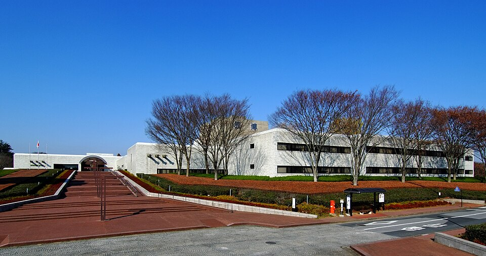</a> <a href="https://commons.wikimedia.org/wiki/File:Haramaki_at_National_Museum_of_Japanese_History.jpg">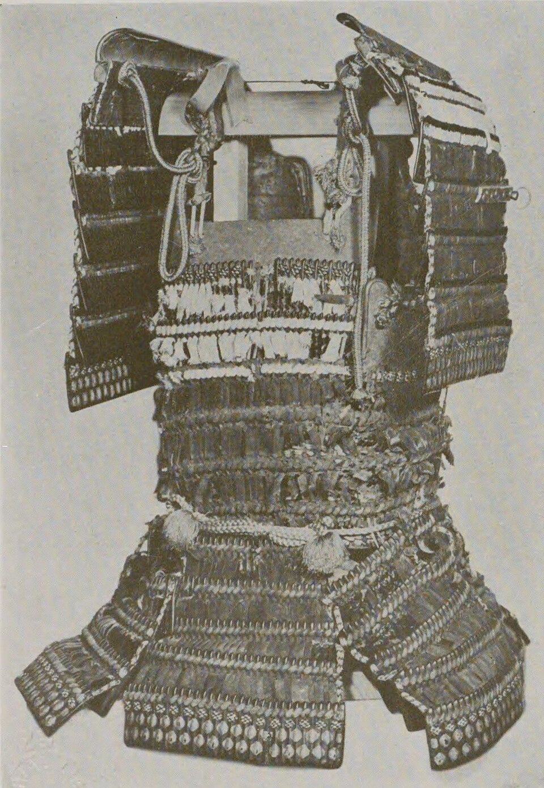</a>

*The National Museum of Japanese History, Sakura · A samurai haramaki (armour) of the Nanbokucho period*

A huge national museum that tells Japan's story from the earliest times to modern life, with life-size models and many samurai-era objects. Sakura also has a preserved samurai street. A day trip: about 50 min by Keisei express from Keisei-Ueno, then a 15 min walk **(check)**.
- **Cost:** about ¥600–900 (~NZ$7–10); listings disagree **(check)**
- **Hours:** 9:30–16:30 (Oct–Feb), last entry about 16:00. **Closed Mondays** (Tuesday if the Monday is a holiday)
- **Best / avoid:** **Tuesday to Friday**. **Avoid Mondays** (19 Oct, 2 Nov). Allow a full day with the travel.

#### [Yayoi Kusama Museum](https://maps.google.com/?cid=3362489232406186726) and [Jōrin-ji](https://maps.google.com/?cid=11436131296302717075) (Bentencho, Shinjuku)

<a href="https://commons.wikimedia.org/wiki/File:YAYOI_KUSAMA_MUSEUM_%E8%8D%89%E9%96%93%E5%BD%8C%E7%94%9F%E7%BE%8E%E8%A1%93%E9%A4%A82018frontCIMG3591.jpg">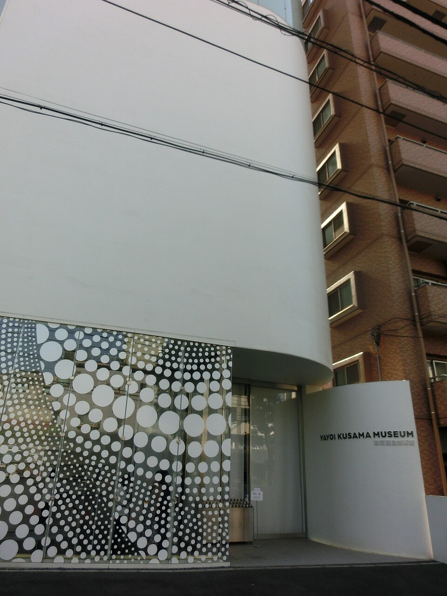</a>

*The Yayoi Kusama Museum's entrance*

A small museum of the dotted, mirrored art of Japan's best-known living artist, in a building of stacked cubes. Entry is by **timed ticket only**, about 90 min, for 200 visitors a day. Next door, the small **Jōrin-ji** temple is a ten-minute add-on **(I couldn't confirm details)**.
- **Cost:** about ¥1,100 (~NZ$12) **(check)**. The temple is free
- **Hours:** 11:00–17:30, **Thursday to Sunday and national holidays only**. Online tickets only; sales open on the 1st of a month at 10:00, so check the museum's site now, because **many slots may already be gone** **(check)**
- **Best / avoid:** **Thu–Sun** or Tue 3 Nov (holiday). **Closed Monday to Wednesday.** Our open dates: 15–18 Oct, 24–25 Oct, 31 Oct–1 Nov, 3 Nov and 5–8 Nov. Waseda station (Tozai Line) is 7 min away.

#### [teamLab Borderless](https://maps.google.com/?cid=6355049266444838481) (Azabudai Hills, Mori Building)

<a href="https://commons.wikimedia.org/wiki/File:TeamLab_Borderless_Azabudai_Hills.jpg">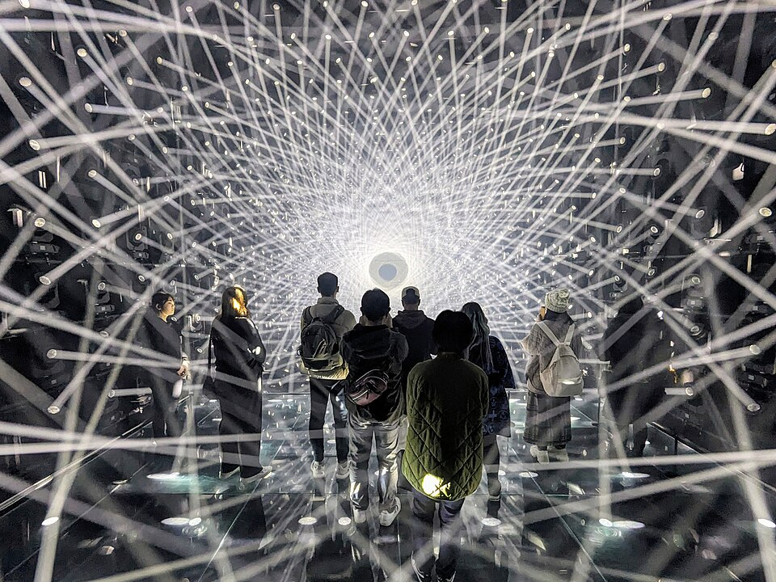</a>

*Visitors in a light sculpture at teamLab Borderless, Azabudai Hills*

A big, borderless digital art museum where light and images flow from room to room and over the visitors. It's a photographer's playground, but check the rules on tripods and flash **(check)**.
- **Cost:** about ¥3,400–4,000 (~NZ$37–44) each. **Dynamic pricing** makes weekdays cheaper **(check)**
- **Hours:** about 10:00–19:00 on weekdays and longer on weekends (sources disagree; last entry about an hour before closing) **(check)**. Timed tickets, so **book ahead**
- **Best / avoid:** a **weekday morning**. **Avoid weekends**, evenings and 3 Nov, when slots sell out and prices rise.

#### [Art Aquarium Museum](https://maps.google.com/?cid=15689961400037075470) (Ginza)

<a href="https://commons.wikimedia.org/wiki/File:Tokyo_Goldfish_exhibition_(33039883398).jpg">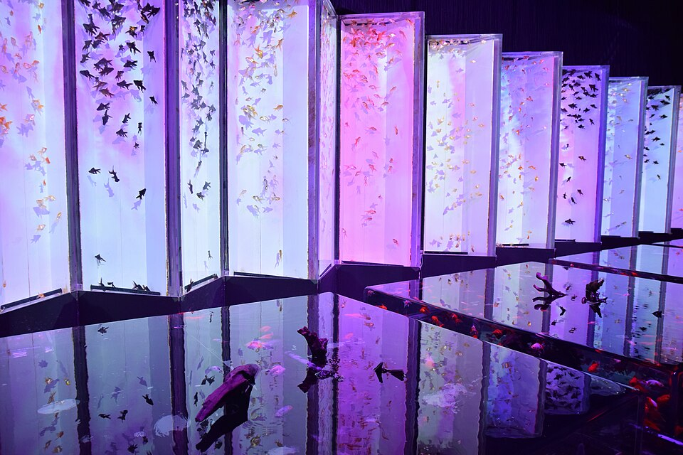</a>

*Art Aquarium's goldfish displays (an earlier showing)*

Goldfish swimming in large lit tanks, with music and light changing around them. It's a short, pretty visit on the 9th floor of the Ginza Mitsukoshi New Building, connected to Ginza Station (Exit 7). Check whether photography has restrictions **(check)**.
- **Cost:** about ¥2,300 online, ¥2,400 at the door (~NZ$25–26)
- **Hours:** about 10:00–19:00 daily, last entry about 18:00–18:30 **(check)**
- **Best / avoid:** a **weekday daytime**. Weekends and evenings are busiest. No closing day.

#### [Shōtō Museum of Art](https://maps.google.com/?cid=13122427293131002926) (very near base)

<a href="https://commons.wikimedia.org/wiki/File:Shoto_Museum_of_Art_2010.jpg">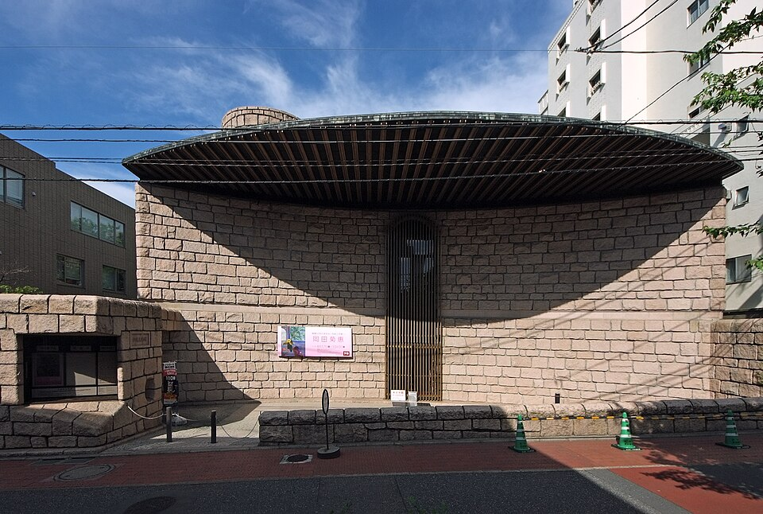</a>

*The Shoto Museum of Art's stone-clad building*

A small public art museum in a striking 1981 concrete-and-stone building by the architect Seiichi Shirai, a short walk from base. The current show, *Rojō [shared ground]*, runs to 23 Nov.
- **Cost:** about ¥1,000 (~NZ$11), the last price I could confirm **(check)**
- **Hours:** 10:00–18:00 **(check)**. **Closed Mondays**
- **Best / avoid:** any day except **Mondays** (19 Oct, 2 Nov). Quiet on weekdays. A short, easy wet-weather hour.

#### [Komaba Museum](https://maps.google.com/?cid=9502128701029406267) (University of Tokyo, Komaba)

<a href="https://commons.wikimedia.org/wiki/File:University_of_Tokyo_-_Komaba_Campus_-_Building_1.JPG">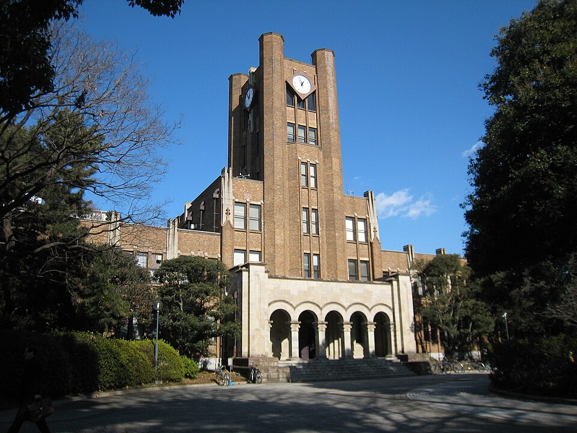</a>

*Building 1 on the University of Tokyo's Komaba campus*

A free university museum with changing exhibitions on the Komaba campus. It's two stops from Shibuya on the Keio Inokashira Line, then 3 min from Komaba-todaimae. Look at what's on first, because the shows change.
- **Cost:** free
- **Hours:** 10:00–18:00, last entry 17:30 (some listings say 17:00) **(check)**
- **Best / avoid:** **Wednesday to Sunday** are safest: the official notes say it's **closed Tuesdays**, and closing days can vary by exhibition, so check the exhibition page. Weekdays are quiet.

#### [PARCO Museum](https://maps.google.com/?cid=869598732706709672) (Shibuya PARCO, 4F)

<a href="https://commons.wikimedia.org/wiki/File:Shibuya_Parco_2.jpg">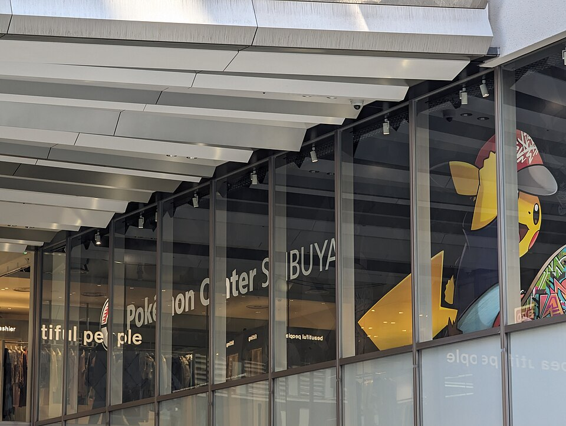</a>

*Shibuya PARCO, home of the PARCO Museum*

A small gallery on the 4th floor of the Shibuya PARCO store, with changing shows of pop culture, design and contemporary art. The show during our stay is MES's *RE-I*, from 24 Oct to 16 Nov **(check)**. A short walk from base.
- **Cost:** free or about ¥500 (~NZ$5.50), depending on the show **(check)**
- **Hours:** about 11:00–21:00 (earlier on a show's last day) **(check)**
- **Best / avoid:** any day, with no weekly closing. A **weekday daytime** is quieter. Weekend afternoons are crowded.

#### [Setagaya Art Museum](https://www.google.com/maps/search/?api=1&query=Setagaya+Art+Museum) (Kinuta Park)

<a href="https://commons.wikimedia.org/wiki/File:Setagaya_Art_Museum.jpg">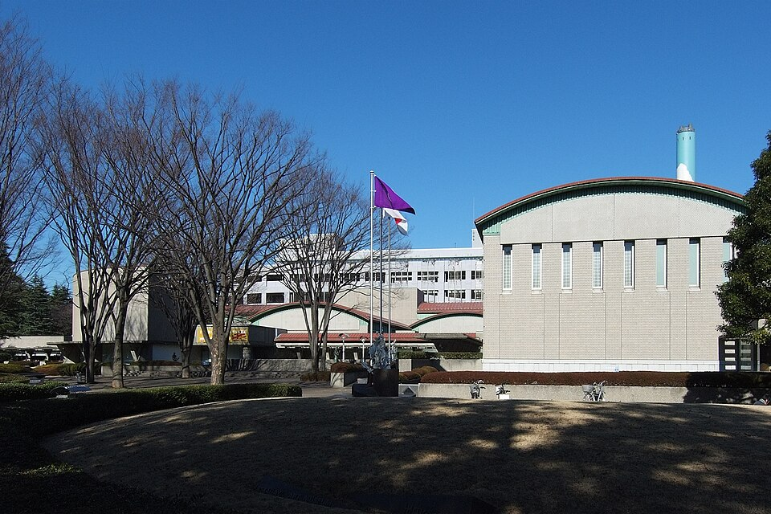</a>

*Setagaya Art Museum, in Kinuta Park*

A modern art museum in Kinuta Park with a café, good for a gallery visit and then a walk in the park, which has a wide lawn and tall trees. I couldn't find the autumn show, so check what's on. Den-en-toshi Line to Yoga, then about 15 min walk.
- **Cost:** depends on the show, usually about ¥1,000–1,500 (~NZ$11–17) **(check)**
- **Hours:** 10:00–18:00 **(check)**. **Closed Mondays**
- **Best / avoid:** **Tuesday to Sunday**. **Avoid Mondays** (19 Oct, 2 Nov). A weekday keeps the park quiet.

#### [Yodobashi Fujisawa Camera Museum](https://maps.google.com/?cid=4645273803720285934) (Fujisawa)

A private museum of historic cameras run by the Yodobashi store, in Fujisawa, where the Enoden line to Kamakura starts, so it can fit around the Kamakura day (#1) **(check the location)**. I couldn't find a photo of it that's free to use. **No photography inside.**
- **Cost:** about ¥3,000 for adults (~NZ$33), from the museum's own page. Book online at least a day ahead for a guaranteed slot
- **Hours:** 10:00–18:00, last entry 17:00. Closed only over the year-end and New Year
- **Best / avoid:** a **weekday**, when you can still get in on the day. Weekends are busier.

#### [Showa Era Lifestyle Museum](https://maps.google.com/?cid=13899841542931401837) (Minamikugahara, Ota)

<a href="https://commons.wikimedia.org/wiki/File:Showa_no_kurashi_museum_ota_2014.jpg">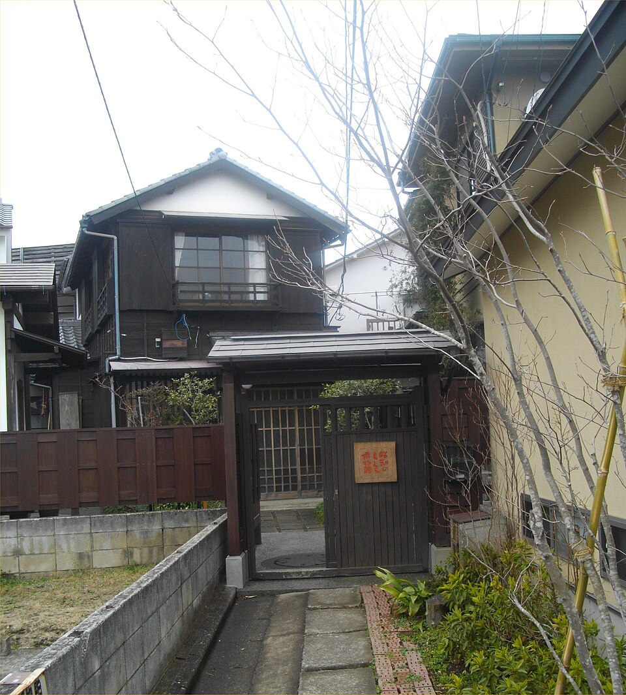</a>

*The Showa Era Lifestyle Museum, a 1951 family home*

A real 1951 family house kept as it was, with its furniture, kitchen and everyday objects, so you can see a mid-century Tokyo home. It's tiny and quiet, and it's an eight-minute walk from Kugahara Station on the Tokyu Ikegami Line.
- **Cost:** about ¥500 (~NZ$5.50) **(check)**
- **Hours:** 10:00–17:00, **open Friday to Sunday only** **(check)**
- **Best / avoid:** **Fri, Sat or Sun only**: 16–18 Oct, 24–25 Oct, 31 Oct–1 Nov, 6–8 Nov. **Closed Monday to Thursday.** Quiet even on weekends.

#### [Tokorozawa Aviation Memorial Park](https://maps.google.com/?cid=10289274659213424480)

<a href="https://commons.wikimedia.org/wiki/File:Tokorozawa_Aviation_Commemorative_Park.jpg">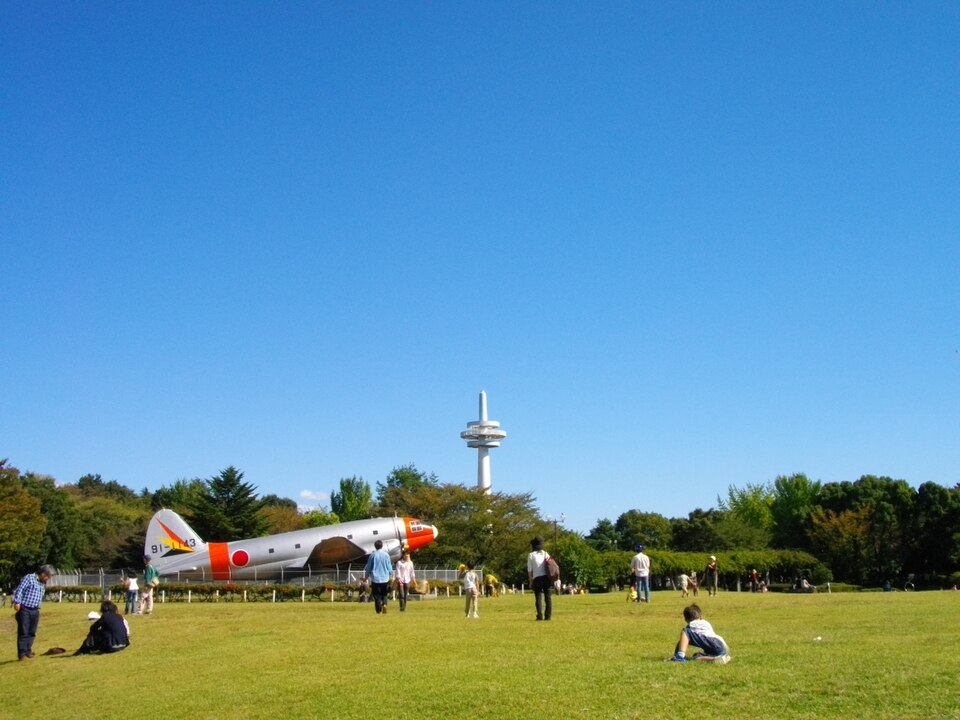</a>

*An aircraft on display in Tokorozawa Aviation Memorial Park*

Japan's first airfield became a park with a museum of aviation history and a big lawn with aircraft on show. It's on the Seibu line out of Shinjuku, about 40 min **(check)**, so it may pair with Kawagoe (#11) on the same day.
- **Cost:** the park is free; the museum about ¥510 (~NZ$6) **(check)**
- **Hours:** 9:30–17:00, last entry 16:30. **Closed Mondays** (Tuesday if the Monday is a holiday)
- **Best / avoid:** **Tuesday to Sunday**. **Avoid Mondays** (19 Oct, 2 Nov). Weekends are busy with families.

#### [Aviation Shrine (Koku Jinja)](https://maps.google.com/?cid=11703968861367015555)

<a href="https://commons.wikimedia.org/wiki/File:20240414_Kokujinjya.jpg">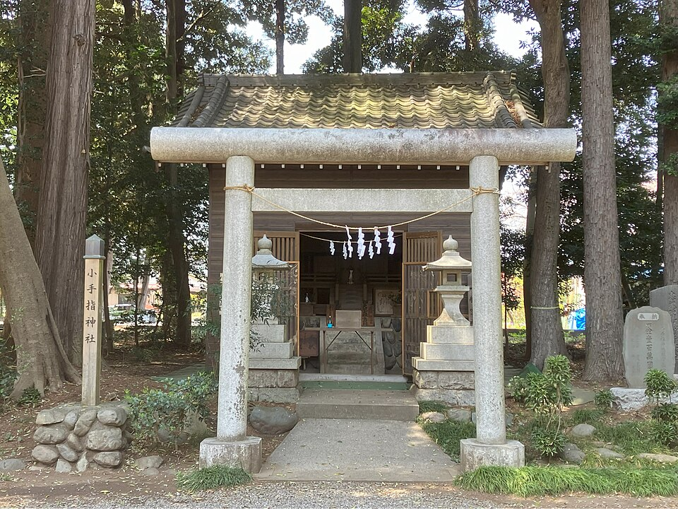</a>

*The Aviation Shrine (Koku Jinja)*

A small shrine to aviators who died in flight, which I understand is near the Tokorozawa Aviation Park. It's a quick stop on the same trip. I couldn't confirm the exact location or hours **(check)**.
- **Cost:** free
- **Hours:** a shrine, so open in daylight; the office may keep shorter hours **(check)**
- **Best / avoid:** any day. Combine with the park above and avoid Monday, when the museum is shut.

#### [Samurai Restaurant show](https://maps.google.com/?cid=3294564358368833700) (Kabukicho, Shinjuku)

A loud, costume-heavy show of samurai, dancers and drummers, with drinks or a light meal. It's touristy, but it's an easy fun hour, and the venue only admits adults. Listings show **daytime sessions** (about 10:30, 13:30 and 16:00), not only evening **(check)**.
- **Cost:** about US$55–77 (~NZ$90–125) each on resale sites, with two drinks **(check the venue's own price)**. Extra food and drink are often cash only
- **Hours:** sessions run about 1 h 40 min to 2 h 10 min **(check)**
- **Best / avoid:** any day. A **weekday daytime** is easiest. Book ahead for weekends. Pairs with Shinjuku Gyoen or the Metropolitan Government Building (#5).

### Too big for a day trip

Moved here from the main list: Hakone is more than a day trip. Avoid weekends.

#### Hakone: the old Tokaido road and Lake Ashi 📷🏛🥾🏞📜

  

*Lake Ashi with Fuji, and Hakone Shrine's torii on the shore · Amazake-chaya, the thatched teahouse on the old Tokaido road · Hiroshige, Hakone (Fifty-three Stations of the Tokaido)*

- **[Old Tokaido road](https://www.google.com/maps/search/?api=1&query=Old+Tokaido+Road+Hakone+stone+pavement)**: the best-preserved stretch of the Edo-period highway between Edo and Kyoto, with original stone paving under cedars. Walk **Hatajuku → Moto-Hakone (75–100 min)**, mostly uphill, or the reverse, mostly downhill.
- **[Amazake-chaya](https://www.google.com/maps/search/?api=1&query=Amazake-chaya+Hakone)**: a thatched teahouse that has served travellers on this road for over 350 years. Have amazake and mochi there.
- **[Hakone Checkpoint (Sekisho)](https://www.google.com/maps/search/?api=1&query=Hakone+Sekisho)**: a reconstruction of the Edo checkpoint where travellers' papers were inspected. It's on the lakeshore, next to the old **cedar avenue**.
- **[Lake Ashi](https://maps.google.com/?cid=5294609115739185867)** and the **[Hakone Shrine lakeside torii](https://www.google.com/maps/search/?api=1&query=Hakone+Shrine+Torii+of+Peace)**: Fuji over the lake on clear days.
- 📜 **History link:** Hiroshige's *Fifty-three Stations of the Tokaido* has a Hakone print. The road we'd walk is the road in those prints.
- **Getting there:** prices are approximate **(check)**. Train is the easier option.
  - **By train (recommended):** buy the Odakyu *Hakone Freepass* (2-day, from Shinjuku) for ¥7,100 (~NZ$78) each. It covers the train to Hakone and back, the local buses, the lake boat and the ropeway. The **Romancecar** limited express from Shinjuku to Hakone-Yumoto takes about 85 min and costs an extra ¥1,200 (~NZ$13) each way for a reserved seat. Book it ahead. It's then about 20 min by bus to Hatajuku. Allow about 2 h door to door. **For two: about ¥19,000 (~NZ$209)** with the Romancecar both ways, or ¥14,200 (~NZ$156) on ordinary expresses, which take about 2 h to Hakone-Yumoto with a change at Odawara.
  - **By car:** about 90 km, **1.5–2 h each way** by the Tomei Expressway and the Odawara-Atsugi Road. Expect much longer on weekends and in autumn-colour traffic. Costs: tolls about ¥2,500–4,000 each way, fuel about ¥3,000 and parking about ¥1,000–2,000. **For the car: about ¥9,000–13,000 (~NZ$100–145)**, and the lake boat (about ¥1,200, ~NZ$13 each one way) and ropeway are extra. You need an International Driving Permit (from the AA) with your NZ licence. A car also fits badly with the one-way old-road walk, because you have to come back to it.
- **Time:** a very long day. Leave early, or better, stay a night.

### Too far for a day trip (need overnights, so probably not this trip)
[Matsumoto Castle](https://maps.google.com/?cid=10388975450222032468) · [Takayama](https://maps.google.com/?cid=15344603428797604828) and [Hida Folk Village](https://maps.google.com/?cid=15466683148941065284) · [Shinhotaka Ropeway](https://maps.google.com/?cid=15656747577072557457) · [Shirakawa-go](https://maps.google.com/?cid=14755289620389823992) · [Kanazawa](https://maps.google.com/?cid=10228050530913903125) · [Magome](https://maps.google.com/?cid=9040534682970691322) and the Nakasendo walk
