# Tokyo: activity groups (clean list)

**Key:** ☀️ fine-weather group · ☔ wet-weather group (works in rain) · 📷 photography · 🏛 history/museum · 🥾 walk · 🏞 views · 📜 link to a historic print or painting
Every group here is **top** priority. Backups are at the bottom. Place names link to Google Maps.
Background reading: [Ukiyo-e landscape prints, their viewpoints and where to see them](ukiyo-e.md).
Photos (tap one for its source) are from Wikimedia Commons; see [photo credits](photos/CREDITS.md).
NZ$ prices are approximate, at ¥1,000 ≈ NZ$11 (rate on 9 Oct 2026).

**Day-of-week traps:**
- Most museums and gardens close on **Mondays** (Tokyo Mondays: 19 Oct, 2 Nov). Use Mondays for hikes and day trips.
- Avoid Kamakura and Hakone on weekends (24–25 Oct, 31 Oct–1 Nov, 7–8 Nov) if possible.
- **3 Nov (Tue) is Culture Day**, a public holiday: busy everywhere, and some museums are free.

---

## ☀️ Fine-weather groups

### 1. Kamakura and the Shonan coast (day trip) 📷🏛🥾🏞📜

<a href="https://commons.wikimedia.org/wiki/File:Kamakura-Japon00050.JPG">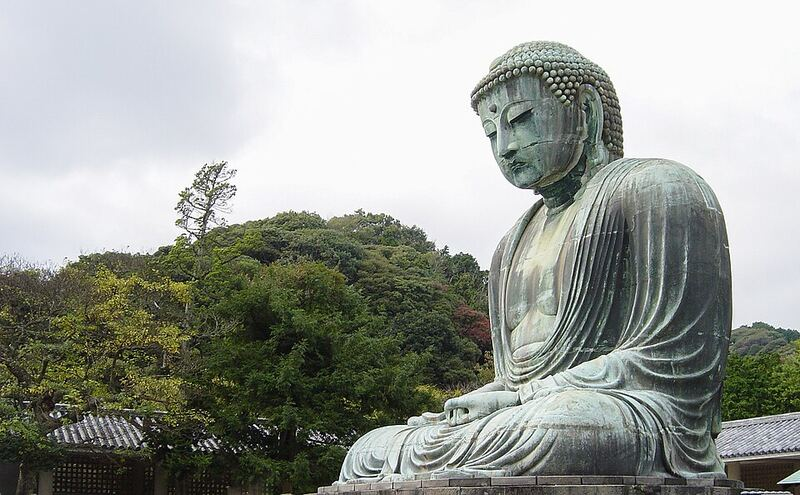</a> <a href="https://commons.wikimedia.org/wiki/File:Jiz%C5%8D_statues,_Hase-dera_Temple,_Kamakura,_Japan;_2014.jpg">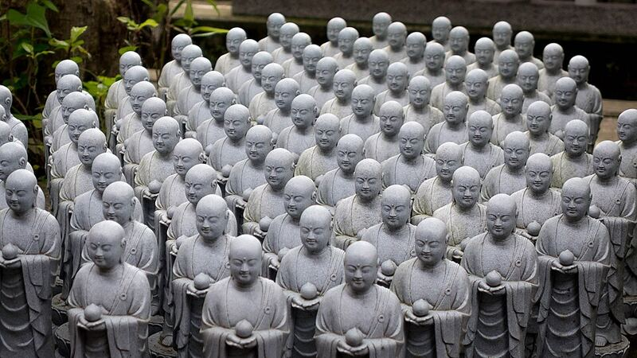</a> <a href="https://commons.wikimedia.org/wiki/File:Shichiri_beach_in_Sagami_province.jpg">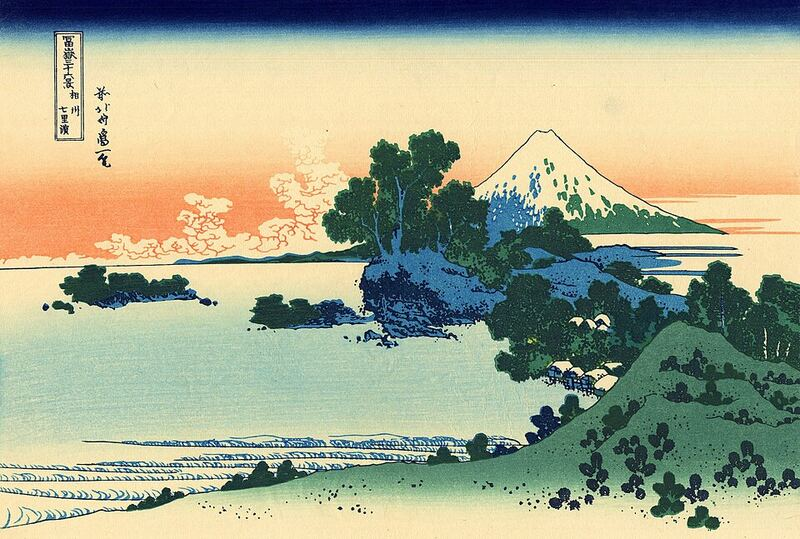</a>

*Kamakura's Great Buddha, outdoors since the 1490s · Hase-dera's rows of small jizo statues · Hokusai, Shichiri Beach in Sagami Province*

- **[Great Buddha (Kotoku-in)](https://www.google.com/maps/search/?api=1&query=Kotoku-in+Great+Buddha+Kamakura)**: a 13th-century bronze Buddha, sitting outdoors since the hall around it was washed away in the late 1400s.
- **[Hase-dera](https://www.google.com/maps/search/?api=1&query=Hase-dera+Kamakura)**: a hillside temple with sea views, 5 minutes' walk from the Buddha.
- **[Daibutsu hiking course](https://www.google.com/maps/search/?api=1&query=Daibutsu+Hiking+Course+Kamakura)**: a wooded ridge trail from the Buddha to Kita-Kamakura, about 1.5 h, easy to moderate. It finishes near Engaku-ji and Kencho-ji, two of Kamakura's great Zen temples (pick one).
- **[Tsurugaoka Hachimangu](https://www.google.com/maps/search/?api=1&query=Tsurugaoka+Hachimangu)**: the shrine of the shoguns who ruled from Kamakura in the 1100s–1300s.
- 📜 **History link:** Hokusai's *Shichiri Beach in Sagami Province* (Thirty-six Views of Mt Fuji) shows Fuji across the bay. Stand on **[Shichirigahama beach](https://www.google.com/maps/search/?api=1&query=Shichirigahama+Beach)** (Enoden line) to see the same view, best on a clear afternoon. Hokusai's *Enoshima* print is a stop further along.
- **Getting there:** Odakyu *Enoshima-Kamakura Freepass* from Shinjuku. The Odakyu Line runs right by the base **(check price)**. Starting at [Kamakura Station](https://maps.google.com/?cid=10126820322969569051).
- **Time:** full day, on a weekday.

### 2. Hakone: the old Tokaido road and Lake Ashi (day trip) 📷🏛🥾🏞📜

<a href="https://commons.wikimedia.org/wiki/File:Lake_Ashi_%26_Mt_Fuji_%26_Hakone_Shrine.jpg">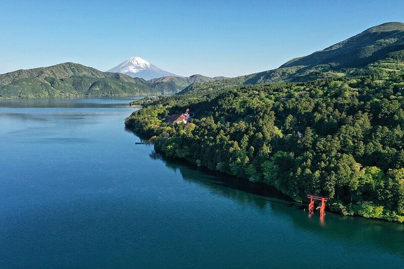</a> <a href="https://commons.wikimedia.org/wiki/File:Amazake-cyaya_01.jpg">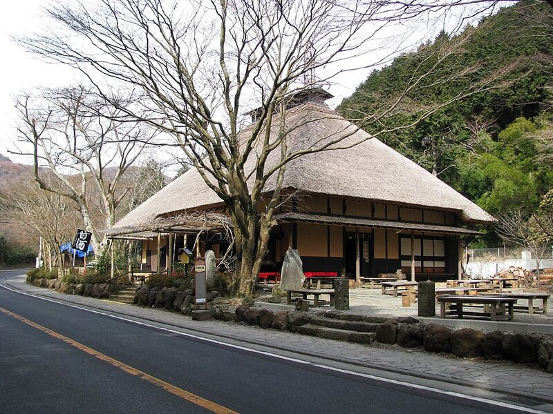</a> <a href="https://commons.wikimedia.org/wiki/File:Hakone_No._11._Hakone_one_of_the_fifty-three_noted_places_on_Tokaido._Painted_by_Hiroshige_(titel_op_object)_De_T%C3%B4kaid%C3%B4_van_Hiroshige_(serietitel)_Hiroshige_no_fude_T%C3%B4kaid%C3%B4_(serietitel_op_object),_RP-P-2010-310-95-11.jpg">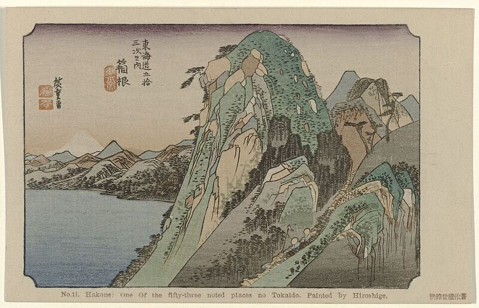</a>

*Lake Ashi with Fuji, and Hakone Shrine's torii on the shore · Amazake-chaya, the thatched teahouse on the old Tokaido road · Hiroshige, Hakone (Fifty-three Stations of the Tokaido)*

- **[Old Tokaido road](https://www.google.com/maps/search/?api=1&query=Old+Tokaido+Road+Hakone+stone+pavement)**: the best-preserved stretch of the Edo-period highway between Edo and Kyoto, with original stone paving under cedars. Walk **Hatajuku → Moto-Hakone (75–100 min)**, mostly uphill, or the reverse, mostly downhill.
- **[Amazake-chaya](https://www.google.com/maps/search/?api=1&query=Amazake-chaya+Hakone)**: a thatched teahouse that has served travellers on this road for over 350 years. Have amazake and mochi there.
- **[Hakone Checkpoint (Sekisho)](https://www.google.com/maps/search/?api=1&query=Hakone+Sekisho)**: a reconstruction of the Edo checkpoint where travellers' papers were inspected. It's on the lakeshore, next to the old **cedar avenue**.
- **[Lake Ashi](https://maps.google.com/?cid=5294609115739185867)** and the **[Hakone Shrine lakeside torii](https://www.google.com/maps/search/?api=1&query=Hakone+Shrine+Torii+of+Peace)**: Fuji over the lake on clear days.
- 📜 **History link:** Hiroshige's *Fifty-three Stations of the Tokaido* has a Hakone print. The road we'd walk is the road in those prints.
- **Getting there:** prices are approximate **(check)**. Train is the easier option.
  - **By train (recommended):** buy the Odakyu *Hakone Freepass* (2-day, from Shinjuku) for ¥7,100 (~NZ$78) each. It covers the train to Hakone and back, the local buses, the lake boat and the ropeway. The **Romancecar** limited express from Shinjuku to Hakone-Yumoto takes about 85 min and costs an extra ¥1,200 (~NZ$13) each way for a reserved seat. Book it ahead. It's then about 20 min by bus to Hatajuku. Allow about 2 h door to door. **For two: about ¥19,000 (~NZ$209)** with the Romancecar both ways, or ¥14,200 (~NZ$156) on ordinary expresses, which take about 2 h to Hakone-Yumoto with a change at Odawara.
  - **By car:** about 90 km, **1.5–2 h each way** by the Tomei Expressway and the Odawara-Atsugi Road. Expect much longer on weekends and in autumn-colour traffic. Costs: rental car about ¥8,000–12,000 a day, tolls about ¥2,500–4,000 each way, fuel about ¥3,000 and parking about ¥1,000–2,000. **For the car: about ¥18,000–25,000 (~NZ$200–275)**, and the lake boat (about ¥1,200, ~NZ$13 each one way) and ropeway are extra. You need an International Driving Permit (from the AA) with your NZ licence. A car also fits badly with the one-way old-road walk, because you have to come back to it.
- **Time:** long full day. Leave early.

### 3. Mt Takao (day trip) 🥾🏞📷

<a href="https://commons.wikimedia.org/wiki/File:Views_of_Mt_Fuji_from_near_the_summit_of_Mt_Takao..jpg">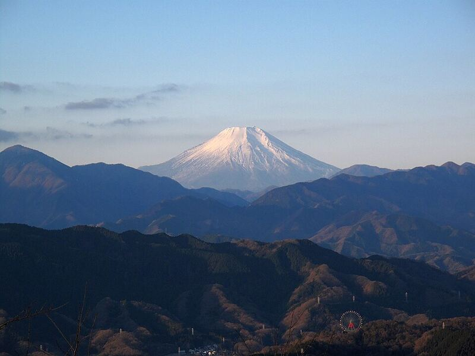</a> <a href="https://commons.wikimedia.org/wiki/File:Tengu_@_Shinto_shrine_@_Mount_Takao_(9876464715).jpg">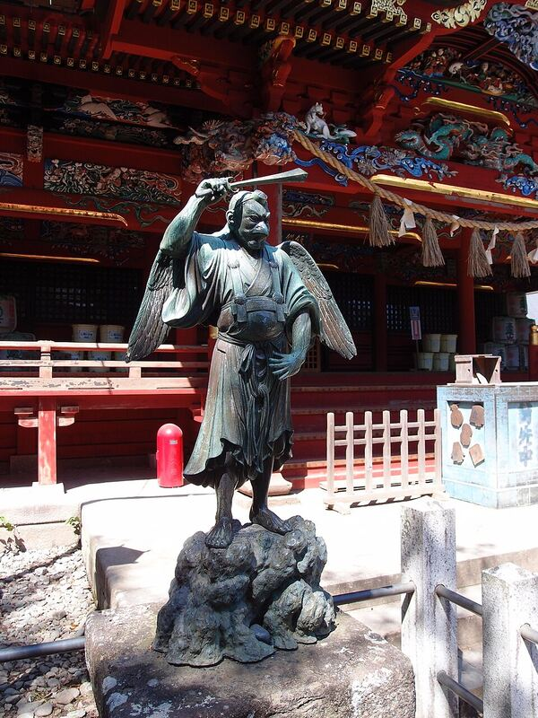</a>

*Fuji from Mt Takao's summit · A tengu guardian at Yakuo-in*

- **[Mount Takao](https://maps.google.com/?cid=14341444200467673055)**: Tokyo's favourite hiking mountain. Walk up Trail 1 (paved) or Trail 6 (a stream path), about 1.5–2 h, or take the cable car (about ¥500 (~NZ$6)) part of the way and walk the rest.
- **[Yakuo-in](https://www.google.com/maps/search/?api=1&query=Yakuoin+Yukiji+Takao)**: a mountain temple guarded by statues of *tengu* (long-nosed mountain spirits), which is unusual.
- Fuji from the summit on a clear morning. Autumn colour starts in early November, with the peak mid to late November.
- **Getting there:** Keio Line from Shinjuku, about 50 min.
- **Time:** most of a day. Good for a Monday.

### 4. Edo heart: Nihonbashi and Edo Castle (print walk) 📜🏛🥾📷

<a href="https://commons.wikimedia.org/wiki/File:Imperial_Palace_Tokyo_Tenshudai_Donjon_base.jpg">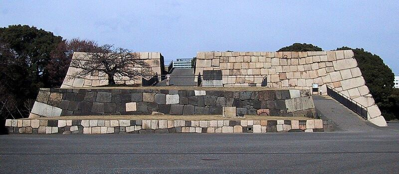</a> <a href="https://commons.wikimedia.org/wiki/File:Nihonbashi_12.jpg">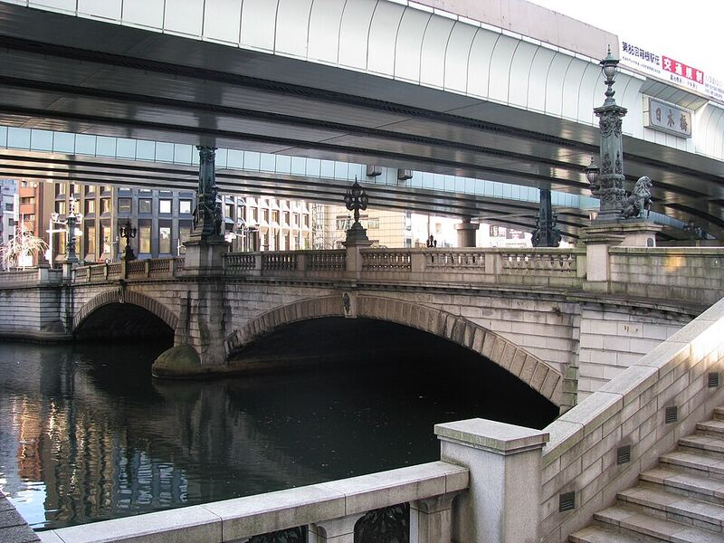</a> <a href="https://commons.wikimedia.org/wiki/File:Suruga-cho_LACMA_M.73.75.26.jpg">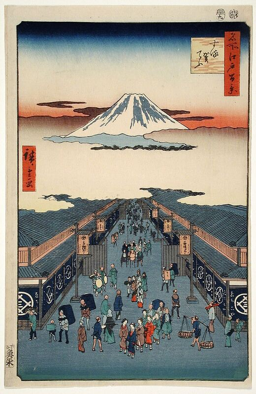</a>

*The stone base of Edo Castle's keep, in the East Gardens · Nihonbashi bridge, under the expressway · Hiroshige, Suruga-cho: the Echigoya (now Mitsukoshi) street with Fuji*

- **[Imperial Palace East Gardens](https://www.google.com/maps/search/?api=1&query=Imperial+Palace+East+Gardens)**: the inner grounds of Edo Castle, with the huge stone base of the old keep, moats and gates. Free. **Closed Mon and Fri (check).**
- **[Nihonbashi bridge](https://www.google.com/maps/search/?api=1&query=Nihonbashi+Bridge)**: the starting point of the Edo highways. Hokusai drew Fuji beyond it, and Hiroshige's Tokaido series begins here. Today an expressway runs over it (it's being moved underground).
- **[Suruga-cho (Mitsukoshi corner)](https://www.google.com/maps/search/?api=1&query=Mitsukoshi+Nihonbashi+Main+Store)**: Hiroshige's *Suruga-cho* shows the Echigoya store, which became Mitsukoshi, with Fuji at the end of the street. The store still stands, though buildings now hide Fuji. Compare the print on your phone.
- **[Kanda Surugadai](https://www.google.com/maps/search/?api=1&query=Surugadai+Kanda+Tokyo)**: the rise Hokusai drew Fuji from in *Surugadai in Edo*.
- **Getting there:** Chiyoda Line from Yoyogi-koen, direct to Otemachi.
- **Time:** half to full day. Pairs well with **#9**, which has the Edo-Tokyo Museum's full-size Nihonbashi replica and the prints themselves. See those first, then walk the real places.

### 5. Asakusa and the Sumida River 📷🏛📜

<a href="https://commons.wikimedia.org/wiki/File:Kaminarimon_Gate_of_Sensoji_Temple_2.JPG">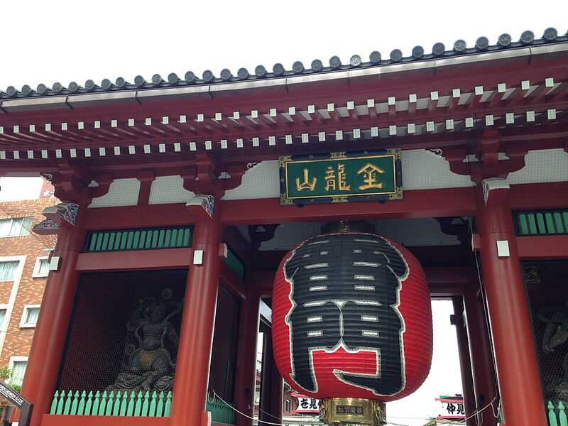</a> <a href="https://commons.wikimedia.org/wiki/File:Five-storied_Pagoda,_Sens%C5%8D-ji_Temple,_Asakusa_(53416862403).jpg">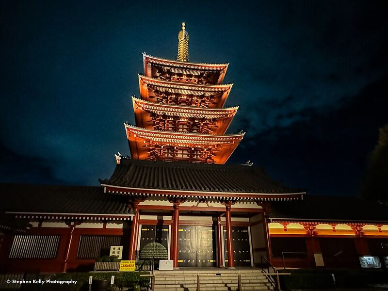</a> <a href="https://commons.wikimedia.org/wiki/File:Nakajima-no-ochaya_110925_2.jpg">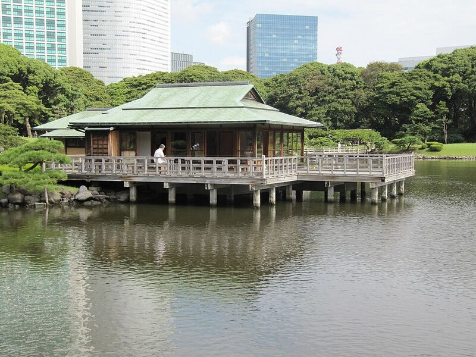</a>

*Senso-ji's Kaminarimon gate · Senso-ji's pagoda after dark · The teahouse on the pond at Hama-rikyu*

- **[Senso-ji](https://www.google.com/maps/search/?api=1&query=Senso-ji)**: Tokyo's oldest temple, with the Kaminarimon gate and its giant lantern. Go early morning or after dark for photos without the crowds.
- 📜 Hiroshige's *Kinryuzan Temple at Asakusa* shows the gate in snow, looking towards the pagoda. The same angle works today.
- **[Sumida River water bus](https://www.google.com/maps/search/?api=1&query=Asakusa+Pier+Tokyo+Cruise)** from Asakusa downriver to **[Hama-rikyu Gardens](https://www.google.com/maps/search/?api=1&query=Hama-rikyu+Gardens)**, the shogun's seaside garden with a teahouse on the pond.
- Optional: **[Tokyo Skytree](https://www.google.com/maps/search/?api=1&query=Tokyo+Skytree)** deck across the river (paid).
- **Getting there:** Ginza Line from Shibuya, direct to Asakusa.
- **Time:** full day. Ryogoku (**#9**) is 10 minutes away if the weather turns.

### 6. Views over Tokyo: free observation decks (plus Shinjuku Gyoen) 🏞📷

<a href="https://commons.wikimedia.org/wiki/File:Fujisan_20070311.jpg">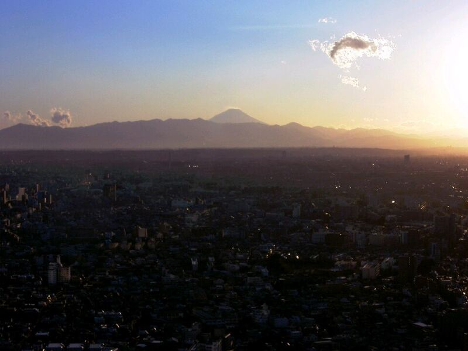</a> <a href="https://commons.wikimedia.org/wiki/File:Shinjuku_Gyoen_autumn_season.jpg">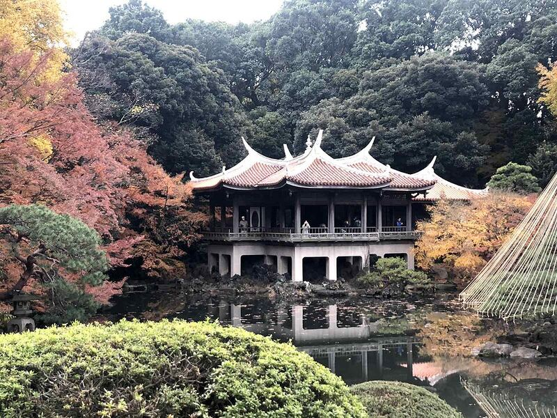</a> <a href="https://commons.wikimedia.org/wiki/File:Shibuya_scramble_square_sky_rooftop_couches_(48995414602).jpg">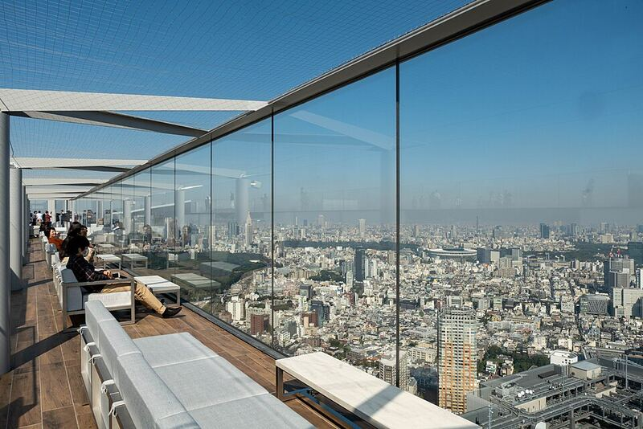</a>

*Fuji at sunset from the Metropolitan Government Building · Shinjuku Gyoen in autumn · Shibuya Sky's rooftop deck*

Do these one or two at a time as they fit other days.
- **[Tokyo Metropolitan Government Building](https://www.google.com/maps/search/?api=1&query=Tokyo+Metropolitan+Government+Building)** (Shinjuku): 45F, free. Fuji on clear mornings. South Deck 9:30–22:00.
- **[Shinjuku Gyoen](https://maps.google.com/?cid=12815362615039550287)** next door: a former imperial garden with autumn colour. **Chrysanthemum exhibition 1–15 Nov.** Closed Mondays.
- **[Bunkyo Civic Centre](https://maps.google.com/?cid=12778390561688336080)**: 25F, free, with a Fuji view. Near Kasuga and Korakuen.
- **[Carrot Tower](https://www.google.com/maps/search/?api=1&query=Carrot+Tower+Sangenjaya)** (Sangenjaya): 26F, free **(check)**.
- **[Shibuya Hikarie Sky Lobby](https://www.google.com/maps/search/?api=1&query=Shibuya+Hikarie)**: 11F, free, looking over Shibuya **(check)**.
- Paid option near base: **[Shibuya Sky](https://www.google.com/maps/search/?api=1&query=Shibuya+Sky)** at sunset (book ahead). See the crossing options below.

#### Shibuya Crossing from above (15 min walk from base)

<a href="https://commons.wikimedia.org/wiki/File:Scramble_from_above,_SHIBUYA_SKY_(49367160502)_(cropped).jpg">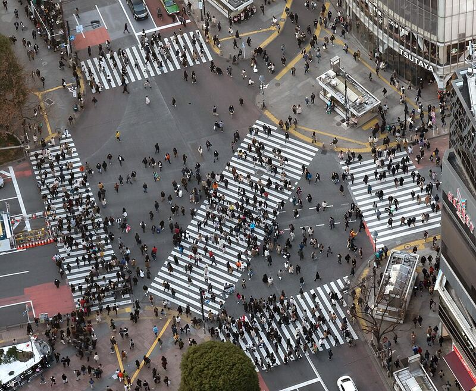</a> <a href="https://commons.wikimedia.org/wiki/File:Tokyo_Shibuya_Scramble_Crossing_2018-10-09.jpg">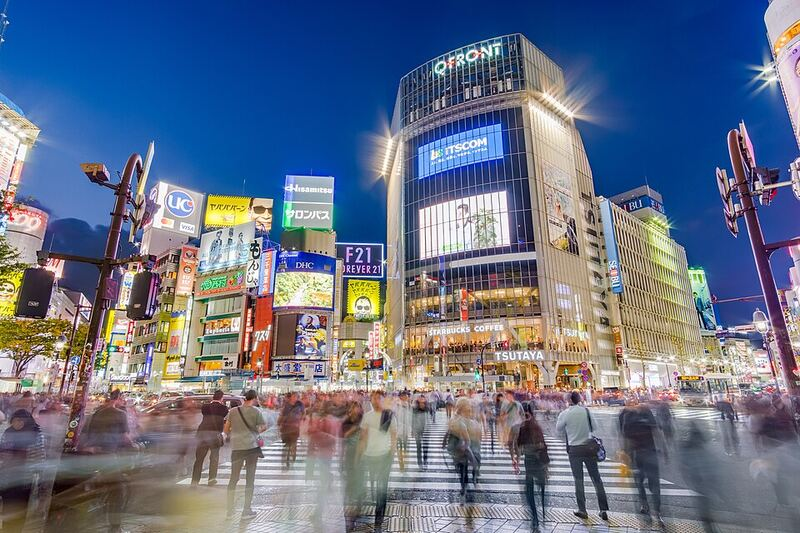</a> <a href="https://commons.wikimedia.org/wiki/File:Starbucks_Coffee_Shibuya_Tsutaya_(53333663763).jpg">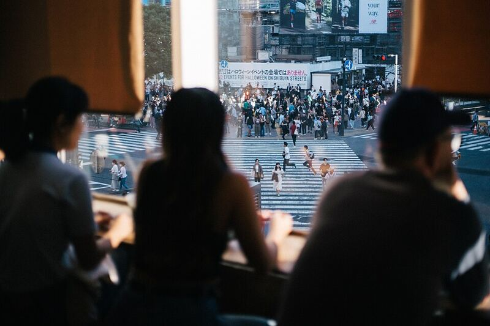</a>

*Shibuya Crossing from above · The crossing after dark · The view from the Starbucks window*

The scramble outside Shibuya station's Hachiko exit, the crossing in all the stock footage: every direction gets a green light at once and the whole junction fills with people. It's busiest on Friday and Saturday evenings, and the lit-up signs are best from dusk (about 17:00 late Oct / 16:45 early Nov). Walk across it first, then watch it from above.

| Viewpoint | View | Cost | Hours | Notes |
|---|---|---|---|---|
| **[MAG8 rooftop](https://www.google.com/maps/search/?api=1&query=MAG8+Crossing+View+Magnet+by+Shibuya109)** (Magnet by Shibuya109, rooftop) | Looking straight down onto the crossing, the classic shot | ¥1,800 (~NZ$20) incl. one drink (up to ¥300 (~NZ$3) off online). **Cards and e-money only, no cash** | 10:00–22:00, last entry 21:30 | **Best for photos.** Open air, but you shoot through clear panels. Optional "drone photo" camera ¥1,500 (~NZ$17) for 150 s. Reopened after renovation 3 Mar 2026. |
| **[Starbucks, Shibuya Tsutaya 2F](https://www.google.com/maps/search/?api=1&query=Starbucks+Coffee+Shibuya+Tsutaya)** | Close and head-on, through glass, from 2 floors up | Price of a drink (about ¥500–800 (~NZ$6–9)) | 7:00–22:30 | **Yes, it's fine to go up for the view.** The 2024 redesign deliberately set the seats back from the window so people can walk up, look and take photos. Buy a drink as a courtesy. Window seats are scarce: go early morning or late evening. |
| **[L'Occitane Café](https://www.google.com/maps/search/?api=1&query=L%27Occitane+Cafe+Shibuya)** (Shibuya Ekimae Building 2–3F) | Close, on the corner of the crossing, slightly elevated | Price of a drink | 10:00–23:00 (last order 22:00) | Calmer than Starbucks. **(check it's still open)** |
| **[Mark City walkway](https://www.google.com/maps/search/?api=1&query=Myth+of+Tomorrow+Shibuya+Mark+City)** (station to Mark City, past Okamoto Taro's *Myth of Tomorrow* mural) | Side-on, through glass | Free | Station hours | A modest view, but free and worth a look on the way through. The mural is worth seeing too. |
| **[Shibuya Sky](https://www.google.com/maps/search/?api=1&query=Shibuya+Sky)** (Scramble Square rooftop, 230 m) | The crossing is tiny far below, but you get the whole city, and Fuji on clear days | Web: about ¥2,700 (~NZ$30) before 15:00, ¥3,400 (~NZ$38) from 15:00; ¥300 (~NZ$3) more at the counter **(check)** | 10:00–22:30, last entry 21:20 | Timed tickets. **Sunset slots sell out**, so book as soon as they open (about 2–4 weeks ahead). The rooftop closes in bad weather. No tripods or selfie sticks. |

**Suggested evening:** sunset at Shibuya Sky, then down to street level to walk the crossing, then MAG8 after dark for the lit-up view from above. Or for a cheaper version, Starbucks at breakfast and the Mark City walkway.

### 7. Setagaya green walk: Todoroki Ravine to Jiyugaoka 🥾📷🏛

<a href="https://commons.wikimedia.org/wiki/File:Fudo_no_Taki_(Todoroki_Valley)_201908.jpg">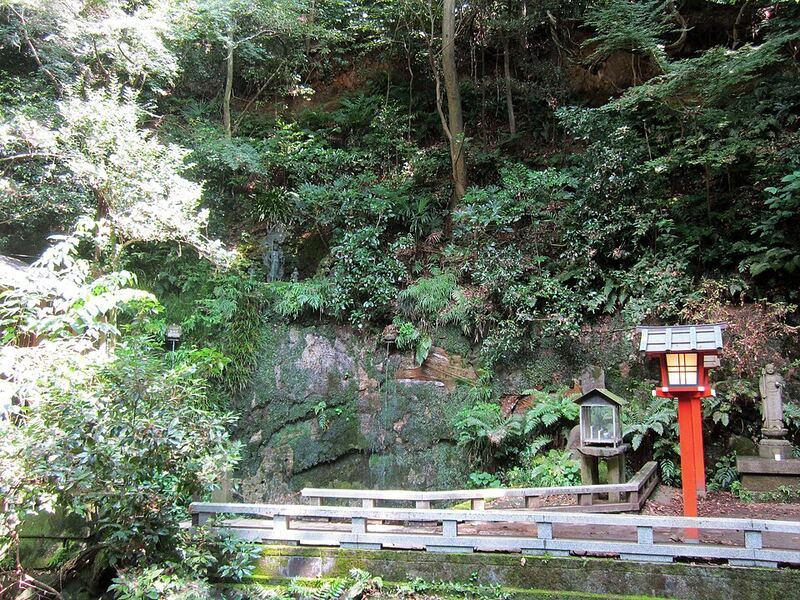</a> <a href="https://commons.wikimedia.org/wiki/File:Fudo_no_Taki_shrine_-_Todoroki_Valley_-_Tokyo,_Japan_-_DSC09484.jpg">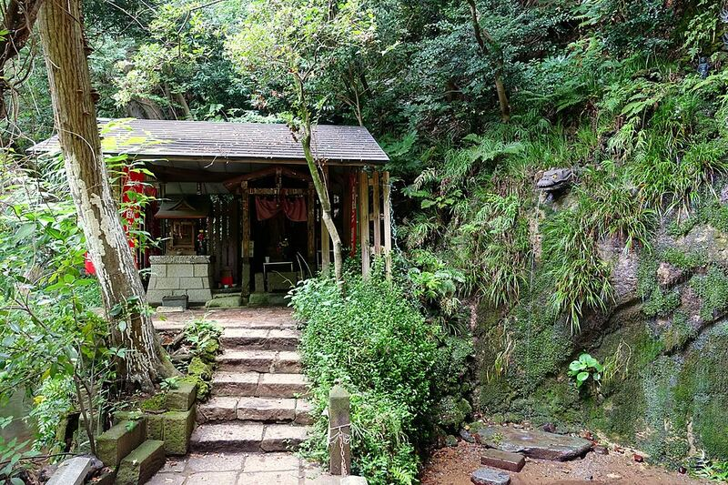</a> <a href="https://commons.wikimedia.org/wiki/File:Joshinji_Sanbutsudo.jpg">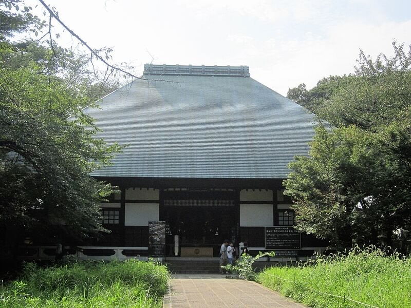</a>

*Todoroki Ravine · Todoroki Fudo shrine by the waterfall · Kuhonbutsu Joshin-ji*

- **[Todoroki Ravine](https://maps.google.com/?cid=8190717095247196857)**: a 1 km wooded stream valley inside the city, with a small waterfall shrine and Kofun-era **burial caves** (tunnel tombs).
- **[Gotoh Museum](https://maps.google.com/?cid=5564290463521425014)**: Japanese and Chinese paintings, ceramics and scrolls, with a hillside garden in autumn colour. **Closed Mondays.**
- **[Kuhonbutsu Joshin-ji](https://maps.google.com/?cid=13888666751185333972)**: a peaceful temple complex with nine Buddha statues in three halls.
- **[Mont St.Clair](https://maps.google.com/?cid=3872742080123885955)** in Jiyugaoka for pastries to finish.
- **Getting there:** Tokyu Den-en-toshi Line from Shibuya, changing to the Oimachi Line.
- **Time:** half to full day, with 2–3 h of easy walking.

---

## ☔ Wet-weather groups

### 8. Ueno Park museums and the Moon Pine 🏛📜📷

<a href="https://commons.wikimedia.org/wiki/File:Tokyo,_Mus%C3%A9e_national_.-_Samurai_do-maru.jpg">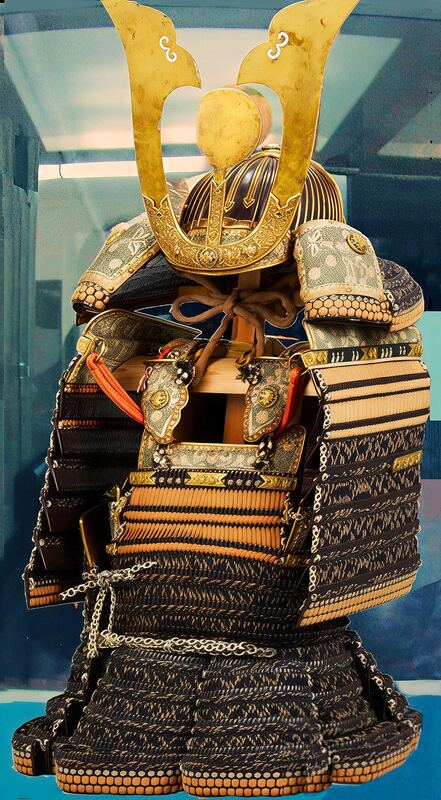</a> <a href="https://commons.wikimedia.org/wiki/File:KiyomizuKannondo_05.JPG">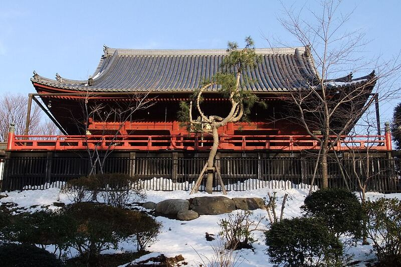</a> <a href="https://commons.wikimedia.org/wiki/File:Ueno_sannai_tsuki_no_matsu_LCCN2008660968.jpg">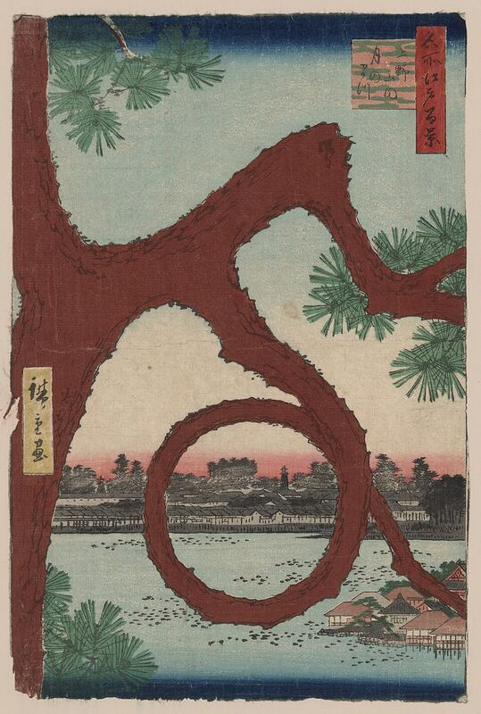</a>

*Samurai armour at the Tokyo National Museum · The Moon Pine at Kiyomizu Kannon-do today · Hiroshige's Moon Pine print, from the same spot*

- **[Tokyo National Museum](https://www.google.com/maps/search/?api=1&query=Tokyo+National+Museum)**: Japan's biggest collection of samurai armour, swords, screens and ukiyo-e. It includes the **[Gallery of Horyuji Treasures](https://maps.google.com/?cid=8184332031323003816)**. Closed Mondays.
- **[Kiyomizu Kannon-do](https://www.google.com/maps/search/?api=1&query=Kiyomizu+Kannon-do+Ueno)**: 📜 the **Moon Pine** from two of Hiroshige's *One Hundred Famous Views of Edo*, a pine trained into a circle that frames the pond. It was lost in the 1870s and recreated in 2012, so you can stand where Hiroshige did.
- Also here: **[National Museum of Western Art](https://maps.google.com/?cid=13484864514866363531)**, **[Tokyo Metropolitan Art Museum](https://maps.google.com/?cid=9518604028842126160)**, and Shinobazu Pond.
- **Getting there:** Chiyoda Line from Yoyogi-koen to Nezu or Yushima, direct.

### 9. Ryogoku: Edo-Tokyo Museum and Hokusai Museum 🏛📜

<a href="https://commons.wikimedia.org/wiki/File:Exhibits_at_Edo_Tokyo_Museum_-_Dec_3_2021_various_21_01_42_475000.jpeg">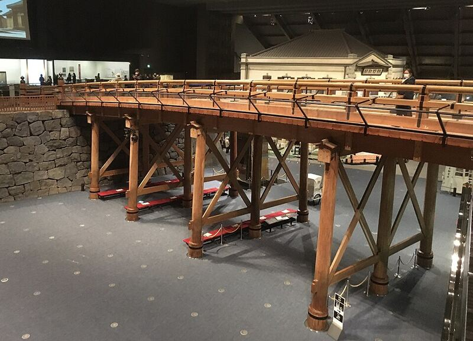</a> <a href="https://commons.wikimedia.org/wiki/File:Edo-Tokyo_Museum_-_lifesize_replica_of_the_Nakamura-za_kabuki_theater_02.jpg">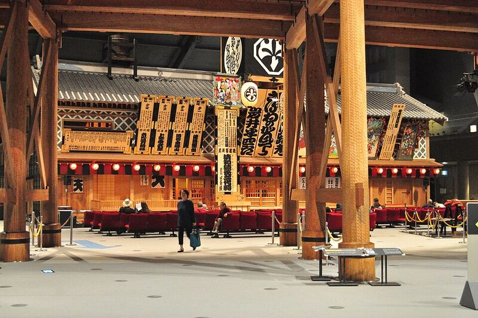</a> <a href="https://commons.wikimedia.org/wiki/File:2018_Sumida_Hokusai_Museum_3.jpg">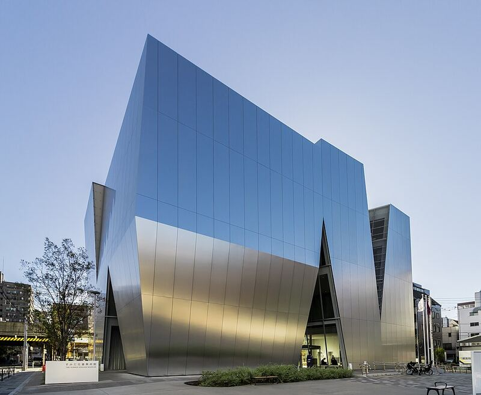</a>

*The full-size Nihonbashi replica in the Edo-Tokyo Museum · The museum's kabuki theatre · Sumida Hokusai Museum*

- **[Edo-Tokyo Museum](https://www.google.com/maps/search/?api=1&query=Edo-Tokyo+Museum)**: reopened 31 Mar 2026 after a 4-year renovation. It has a full-size replica of half of Nihonbashi bridge, models of Edo streets, and kabuki. Closed Mondays.
- **[Sumida Hokusai Museum](https://www.google.com/maps/search/?api=1&query=Sumida+Hokusai+Museum)**: in the district where Hokusai was born. A good place to see his prints before chasing the views. Closed Mondays.
- **Getting there:** Oedo Line or JR Sobu Line to Ryogoku. 10 minutes from Asakusa (**#5**).

### 10. Kawagoe, "Little Edo" (day trip) 🏛📷📜

<a href="https://commons.wikimedia.org/wiki/File:Kawagoe_Toki_no_Kane_5.jpg">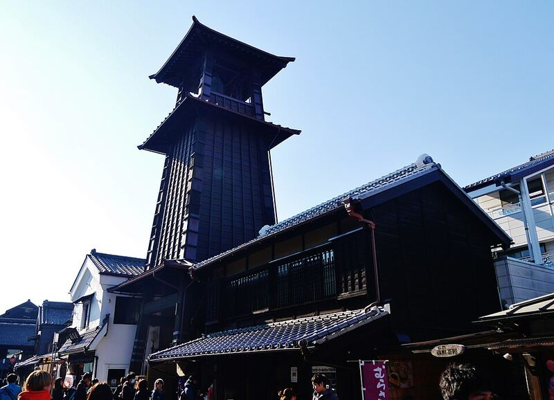</a> <a href="https://commons.wikimedia.org/wiki/File:Kawagoe_Toki_no_Kane_3.jpg">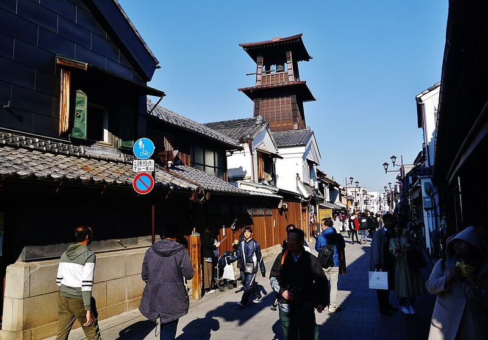</a> <a href="https://commons.wikimedia.org/wiki/File:Gohyaku_Rakan.jpg">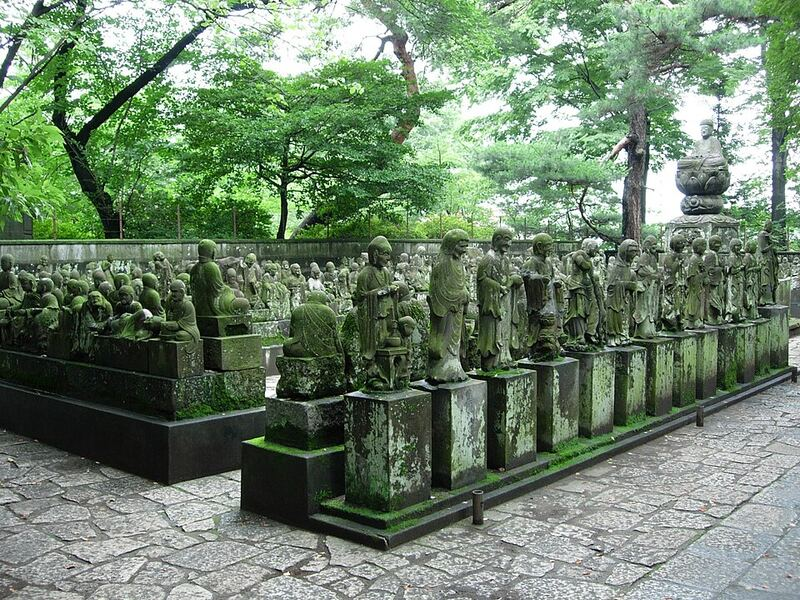</a>

*Toki-no-Kane bell tower · Kurazukuri Street's clay-walled warehouses · Kita-in's 540 rakan statues*

Mostly outdoors, but fine in light rain.
- **[Kurazukuri Street](https://www.google.com/maps/search/?api=1&query=Kurazukuri+Street+Kawagoe)**: over 20 Edo-period clay-walled merchant warehouses, plus the wooden **Toki-no-Kane bell tower**.
- **[Kita-in](https://www.google.com/maps/search/?api=1&query=Kitain+Temple+Kawagoe)**: the **only surviving rooms of Edo Castle**, moved here in the 1630s. It also has **540 stone *rakan* statues**, each with a different face, which is unusual.
- **[Kawagoe Castle Honmaru Palace](https://www.google.com/maps/search/?api=1&query=Kawagoe+Castle+Honmaru+Goten)**: the surviving palace of a feudal lord's castle.
- **Getting there:** Seibu Shinjuku Line from Seibu-Shinjuku, or Tobu Tojo Line from Ikebukuro, about 1 h. Day passes are available **(check)**.

---

## Backup list

### ☀️ Fine weather
- **[Mount Oyama](https://maps.google.com/?cid=11195187286412280388)**: an alternative to Takao. A cable car and an Edo pilgrimage mountain, which Hiroshige drew pilgrims climbing. Odakyu Line.
- **[Gōtoku-ji](https://maps.google.com/?cid=482142090738683052)** (the lucky-cat temple), via the little Setagaya tram line, then **[Shimokitazawa](https://maps.google.com/?cid=3688041400833590402)**.
- **[Meiji Jingu](https://www.google.com/maps/search/?api=1&query=Meiji+Jingu)** and Yoyogi Park, **next to base**. An easy filler morning or evening.
- **[Tokyo Tower](https://www.google.com/maps/search/?api=1&query=Tokyo+Tower)** with **[Zojo-ji](https://www.google.com/maps/search/?api=1&query=Zojo-ji)** at its foot, the Tokugawa family temple.
- **[Rikugien](https://www.google.com/maps/search/?api=1&query=Rikugien+Garden)** or **[Koishikawa Korakuen](https://www.google.com/maps/search/?api=1&query=Koishikawa+Korakuen)**: Edo-period lords' gardens. Korakuen is beside Bunkyo Civic Centre.
- **[Edo-Tokyo Open Air Architectural Museum](https://www.google.com/maps/search/?api=1&query=Edo-Tokyo+Open+Air+Architectural+Museum)** (Koganei): historic houses and shops moved here, set in a park.

### ☔ Wet weather
- **[Ōta Memorial Museum of Art](https://maps.google.com/?cid=528350391604663209)** (Harajuku, near base): ukiyo-e, with exhibitions that change monthly **(check what's showing; it closes for changeovers)**.
- **[Yasukuni Shrine](https://maps.google.com/?cid=13107538590517743248)** and the Yushukan war museum, with the [Zero fighter](https://maps.google.com/?cid=16503706424972160210) in the lobby.
- **[National Museum of Japanese History](https://maps.google.com/?cid=1807054994798992362)** (Sakura, Chiba): a big national history museum. Sakura also has a preserved samurai street. A day trip.
- **[Tojo Museum of History](https://maps.google.com/?cid=9722492646698936878)** (Matsudo): the home of the last Shogun's brother, with gardens.
- **[Yayoi Kusama Museum](https://maps.google.com/?cid=3362489232406186726)** (timed tickets, book ahead) and the small **[Jorin-ji](https://maps.google.com/?cid=11436131296302717075)** next door.
- **[teamLab Borderless](https://maps.google.com/?cid=6355049266444838481)** · **[Art Aquarium](https://maps.google.com/?cid=15689961400037075470)** (Ginza)
- Small galleries: **[Shōtō Museum](https://maps.google.com/?cid=13122427293131002926)**, **[Komaba Museum](https://maps.google.com/?cid=9502128701029406267)** (free), **[PARCO Museum](https://maps.google.com/?cid=869598732706709672)** (free), **[Setagaya Art Museum](https://www.google.com/maps/search/?api=1&query=Setagaya+Art+Museum)** (closed Mondays)
- **[Yodobashi Camera Museum](https://maps.google.com/?cid=4645273803720285934)** · **[Showa Era Lifestyle Museum](https://maps.google.com/?cid=13899841542931401837)** (Fri–Sun only) · **[Tokorozawa Aviation Park](https://maps.google.com/?cid=10289274659213424480)** · **[Aviation Shrine](https://maps.google.com/?cid=11703968861367015555)**
- **[Samurai show](https://maps.google.com/?cid=3294564358368833700)** (Kabukicho): a 2-hour evening show.

### Too far for a day trip (need overnights, so probably not this trip)
[Matsumoto Castle](https://maps.google.com/?cid=10388975450222032468) · [Takayama](https://maps.google.com/?cid=15344603428797604828) and [Hida Folk Village](https://maps.google.com/?cid=15466683148941065284) · [Shinhotaka Ropeway](https://maps.google.com/?cid=15656747577072557457) · [Shirakawa-go](https://maps.google.com/?cid=14755289620389823992) · [Kanazawa](https://maps.google.com/?cid=10228050530913903125) · [Magome](https://maps.google.com/?cid=9040534682970691322) and the Nakasendo walk
