# Ukiyo-e: Japan's landscape prints

**Ukiyo-e** (浮世絵, "pictures of the floating world") are Japanese **woodblock prints** from the Edo period (1600s–1860s). An artist drew the design, a carver cut it into cherry-wood blocks (one per colour) and a printer pressed each sheet by hand. They sold cheaply, for about the price of a bowl of noodles, so they were the popular art of their day, a bit like posters or postcards.

Early ukiyo-e showed kabuki actors and courtesans. In the 1830s two artists made **landscape** a subject in its own right:
- **Katsushika Hokusai** (1760–1849): bold, dramatic and geometric. He was over 70 when he made his Fuji series.
- **Utagawa Hiroshige** (1797–1858): softer, full of weather and atmosphere, and travel. A generation younger, he was Hokusai's rival and successor.

They were helped by a new imported pigment, **Prussian blue**, which is why the skies and water in these prints are so intensely blue.

Pictures are public domain; tap one for its source. See [photo credits](photos/CREDITS.md). NZ$ prices are approximate, at ¥1,000 ≈ NZ$11 (rate on 9 Oct 2026).

---

## Why they speak to a landscape photographer
- **Framing:** Hokusai puts Fuji inside things: under the arch of a bridge, between roof gables, in the curve of a wave.
- **Bold foregrounds:** Hiroshige's Edo views push something huge into the front of the frame (a plum branch, a horse's legs, a lantern) with the view small behind it. It's a wide-angle, close-foreground look, decades before photography did it.
- **Weather as the subject:** driving rain, snow, mist, dusk and fireworks. Several of the most famous prints are about the conditions, not the place.
- **Working in a series:** "Thirty-six views" of one mountain is the same idea as a photo project: one subject from many places, seasons and times of day.
- **Portrait format:** most of the *Edo* views are vertical, like a phone photo.
- The Canadian photographer **Jeff Wall** restaged Hokusai's *Ejiri* (below) as a large photograph, *A Sudden Gust of Wind (after Hokusai)* (1993), now in Tate Modern.

---

## The prints you've probably already seen

<a href="https://commons.wikimedia.org/wiki/File:Tsunami_by_hokusai_19th_century.jpg">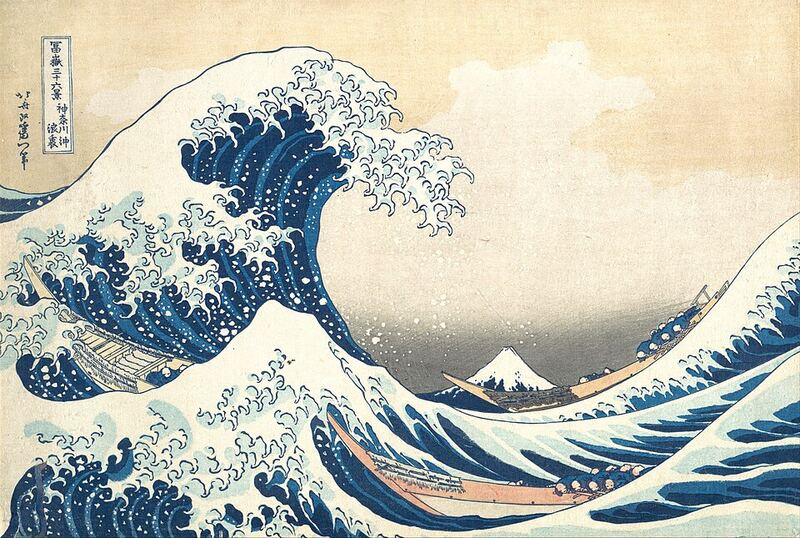</a> <a href="https://commons.wikimedia.org/wiki/File:Red_Fuji_southern_wind_clear_morning.jpg">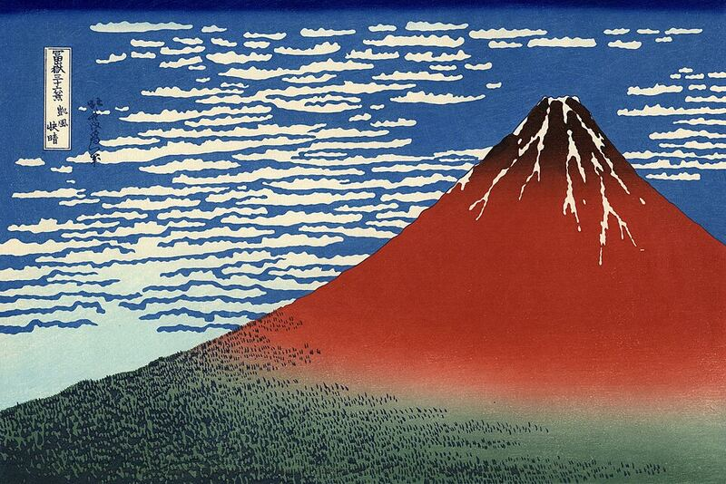</a> <a href="https://commons.wikimedia.org/wiki/File:Lightnings_below_the_summit.jpg">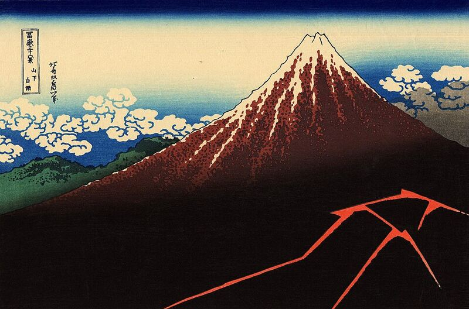</a>

*Hokusai: The Great Wave off Kanagawa · Fine Wind, Clear Morning ("Red Fuji") · Thunderstorm Beneath the Summit ("Black Fuji")*

<a href="https://commons.wikimedia.org/wiki/File:Sudden_Shower_over_Shin-Ohashi_Bridge_and_Atake_(5758870781).jpg">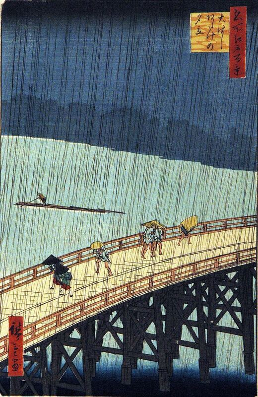</a> <a href="https://commons.wikimedia.org/wiki/File:Vincent_van_Gogh_-_Brug_in_de_regen-_naar_Hiroshige_-_Google_Art_Project.jpg">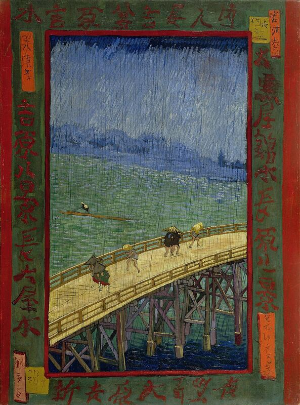</a> <a href="https://commons.wikimedia.org/wiki/File:De_pruimenboomgaard_te_Kameido-Rijksmuseum_RP-P-1956-743.jpeg">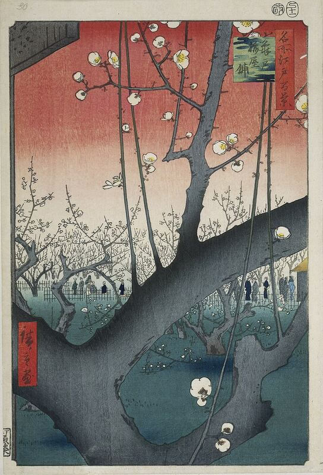</a>

*Hiroshige: Sudden Shower over Shin-Ōhashi Bridge (the people on the bridge in the rain) · Van Gogh's 1887 copy of it · Hiroshige: Plum Park in Kameido*

| Print | Artist and series | Where it's drawn from (approximate map pin) | Near us? |
|---|---|---|---|
| **The Great Wave off Kanagawa** | Hokusai, *Thirty-six Views of Mt Fuji* | Out at sea off Kanagawa (today's Yokohama), looking southwest across the bay to Fuji ([pin](https://www.google.com/maps/search/?api=1&query=35.400,139.700)) | Not a place you can stand. The closest feeling is Fuji across the water from **Shichirigahama** (Kamakura day trip). And it's on the money in your wallet (see below). |
| **Fine Wind, Clear Morning ("Red Fuji")** | Hokusai, *Thirty-six Views* | Fuji lit red by early-morning sun in late summer or early autumn. The exact viewpoint is debated; it's often placed on the Yamanashi side ([pin](https://www.google.com/maps/search/?api=1&query=35.361,138.727)) | **Kawaguchiko.** Be out at sunrise on a clear morning. By late October Fuji usually has snow, so expect pink on white (*beni-Fuji*) rather than the red of the print. |
| **Thunderstorm Beneath the Summit ("Black Fuji")** | Hokusai, *Thirty-six Views* | Fuji's summit above the clouds, with lightning on the lower slopes ([pin](https://www.google.com/maps/search/?api=1&query=35.361,138.727)) | Any clear view of Fuji with cloud below the summit. Common at Kawaguchiko. |
| **Sudden Shower over Shin-Ōhashi Bridge and Atake** | Hiroshige, *One Hundred Famous Views of Edo* | From above the Sumida River, looking at the Shin-Ōhashi bridge with Atake (Fukagawa) on the far bank ([pin](https://www.google.com/maps/search/?api=1&query=35.6878,139.7926)) | **Yes:** Tokyo #10 (Ryogoku). See the Sumida print walk below. Today's Shin-Ōhashi is a little downstream of the old one. |
| **Plum Park in Kameido** | Hiroshige, *Edo* | A famous plum garden in Kameido, through the trunk of its "sleeping dragon" plum ([pin](https://www.google.com/maps/search/?api=1&query=35.7003,139.8288)) | The garden was lost in a 1910 flood. Kameido is 3 stops from Ryogoku. Van Gogh copied this one too. |
| **Shōno: Driving Rain** | Hiroshige, *Fifty-three Stations of the Tōkaidō* | A post town in Mie Prefecture, travellers running uphill in a downpour ([pin](https://www.google.com/maps/search/?api=1&query=34.879,136.520)) | No, too far. |
| **Ejiri in Suruga Province** | Hokusai, *Thirty-six Views* | Near Shizuoka: a gust of wind blows travellers' hats and papers away ([pin](https://www.google.com/maps/search/?api=1&query=35.016,138.488)) | No, too far. This is the one Jeff Wall turned into a photograph. |
| **Kajikazawa in Kai Province** | Hokusai, *Thirty-six Views* | A fisherman on a rock above the rapids of the Fuji River, Yamanashi ([pin](https://www.google.com/maps/search/?api=1&query=35.548,138.468)) | No: in Yamanashi, but off our routes. |

<a href="https://commons.wikimedia.org/wiki/File:Shono-_Driving_Rain_(5758989131).jpg">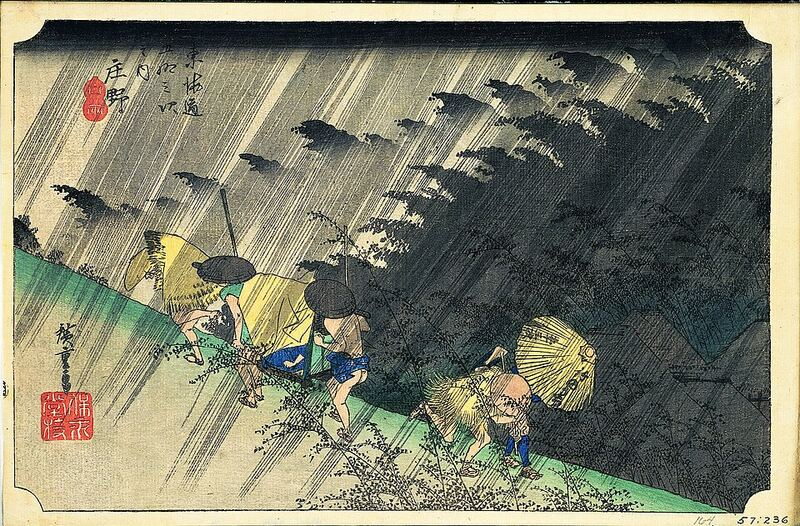</a> <a href="https://commons.wikimedia.org/wiki/File:Ejiri_in_the_Suruga_province.jpg">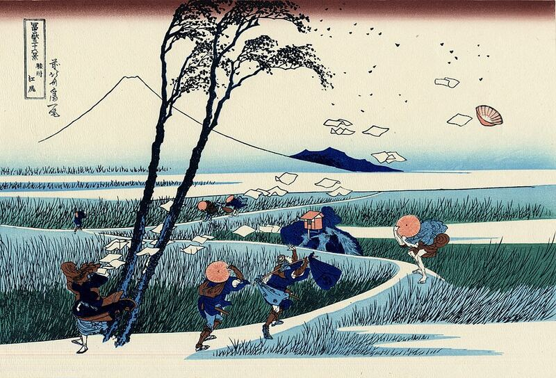</a> <a href="https://commons.wikimedia.org/wiki/File:Kajikazawa_in_Kai_province.jpg">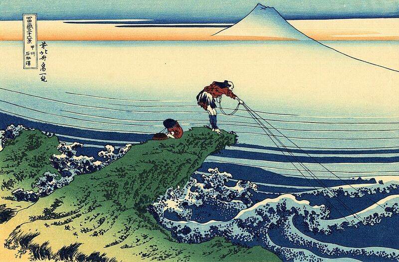</a>

*Hiroshige: Shōno, Driving Rain · Hokusai: Ejiri in Suruga Province · Hokusai: Kajikazawa in Kai Province*

### The series, in brief
- **Hokusai, *Thirty-six Views of Mount Fuji*** (about 1830–32): 46 prints despite the name. Fuji seen from all over the country, often small in the background of everyday life.
- **Hokusai, *One Hundred Views of Mount Fuji*** (1834–35): three small black-and-white picture books.
- **Hiroshige, *Fifty-three Stations of the Tōkaidō*** (1833–34): one print for each post town on the highway from Edo (Tokyo) to Kyoto. His breakthrough.
- **Hiroshige, *One Hundred Famous Views of Edo*** (1856–58): 118 vertical prints of Tokyo's famous spots through the seasons. Many of the places are still there.
- **Hiroshige, *Thirty-six Views of Mount Fuji*** (1858): his answer to Hokusai, finished just before he died. Vertical, gentler, more atmospheric.

---

## Cultural references you may spot
- **The ¥1,000 note** in your wallet has **The Great Wave** on the back (notes issued since July 2024). The **older ¥1,000 note**, still in circulation, shows **Fuji reflected in Lake Motosu**. That design came from a **photograph** by Okada Kōyō, and you can stand at the spot (Kawaguchiko #5).
- **The Japanese passport** (since 2020): every visa page carries one of Hokusai's *Thirty-six Views*.
- **Van Gogh** copied two of Hiroshige's Edo views in oil (*Bridge in the Rain* and *Flowering Plum Orchard*, 1887, both in the Van Gogh Museum, Amsterdam). Monet collected these prints and built his Japanese bridge at Giverny. The craze was called **Japonisme**.
- **Debussy's *La Mer*** (1905): the first edition's cover used The Great Wave.
- **Manga:** Hokusai's sketchbooks were called *Hokusai Manga*, which popularised the word.
- **Bathhouse Fuji:** many old Tokyo *sentō* (public baths) have a huge painted Fuji on the wall. It's a tradition from 1912, and the same "Fuji as icon" idea.
- **Ochazuke packets:** for decades Nagatanien rice-topping packets came with a free card of a Hiroshige *Tōkaidō* print. Older Japanese people often remember collecting them.

<a href="https://commons.wikimedia.org/wiki/File:Vincent_van_Gogh_-_Bloeiende_pruimenboomgaard-_naar_Hiroshige_-_Google_Art_Project.jpg">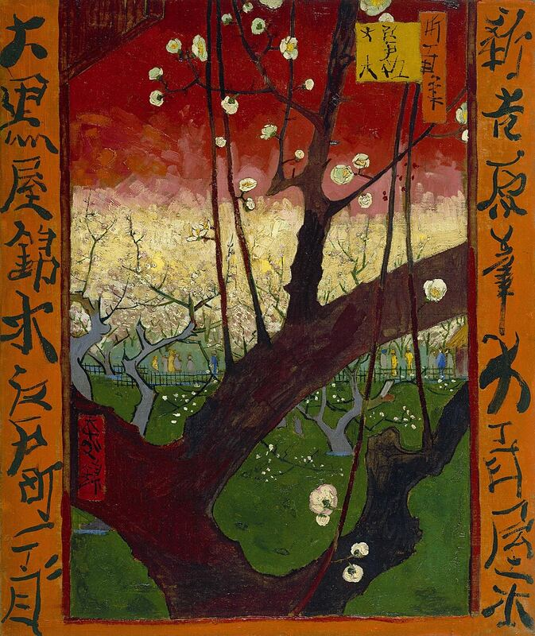</a> <a href="https://commons.wikimedia.org/wiki/File:Lake_Motosu03.jpg">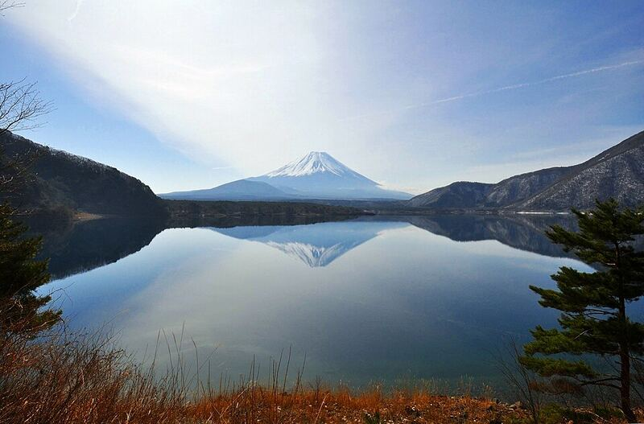</a>

*Van Gogh's copy of Plum Park in Kameido · Fuji in Lake Motosu, the view on the older ¥1,000 note*

---

## Print viewpoints we'll be near

These are places where you can stand roughly where the artist did. The city has changed completely, but the river, bridge, hill or temple is still there. Load the print on your phone and compare.

### Tokyo: the Sumida River and Ryogoku (pairs with Tokyo #10)

<a href="https://commons.wikimedia.org/wiki/File:Fuji_seen_through_the_Mannen_bridge_at_Fukagawa.jpg">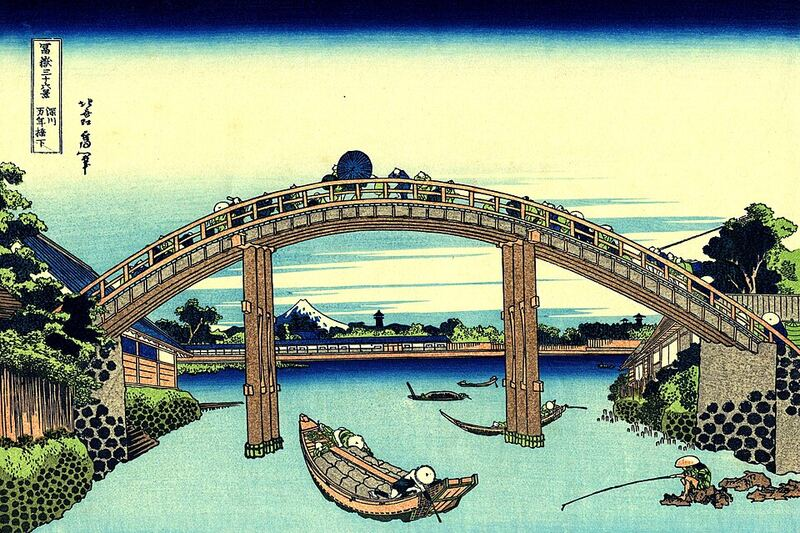</a> <a href="https://commons.wikimedia.org/wiki/File:Sunset_across_the_Ryogoku_bridge_from_the_bank_of_the_Sumida_river_at_Onmagayashi.jpg">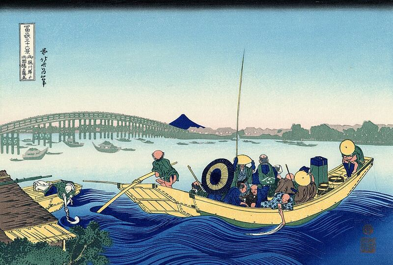</a> <a href="https://commons.wikimedia.org/wiki/File:Fireworks_at_Ryogoku_LACMA_M.2006.136.356.jpg">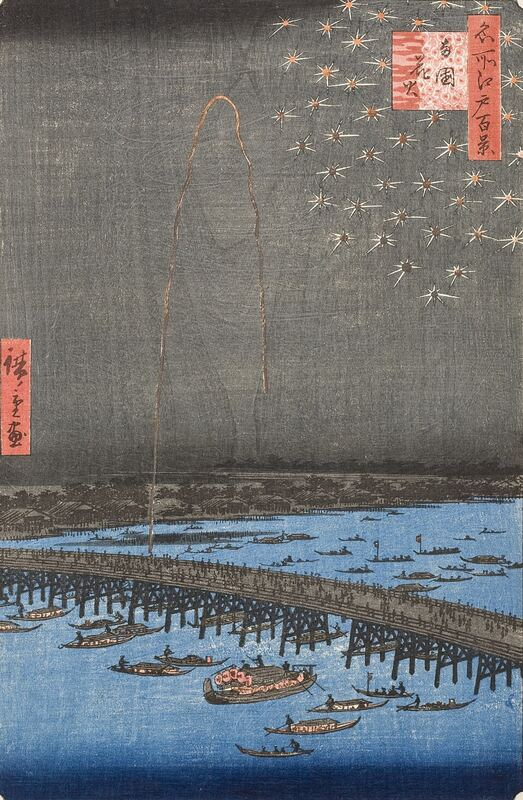</a>

*Hokusai: Under Mannen Bridge at Fukagawa · Hokusai: Sunset across Ryogoku Bridge · Hiroshige: Fireworks at Ryogoku*

| Print | Viewpoint today | Getting there |
|---|---|---|
| Hokusai, *Under Mannen Bridge at Fukagawa*: Fuji framed under a high arched bridge | **[Mannen-bashi](https://www.google.com/maps/search/?api=1&query=萬年橋+江東区)**, where the Onagi canal meets the Sumida. The bridge is now steel, but the arch and the spot are the same. The Bashō memorial garden (the haiku poet lived here) is beside it. | Hanzomon Line from Shibuya, direct to Kiyosumi-shirakawa, then 8 min walk. Or walk from Ryogoku. |
| Hiroshige, *Sudden Shower over Shin-Ōhashi* | **[Shin-Ōhashi](https://www.google.com/maps/search/?api=1&query=新大橋+東京)** and the riverside terrace | Hamacho station (Toei Shinjuku Line), 5 min. Or on the walk below. |
| Hokusai, *Sunset across Ryogoku Bridge from Onmayagashi* · Hiroshige, *Fireworks at Ryogoku* | **[Ryogoku Bridge](https://www.google.com/maps/search/?api=1&query=両国橋)** (by Ryogoku station). Onmayagashi is near today's **[Umaya-bashi](https://www.google.com/maps/search/?api=1&query=厩橋+台東区)**, upstream. | JR Sobu Line or Oedo Line to Ryogoku. |
| Hokusai, *Tsukudajima in Musashi Province* | **[Tsukudajima](https://www.google.com/maps/search/?api=1&query=佃島+佃公園)**, the old fishing island at the river mouth, now among towers | The Sumida water bus (Tokyo #4) passes it on the way to Hama-rikyu. |

**Sumida River print walk (about 3 km, 2–3 h with the museum):** start at **Ryogoku station** (the Ryogoku Bridge prints) → **Sumida Hokusai Museum** → south along the **Sumida River Terrace** to **Shin-Ōhashi** (the rain print) → **Mannen-bashi** (the Fuji-under-the-bridge print) → **[Kiyosumi Garden](https://www.google.com/maps/search/?api=1&query=Kiyosumi+Gardens)**, a merchant's Edo-style pond garden (small fee, **check**). Finish at **Kiyosumi-shirakawa station**, where the Hanzomon Line runs direct to Shibuya. All flat, on public footpaths.

### Tokyo: Asakusa, Kameido and the Skytree side (pairs with Tokyo #4)

<a href="https://commons.wikimedia.org/wiki/File:%E5%90%8D%E6%89%80%E6%B1%9F%E6%88%B8%E7%99%BE%E6%99%AF_%E6%B5%85%E8%8D%89_%E9%87%91%E9%BE%8D%E5%B1%B1-The_Kinryusan_Temple_at_Asakusa_MET_DP122116.jpg">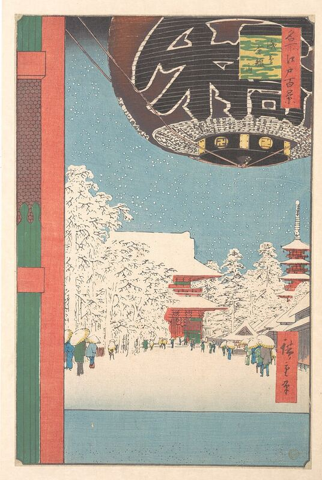</a> <a href="https://commons.wikimedia.org/wiki/File:Asakusa_Honganji_temple_in_th_Eastern_capital.jpg">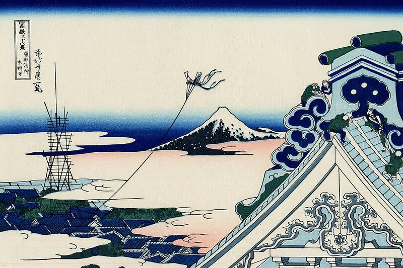</a> <a href="https://commons.wikimedia.org/wiki/File:NDL-DC_1303261-Utagawa_Hiroshige-%E5%90%8D%E6%89%80%E6%B1%9F%E6%88%B8%E7%99%BE%E6%99%AF_%E4%BA%80%E6%88%B8%E5%A4%A9%E7%A5%9E%E5%A2%83%E5%86%85-crd.jpg">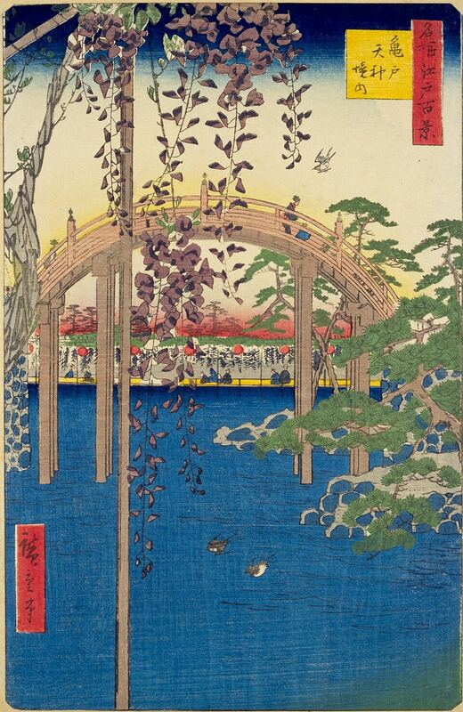</a>

*Hiroshige: Kinryuzan Temple at Asakusa · Hokusai: Honganji at Asakusa · Hiroshige: Inside Kameido Tenjin Shrine*

| Print | Viewpoint today | Getting there |
|---|---|---|
| Hiroshige, *Kinryuzan Temple at Asakusa*: Senso-ji's gate in snow, under the giant lantern | **[Kaminarimon](https://www.google.com/maps/search/?api=1&query=Kaminarimon)**: stand just inside, looking up the approach to the pagoda | Ginza Line from Shibuya, direct to Asakusa. |
| Hokusai, *Honganji Temple at Asakusa*: Fuji beyond a huge temple roof, kites flying | **[Higashi Honganji, Asakusa](https://www.google.com/maps/search/?api=1&query=東本願寺+台東区)**: the temple is rebuilt, and Fuji is hidden by buildings now | Tawaramachi station (Ginza Line), 3 min; 10 min walk from Senso-ji. |
| Hiroshige, *Inside Kameido Tenjin Shrine*: wisteria and a high drum bridge over the pond | **[Kameido Tenjin](https://www.google.com/maps/search/?api=1&query=亀戸天神社)**: the drum bridges and the pond are still there. Wisteria is in May, but the shrine usually holds a **chrysanthemum festival from late October into November (check)**. | JR Sobu Line to Kameido (3 stops from Ryogoku), then 15 min walk. The Skytree is visible from the shrine. |
| Hiroshige, *Plum Park in Kameido* | The garden is gone; a small marker stands near Kameido station | Combine with Kameido Tenjin, but only if passing. |

### Tokyo: Nihonbashi and Kanda (pairs with Tokyo #3)

<a href="https://commons.wikimedia.org/wiki/File:%E6%9D%B1%E6%B5%B7%E9%81%93%E4%BA%94%E5%8D%81%E4%B8%89%E6%AC%A1%E4%B9%8B%E5%86%85_%E6%97%A5%E6%9C%AC%E6%A9%8B_%E6%9C%9D%E4%B9%8B%E6%99%AF-Stations_One-_Morning_View_of_Nihonbashi_MET_DP122174.jpg">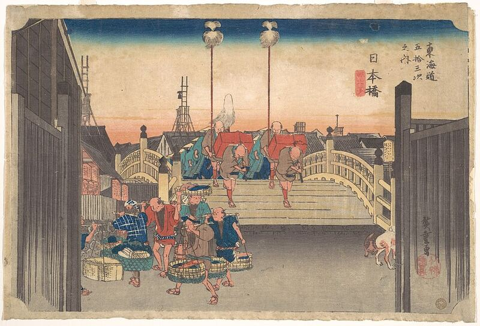</a> <a href="https://commons.wikimedia.org/wiki/File:NDL-DC_1303205-Utagawa_Hiroshige-%E5%90%8D%E6%89%80%E6%B1%9F%E6%88%B8%E7%99%BE%E6%99%AF_%E6%97%A5%E6%9C%AC%E6%A9%8B%E9%9B%AA%E6%99%B4-%E5%AE%89%E6%94%BF3-crd.jpg">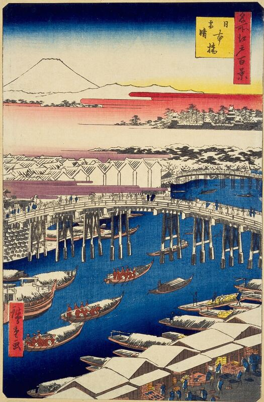</a> <a href="https://commons.wikimedia.org/wiki/File:A_sketch_of_the_Mitsui_shop_in_Suruga_street_in_Edo.jpg">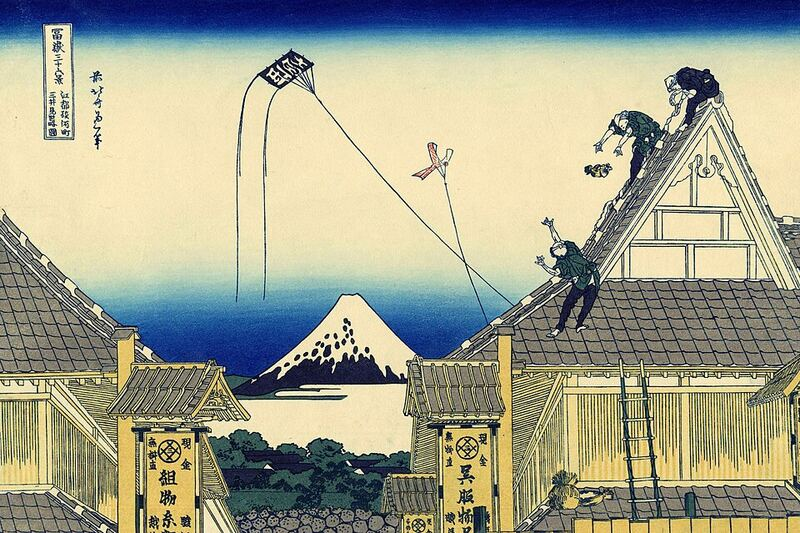</a>

*Hiroshige: Nihonbashi, Morning View (first print of the Tōkaidō) · Hiroshige: Nihonbashi, Clearing after Snow (first print of the Edo views) · Hokusai: Mitsui Shop at Suruga-cho*

| Print | Viewpoint today | Getting there |
|---|---|---|
| Hiroshige, *Nihonbashi: Morning View* and *Clearing after Snow*; Hokusai, *Nihonbashi in Edo* | **[Nihonbashi bridge](https://www.google.com/maps/search/?api=1&query=Nihonbashi+Bridge)**: the start of the Tōkaidō, so the first print of both Hiroshige series. Today it's under an expressway (being moved underground). | Mitsukoshimae station, 1 min. |
| Hokusai, *Mitsui Shop at Suruga-cho*; Hiroshige, *Suruga-cho* | **[Mitsukoshi Nihonbashi](https://www.google.com/maps/search/?api=1&query=Mitsukoshi+Nihonbashi+Main+Store)**: the Mitsui/Echigoya store in both prints became Mitsukoshi, on the same street | Same as above. |
| Hokusai, *Surugadai in Edo* | **[Surugadai, Kanda](https://www.google.com/maps/search/?api=1&query=Surugadai+Kanda+Tokyo)**, above the Kanda River gorge at Ochanomizu | JR or Marunouchi Line to Ochanomizu. 5 min from the Jimbocho print shops (below). |

<a href="https://commons.wikimedia.org/wiki/File:Nihonbashi_bridge_in_Edo.jpg">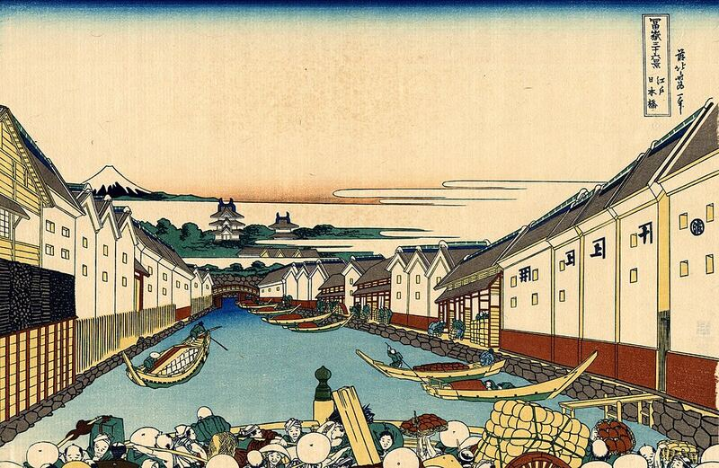</a>  

*Hokusai: Nihonbashi in Edo · Hiroshige: Suruga-cho · Nihonbashi today*

### Tokyo: near base (Shinjuku, Meguro, Hiroo, Ueno)

<a href="https://commons.wikimedia.org/wiki/File:Naito_Shijuku,_Yotsuya_LACMA_M.2007.152.55.jpg">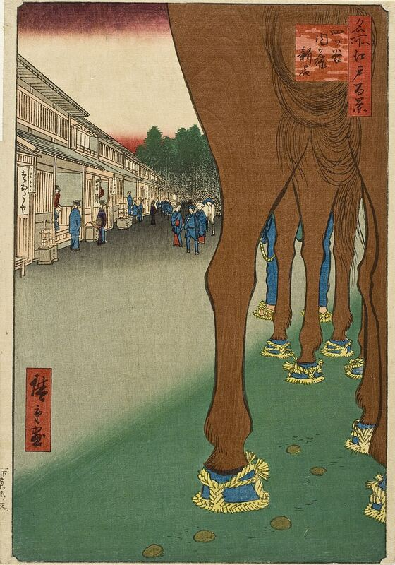</a> <a href="https://commons.wikimedia.org/wiki/File:Hiroshige,_Drum_bridge_at_Meguro_and_Sunset_Hill,_1857.jpg">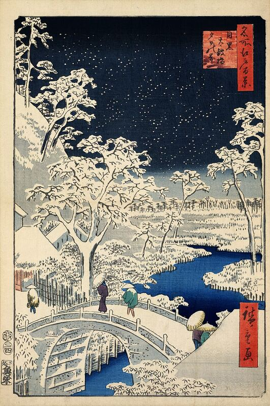</a> 

*Hiroshige: Yotsuya, Naito Shinjuku · Meguro Drum Bridge and Sunset Hill · The Moon Pine, Ueno*

| Print | Viewpoint today | Getting there |
|---|---|---|
| Hiroshige, *Yotsuya, Naito Shinjuku*: the famous horse's legs in the foreground of the Shinjuku post town | **[Shinjuku Gyoen, Shinjuku Gate](https://www.google.com/maps/search/?api=1&query=Shinjuku+Gyoen+Shinjuku+Gate)**: the garden was the Naito lord's estate, beside the old post town on today's Shinjuku-dori | Shinjuku-gyoemmae station (Marunouchi Line). Pairs with Tokyo #5. |
| Hiroshige, *Meguro Drum Bridge and Sunset Hill*: an arched stone bridge in snow, below a steep slope | **[Taiko-bashi, Meguro](https://www.google.com/maps/search/?api=1&query=太鼓橋+目黒区)** at the foot of **[Gyōnin-zaka](https://www.google.com/maps/search/?api=1&query=行人坂+目黒)**, the "sunset hill". The bridge is modern, but the slope and the little **Daien-ji** temple (with hundreds of small stone rakan statues) are as Hiroshige knew them. | JR Yamanote Line from Shibuya to Meguro (5 min), then 5 min walk down the slope. An easy half-hour from base. |
| Hiroshige, *Hiroo on the Furukawa River* | The Furukawa River near Hiroo, now a concrete channel under the expressway | Little survives. Skip unless passing. |
| Hiroshige, *The Moon Pine, Ueno* | **[Kiyomizu Kannon-do](https://www.google.com/maps/search/?api=1&query=Kiyomizu+Kannon-do+Ueno)**: the pine was recreated in 2012 | Already in Tokyo #9, next to the Tokyo National Museum. |

### Day trips and other legs

 <a href="https://commons.wikimedia.org/wiki/File:%E5%AF%8C%E5%A3%AB%E4%B8%89%E5%8D%81%E5%85%AD%E6%99%AF_%E7%9B%B8%E6%A8%A1%E4%B8%83%E9%87%8C%E3%82%B1%E6%B5%9C-View_of_Mount_Fuji_from_Seven-ri_Beach,_Province_of_Sagami_(S%C5%8Dsh%C5%AB-_Shichi-ri_ga_hama),_from_the_series_Thirty-six_Views_of_Mount_Fuji_(Fugaku_sanj%C5%ABrokkei)_MET_DP120491.jpg">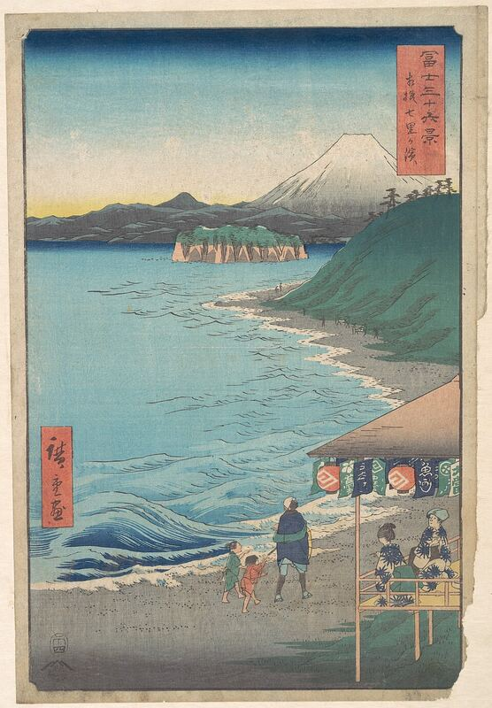</a> 

*Hokusai and Hiroshige both drew Fuji from Shichiri Beach · Hiroshige: Hakone (Tōkaidō)*

<a href="https://commons.wikimedia.org/wiki/File:The_Fuji_reflects_in_Lake_Kawaguchi,_seen_from_the_Misaka_pass_in_the_Kai_province.jpg">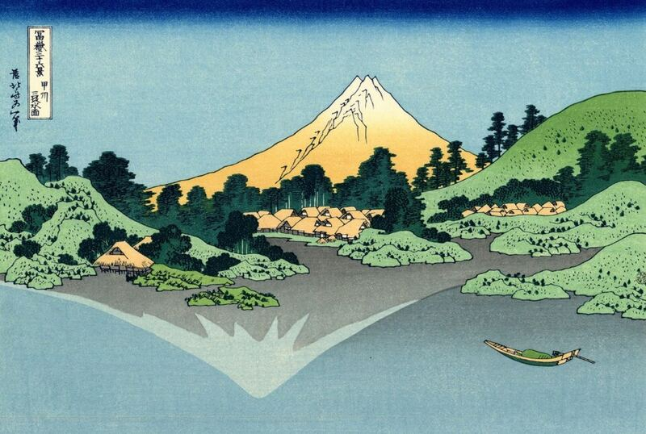</a> <a href="https://commons.wikimedia.org/wiki/File:The_Fuji_seen_from_the_Mishima_pass.jpg">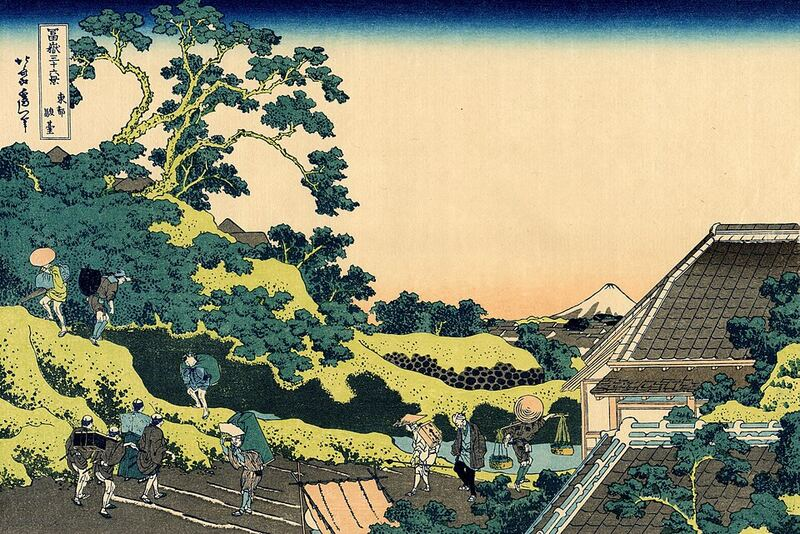</a> <a href="https://commons.wikimedia.org/wiki/File:Otsuki_plain_in_Kai_province_Hiroshige_Guimet_MA8075.jpg">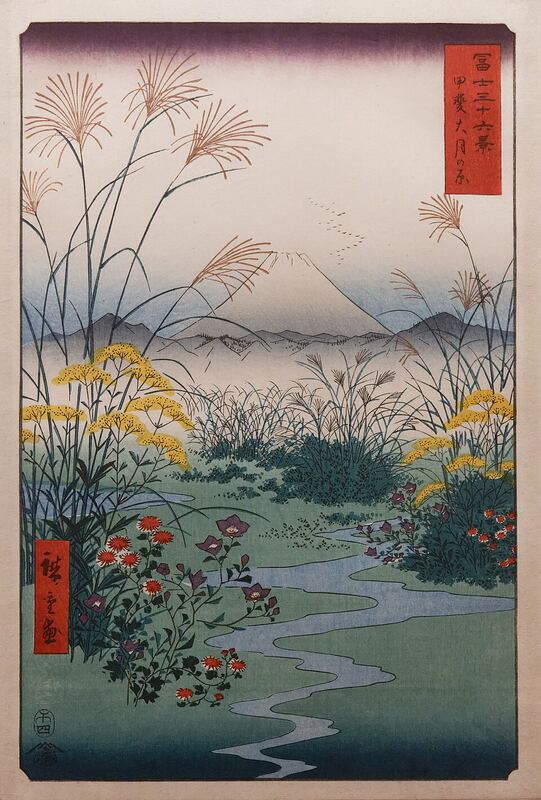</a>

*Hokusai: Reflection in Lake Misaka · Hokusai: Mishima Pass in Kai Province · Hiroshige: Ōtsuki Plain in Kai Province*

| Print | Viewpoint | Leg of the trip |
|---|---|---|
| Hokusai and Hiroshige, *Shichiri Beach in Sagami Province* | **[Shichirigahama beach](https://www.google.com/maps/search/?api=1&query=Shichirigahama+Beach)**, looking west across the bay to Fuji, with Enoshima | Kamakura day trip (Tokyo #1). Enoden line to Shichirigahama station. Best on a clear afternoon. |
| Hiroshige, *Hakone: Lake* (Tōkaidō) | The old Tōkaidō road above **Lake Ashi** | Hakone (see *Too big for a day trip* in the [Tokyo list](tokyo-activities.md)): you walk this road. |
| Hokusai, *Reflection in Lake Misaka, Kai Province* | **[Tenka-chaya, Misaka Pass](https://www.google.com/maps/search/?api=1&query=Tenka+Chaya+Misaka+Pass)**, above Lake Kawaguchi | Kawaguchiko #2. One hiking bus a day, 9:50 **(check)**. |
| Hokusai, *Mishima Pass in Kai Province*: travellers linking arms around a giant tree to measure it | Usually identified as **[Kagosaka Pass](https://www.google.com/maps/search/?api=1&query=籠坂峠)**, on the old road from Lake Yamanaka toward Gotemba **(check)** | Kawaguchiko #6 (Lake Yamanaka). On the Fujikyu bus route to Gotemba, so by bus only. Probably not worth a special trip. |
| Hiroshige, *Ōtsuki Plain in Kai Province* (his *Thirty-six Views of Mt Fuji*) | The plain around **Otsuki**, on the old Koshu road | We pass through Otsuki on 30 Oct (Kawaguchiko #8). |
| Hiroshige, *Monkey Bridge in Kai Province* | **Saruhashi** | Kawaguchiko #8, same day. |

### Nikko: Hokusai's and Hiroshige's waterfalls

<a href="https://commons.wikimedia.org/wiki/File:Kirifuri_Waterfall_at_Kurokami_Mountain_in_Shimotsuke_MET_DP141256.jpg">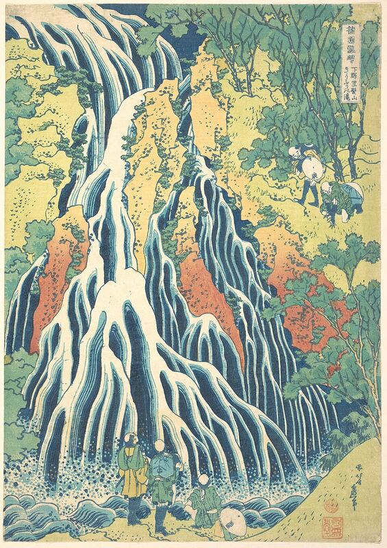</a> <a href="https://commons.wikimedia.org/wiki/File:Kirifuri_Falls_20090719.jpg">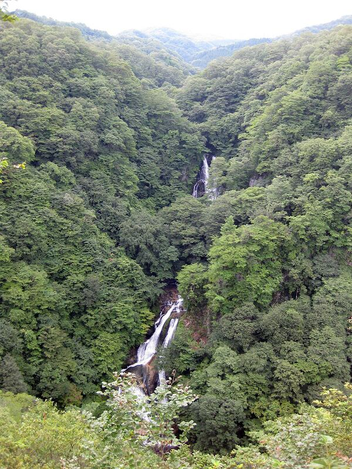</a> <a href="https://commons.wikimedia.org/wiki/File:Shimotsuke_Province,_Mount_Nikko,_Urami_Waterfall_(5765889520).jpg">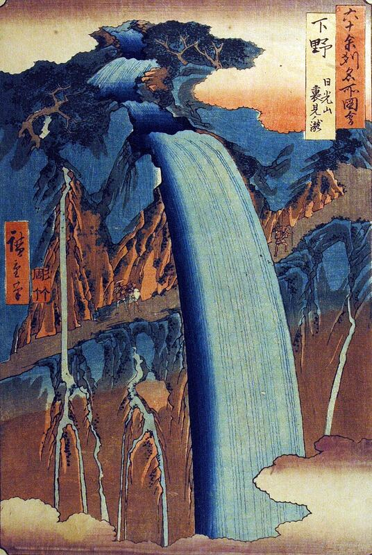</a>

*Hokusai: Kirifuri Falls at Mt Kurokami · Kirifuri Falls today · Hiroshige: Urami Falls, Mt Nikko*

Hokusai's other great landscape series, *A Tour of the Waterfalls in the Provinces* (about 1832), has a Nikko waterfall in it, and so does Hiroshige's *Famous Places in the Sixty-odd Provinces*.

| Print | Viewpoint | Getting there |
|---|---|---|
| Hokusai, *Kirifuri Falls at Mt Kurokami, Shimotsuke* | **[Kirifuri Falls](https://www.google.com/maps/search/?api=1&query=Kirifuri+Falls)** observation deck. Hokusai's version is far more dramatic than the real thing, but the two-tier shape is there. | Bus from Nikko stations to Kirifuri-no-taki, then a short walk **(check times)**. Already in the Nikko backups. |
| Hiroshige, *Urami Falls, Mt Nikko, Shimotsuke* | **[Urami Falls](https://www.google.com/maps/search/?api=1&query=Urami+Falls+Nikko)** ("view from behind" falls): the path goes behind the curtain of water, as the name says | Bus from Nikko stations toward Chuzenji, about 13 min, to Urami-no-taki Iriguchi, then **about 45 min walk** up a side road and forest steps. It sometimes closes after rockfalls **(check before going)**. Could be added to a Nikko day. |

<a href="https://commons.wikimedia.org/wiki/File:%E8%A3%8F%E8%A6%8B%E3%81%AE%E6%BB%9D_-_panoramio_(3).jpg">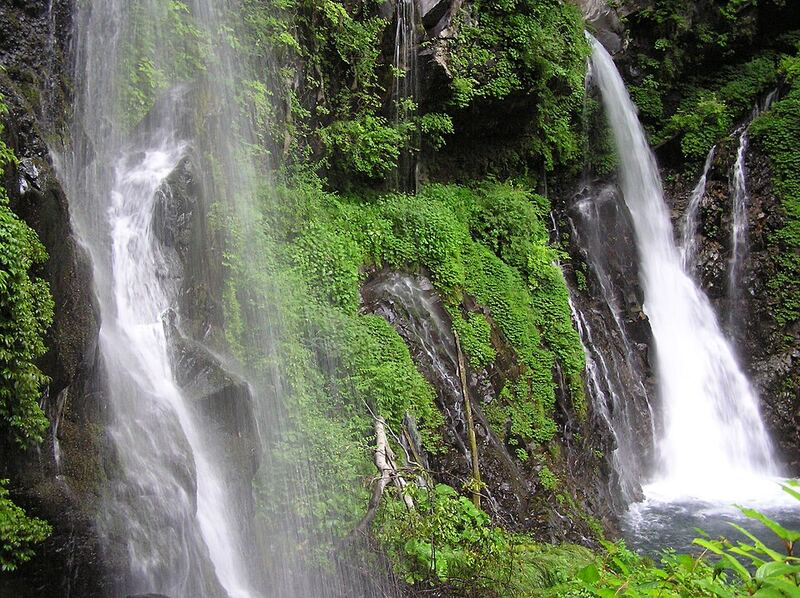</a>

*Urami Falls today*

---

## Where to see the real thing

Prints fade in light, so museums show them for a few weeks at a time and rotate them. **What's on during our dates matters more than the museum's name.** The good news: three excellent shows overlap our Tokyo days.

Our Tokyo days: **Thu 15 – Mon 19 Oct · Sat 24 – Sun 25 Oct · Sat 31 Oct – Sun 8 Nov.** Most museums close on **Mondays** (19 Oct, 2 Nov). **3 Nov** is Culture Day, a public holiday: museums are open but busy.

### 1. Tokyo National Museum: *Hiroshige: New Perspectives on Edo Japan* ⭐
A major Hiroshige show, from a newly donated collection, in three parts with different works:
- **Part 1, to 25 Oct: *Fifty-three Stations of the Tōkaidō*.** This is the series that includes the Hakone print and *Shōno: Driving Rain* (which prints are shown isn't listed). **Go on 15–18 Oct or 24–25 Oct.**
- **Part 2, 27 Oct – 23 Nov: *Sixty-nine Stations of the Kiso Road*** (the inland highway through the mountains). Go on 31 Oct – 8 Nov.
- Part 3 (*One Hundred Famous Views of Edo*) starts 25 Nov, after we leave. Sadly.
- **Cost:** ¥1,500 (~NZ$17), which includes the museum's main collection the same day. Advance tickets have finished; buy at the door.
- **Hours:** 9:30–17:00, **Fridays and Saturdays to 20:00**. Last entry 30 min before closing. Closed Mondays.
- **Getting there:** Chiyoda Line from Yoyogi-koen, direct to **Nezu** (about 20 min), then a 10 min walk. Or JR to Ueno, then 10 min through Ueno Park. Pairs with Tokyo #9 (the Moon Pine is 10 min away).
- If you go twice (once per part), that's ¥3,000 (~NZ$34). Both parts are worth it, but Part 1 is the one to prioritise.

### 2. Sumida Hokusai Museum: *Best of the Sumida Hokusai Museum* ⭐
The museum's 10th-anniversary show of its finest works, including Hokusai's long painted scroll of both banks of the Sumida River. The permanent gallery has high-quality replicas of the famous prints, including The Great Wave, so you always see the greatest hits.
- **Dates:** to 23 Nov. First term to 18 Oct, second term 21 Oct – 23 Nov (some works change). Closed 20 Oct for the changeover.
- **Cost:** ¥1,500 (~NZ$17). Permanent gallery only: ¥400 (~NZ$5).
- **Hours:** 9:30–17:30 (last entry 17:00). Closed Mondays.
- **3 Nov: "Celebrate Hokusai's Birthday!"** anniversary event **(check details)**.
- **Getting there:** Oedo Line to Ryogoku (A3 exit), 5 min walk; or JR Ryogoku, 9 min. The start of the Sumida print walk above.

### 3. Ōta Memorial Museum of Art: *Katsushika Ōi, "Night Scene in the Yoshiwara": The Lineage of Nightscapes* ⭐
Ōi was **Hokusai's daughter**, an artist in her own right who worked with him. Her *Night Scene in the Yoshiwara* is famous for its **light and shadow**: lantern light spilling through a lattice into the dark street, almost like a long-exposure night photograph. This show traces night scenes in ukiyo-e. For a photographer, it's perhaps the most interesting show of the three.
- **Dates:** first term to 3 Nov, second term 7 Nov – 6 Dec. *Night Scene in the Yoshiwara* is shown in both terms; everything else changes.
- **Closed:** Mondays, plus 4–6 Nov for the changeover. **Open on our Tokyo days:** 15–18 Oct, 24–25 Oct, 31 Oct, 1 Nov, 3 Nov, 7–8 Nov.
- **Cost:** ¥1,200 (~NZ$14). **Cash only.**
- **Hours:** 10:30–17:30 (last entry 17:00). Small and calm.
- **Getting there:** about 20 min walk from base, or one stop on the Chiyoda Line to Meiji-jingumae (3 min walk), or JR Harajuku (5 min). A perfect wet-weather hour.

### Also worth knowing
| Place | What | Cost | Hours | Getting there |
|---|---|---|---|---|
| **[Edo-Tokyo Museum](https://www.google.com/maps/search/?api=1&query=Edo-Tokyo+Museum)** (Ryogoku, Tokyo #10) | Not a print museum, but it puts the prints in context: the full-size Nihonbashi, a huge model of Ryogoku Bridge in the 1840s | ¥1,300 (~NZ$15) **(check)** | 9:30–17:30, Sat to 19:30, closed Mon | Next to the Sumida Hokusai Museum |
| **[Kawaguchiko Museum of Art](https://www.google.com/maps/search/?api=1&query=Kawaguchiko+Museum+of+Art)** | Collects art of Fuji. Autumn shows the collection *Painted Fuji* and a local painter's Fuji landscapes (to 20 Dec). Its Hokusai/Hiroshige print show **ended on 4 Oct**, so expect few or no ukiyo-e **(check)** | ¥800 (~NZ$9) | 9:30–17:00, **closed Tuesdays** (27 Oct) | Red Line sightseeing bus **(check the stop)** |
| **[Okada Museum of Art](https://www.google.com/maps/search/?api=1&query=Okada+Museum+of+Art+Hakone)** (Hakone) | Edo-period paintings, including hand-painted works by ukiyo-e masters | ¥2,800 (~NZ$32) | 9:00–17:00. Lockers for phones and bags are compulsory | Hakone Tozan bus to Kowakien (covered by the Hakone Freepass). Only if time on the Hakone day. |

### Buying a print
- **Jimbocho** (the old-book district, 5 min from Surugadai in Tokyo #3) has antique print shops selling real Edo-period prints, from a few thousand yen for minor works **(check)**. **[Hara Shobo](https://www.google.com/maps/search/?api=1&query=Hara+Shobo+Jimbocho)** is the best known **(check hours)**.
- **Modern hand-printed reproductions**, made with the original woodblock techniques (for example by the Adachi Foundation), are sold in museum and print shops. A good-quality Great Wave or Red Fuji costs from about ¥10,000 (~NZ$113) **(check)**.

---

### Going further: shin-hanga
In the early 1900s a "new prints" movement (*shin-hanga*) carried on the landscape tradition with a more **photographic** look: soft light, rain, snow, dusk and reflections. Look out for **Kawase Hasui** (rainy and snowy Tokyo streets, temples at dusk) and **Yoshida Hiroshi** (mountains and lakes). If the classic prints click for you, these may click even more.
